# Communication {#sec-communication}



:::: {.slide-outcomes}

::: {.callout-note title="Learning outcomes & Chapter summary"}

1. **Design** a visualization around the message and audience, using guidelines as a starting point rather than rigid rules.
2. **Format** axis and legend values, titles, and ranges to make a figure understandable without a spoken explanation.
3. **Distinguish** filtering observations from zooming into a chart, since filtering can change statistical summaries.

:::

::::

## Why bother?

[During data exploration, you are often the main person interpreting a chart.]{slide-bullet}
[For communication, a figure needs to make sense to someone who does not already
know the data or the plotting code.]{.slide-bullet}
[That reader might encounter it without the surrounding text or a spoken explanation.]{.slide-bullet}
Readable labels, an informative title, and an appropriate view of the data
are therefore part of the explanation itself.

Many useful design recommendations are collected in the
[Cato Institute's visualization style guide](https://github.com/glosophy/CatoDataVizGuidelines/blob/master/PocketStyleBook.pdf).
Other collections include [these style guidelines](https://medium.com/nightingale/style-guidelines-92ebe166addc),
[this spreadsheet of visualization guides](https://docs.google.com/spreadsheets/d/1F1gm5QLXh3USC8ZFx_M9TXYxmD-X5JLDD0oJATRTuIE/edit#gid=1679646668),
and the [Data Visualization Society's resources](https://www.datavisualizationsociety.org/).
Another way to learn is from other people's mistakes:
[the Economist's review of its own charts](https://medium.economist.com/mistakes-weve-drawn-a-few-8cdd8a42d368)
contains useful examples.

[These are **guidelines**, not rules that work independently of the audience and context.]{.slide-bullet}
For example, a familiar association with a fruit or political party may matter
more than using the default palette.
[This discussion of breaking visualization rules](https://medium.economist.com/why-you-sometimes-need-to-break-the-rules-in-data-viz-4d8ece284919)
illustrates how a deliberate exception can sometimes make a visualization more memorable.
The important question is whether the choice helps readers understand the data.

The examples below use (mostly) published figures to show how design
choices affect what a reader notices and concludes.
Treat them as prompts to ask what comparison the reader needs to make.

## Design shapes the message

Titles, colors, and graphical direction can emphasize different aspects of a dataset.
Ask what message each design brings forward, and what important context it leaves behind. This first figure using red color and a reversed axis to draw parallels between the deaths in this war to the dripping of blood.

::: {.slide-visual}

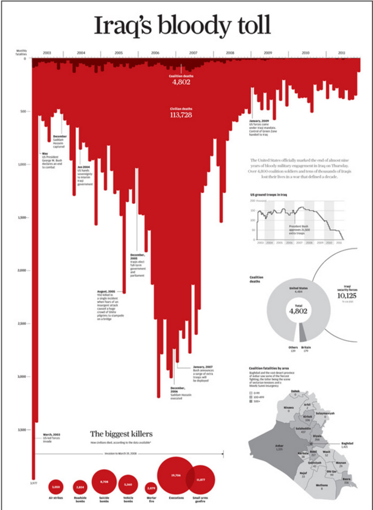{width=70% fig-alt="An Iraq casualty infographic uses a red, downward-pointing area and the title Iraq's bloody toll."}

:::

The same data set could have been presented with a more positive design,
focusing on the recent decline in the death rate.

::: {.slide-visual}

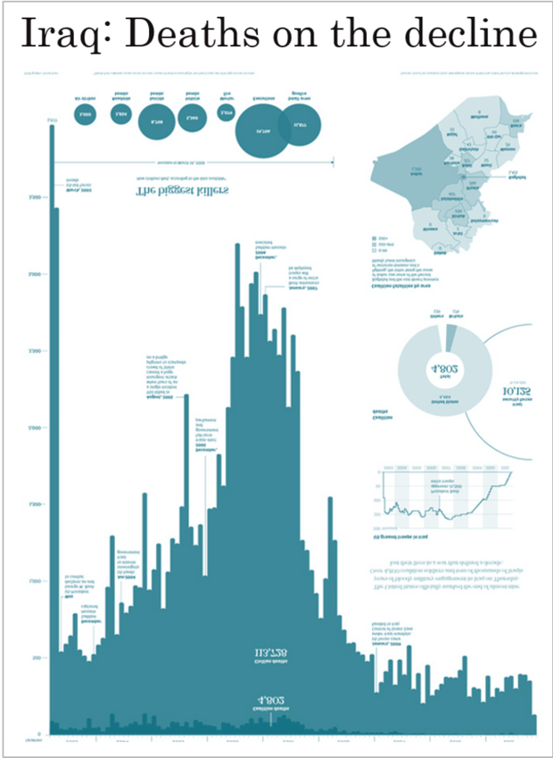{width=70% fig-alt="A contrasting Iraq casualty infographic uses blue, upward-pointing bars and the title Iraq: Deaths on the decline."}

:::

[Both these messages are true
and the complete data story includes both]{.slide-bullet},
but in a visulization we can what to highlight.
This not only important to be aware of when making our own visualization,
but also when reading a visualization from someone else.


## Match the detail to the audience

This chart of the evolution of the size of Napoleon's army
when they marched towards Moscow
rewards careful study by combining several kinds of information.
That richness can be useful for exploration,
but may require more explanation
than a reader has time for in a short presentation.

::: {.slide-visual}

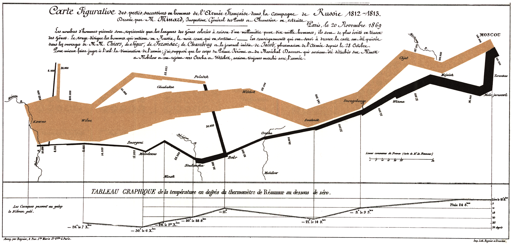{fig-alt="Minard's map of Napoleon's Russian campaign combines troop strength, direction of travel, geography, and temperature."}

:::

A simpler "take home" message of this chart presented to C-level executives
in a short update meeting,
might be much simpler and just focus on the outcome of the operation.

::: {.slide-visual}

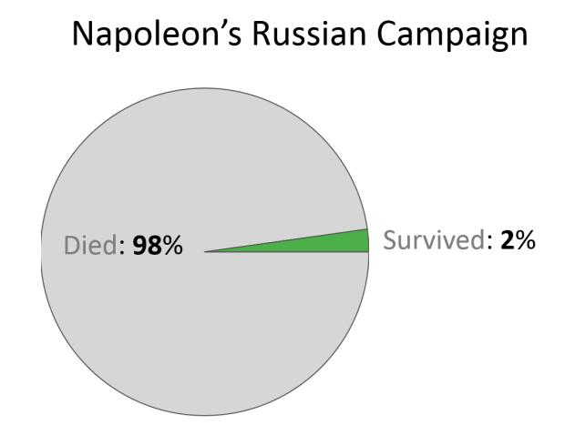{fig-alt="A simplified pie-chart summary of Napoleon's campaign labels 98 percent as died and 2 percent as survived."}

:::

The simplified chart emphasizes the scale of the losses but discards route, timing,
and conditions. Even a concise label needs checking: a reduction in army strength
does not, by itself, establish how many soldiers died.

## Make category comparisons easy

::: {.slide-visual}

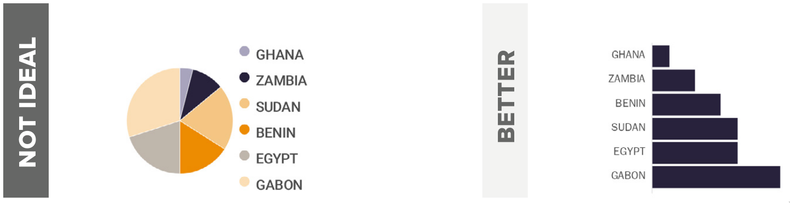{fig-alt="A comparison schematic replaces a many-category pie chart and its legend with a sorted horizontal bar chart."}

:::

Positions and lengths on a common scale are usually easier to compare than angles
and areas. A bar chart can also place each category name beside the value it identifies.

::: {.slide-visual}

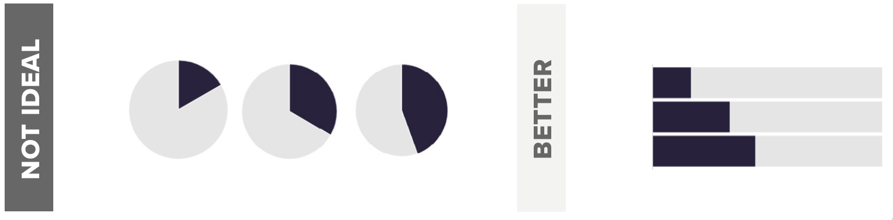{fig-alt="A schematic compares reading proportions from several pie charts with reading aligned horizontal bars."}

:::

Comparisons across several pies require the reader to mentally align angles.
A shared baseline makes the intended comparison more direct.

::: {.slide-visual}

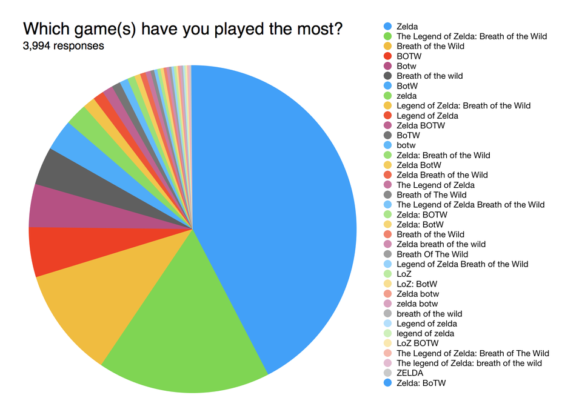{fig-alt="A video-game survey pie chart has many narrow slices and a long color legend."}
:::

::: {.slide-visual}

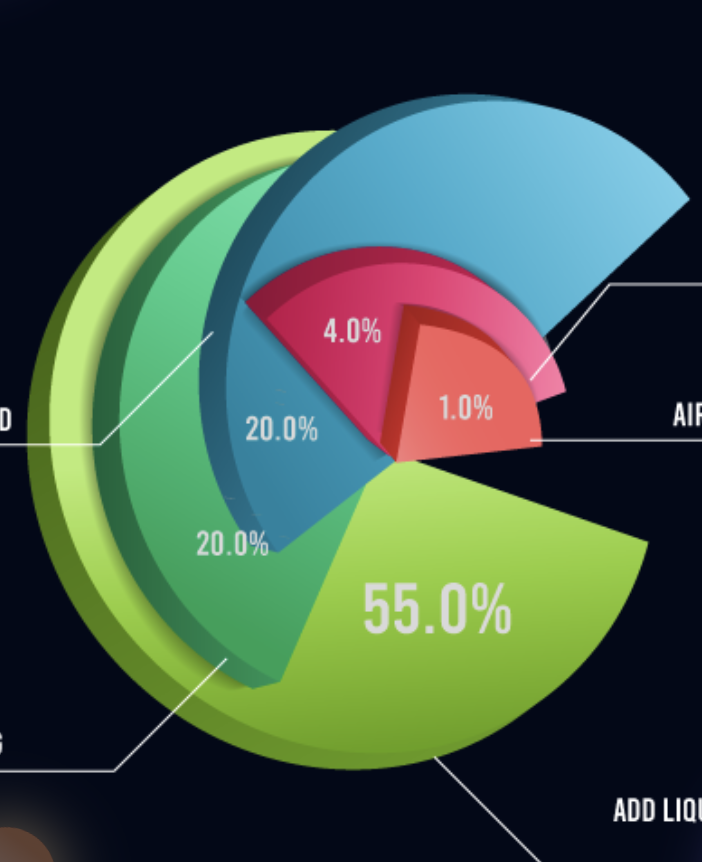{fig-alt="An exploded three-dimensional donut chart adds perspective, separated pieces, and overlapping surfaces to a part-to-whole display."}

:::

With many categories, matching small wedges to a long legend becomes hard work.
Extrusion and exploded pieces add visual complexity without making the values easier to compare.

::: {.slide-visual}

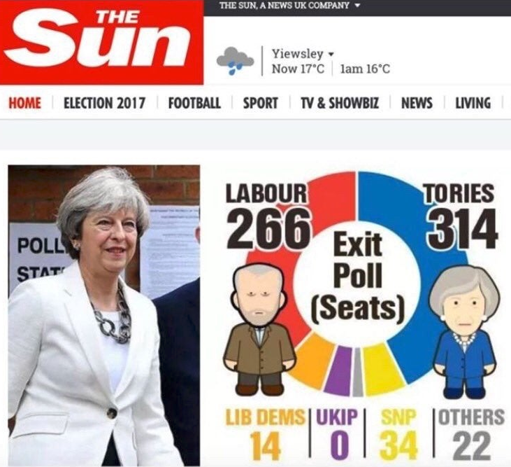{fig-alt="An election-news graphic uses donut sectors whose apparent areas do not match the displayed seat counts."}

:::

A published chart can look polished while contradicting its own numerical labels.
Check whether sector angles and areas represent the values proportionally,
rather than trusting the visual finish.

## Use color to add information

::: {.slide-visual}

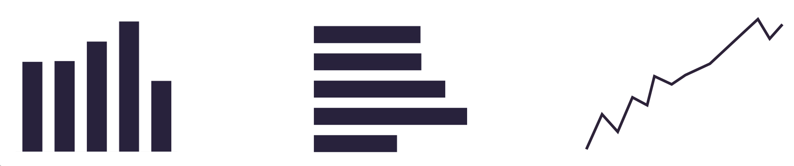{fig-alt="Examples of a single bar series and a single line series use one consistent color instead of unnecessary category colors."}

:::

When a chart shows one series, extra colors can imply distinctions that do not exist.
A single color often provides a clear starting point.

::: {.slide-visual}

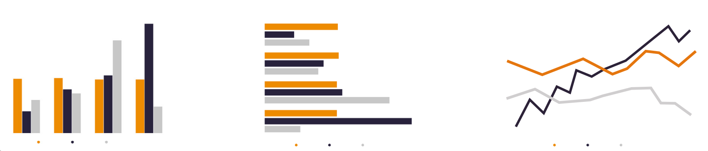{fig-alt="Bar and line chart examples use orange to highlight one series while leaving the remaining series gray."}

:::

Use a contrasting color to draw attention to the observation or series that matters
for the current question. Keep the remaining observations as context.

::: {.slide-visual}

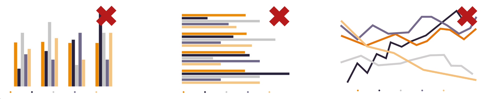{fig-alt="Chart examples marked with red crosses illustrate how many saturated colors and competing series undermine selective highlighting."}

:::

If every series asks for attention, highlighting stops being selective.
Consider smaller, separate views when a comparison becomes too crowded.

::: {.slide-visual}

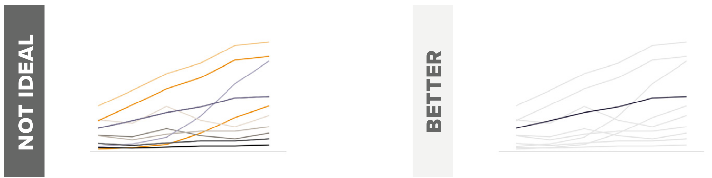{fig-alt="A not-ideal versus better line-chart comparison keeps one orange line prominent and makes the contextual series lighter."}

:::

Make the foreground comparison easier to find by reducing the saturation or contrast
of the background series. The context should remain visible and interpretable.

::: {.slide-visual}

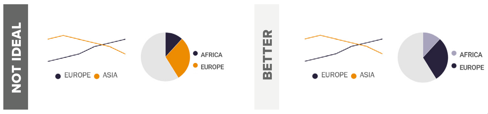{fig-alt="A comparison across line and pie charts shows that reusing the same colors for the same groups makes identification easier."}

:::

Use the same color for the same group across related figures.
Reassigning a familiar color forces the reader to relearn the mapping;
@sec-color develops these choices in more detail.

## Make long labels readable

::: {.slide-visual}

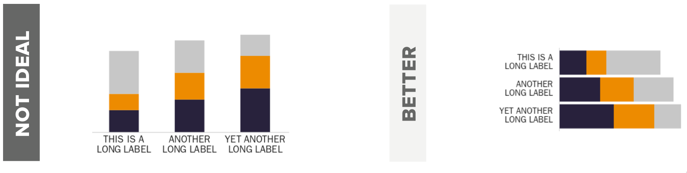{fig-alt="A schematic replaces vertical bars with awkwardly wrapped category names by horizontal bars with readable labels."}

:::

Change the chart orientation when that gives category names room to be read naturally.
Horizontal bars often preserve the comparison while avoiding rotated or heavily wrapped text.

## Ask what a chart does *not* show

::: {.slide-visual}

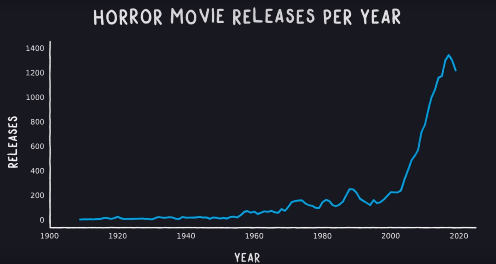{fig-alt="A line chart shows the number of horror-film releases increasing over time."}

:::

An increasing number of horror releases does not establish that horror's share
of all films is increasing. Ask what denominator would be needed to support that claim.

::: {.slide-visual}

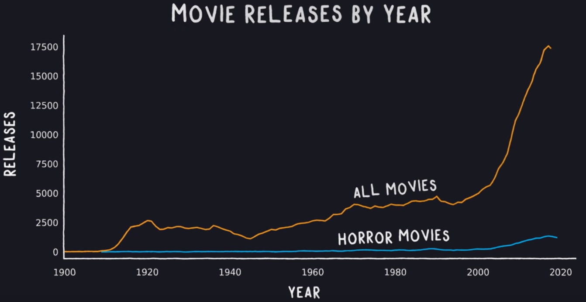{fig-alt="The horror-film series is shown alongside a much larger series for all movie releases."}

:::

Adding total releases changes the question we can answer.
To discuss relative popularity, examine the horror share alongside counts,
and consider whether dataset coverage or reporting has changed.

::: {.slide-visual}

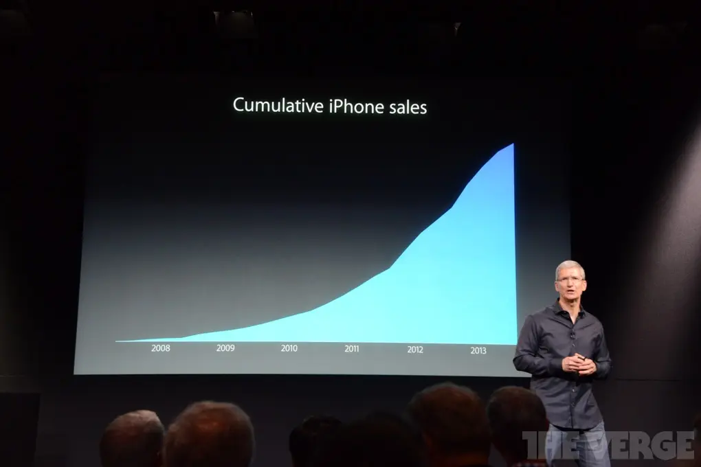{fig-alt="A presentation graphic emphasizes an increasing cumulative total of iPhone sales."}

:::

A cumulative total of nonnegative sales cannot decrease.
Its increasing height alone does not show that the current rate of sales is accelerating.

::: {.slide-visual}

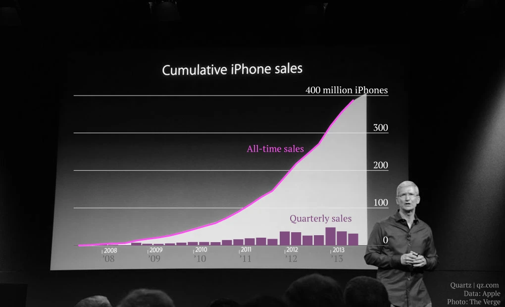{fig-alt="An annotated iPhone-sales graphic adds quarterly sales to the cumulative total."}

:::

Quarterly sales correspond to increments in the cumulative total, not its height.
Showing both can reveal changes in the rate that an ever-increasing total conceals.

## Avoid redundant 3D

<!-- TODO we could move these examples to the channel encoding lesson -->

::: {.slide-visual}

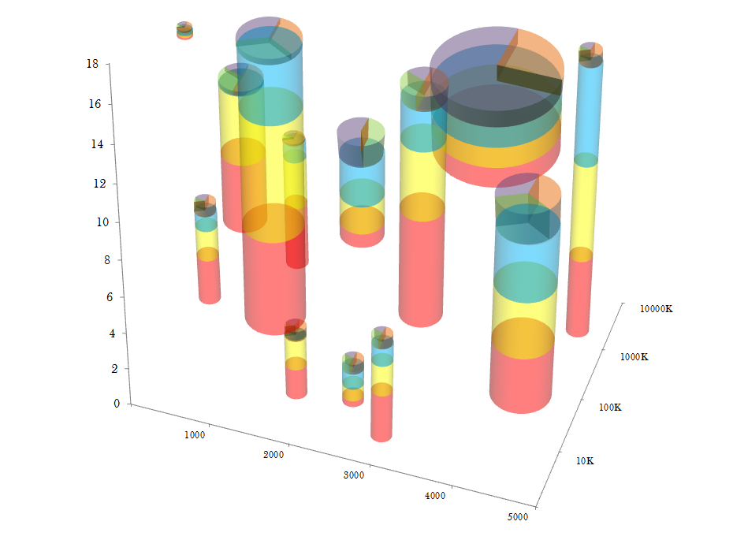{fig-alt="A three-dimensional chart uses stacked, translucent cylinders with perspective and overlapping surfaces."}

:::

Perspective and occlusion make both heights and colored segments harder to compare.
Use a third spatial dimension when it represents something the reader needs to understand,
rather than simply as decoration.

::: {.slide-visual}

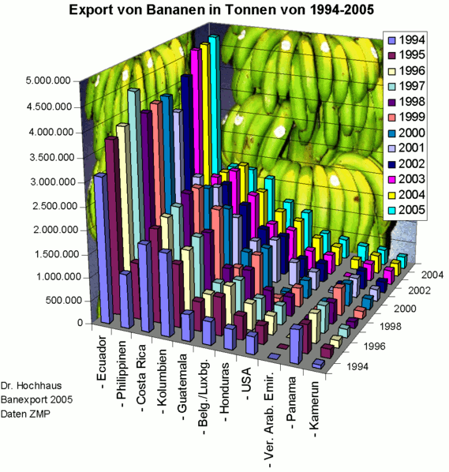{fig-alt="A densely decorated three-dimensional banana-export chart combines a fruit-textured background, many colors, and angled labels."}

:::

Textures, gradients, tilted axes, and competing colors can obscure the values.
Readers should be able to answer the data question without first decoding the decoration.

<!-- Existing learning outcomes and programming examples remain in the reading
     view. The Communication presentation uses only the image examples above. -->


```{python}
#| label: communication-python-setup
#| include: false
import altair as alt
import pandas as pd

alt.data_transformers.enable('vegafusion')
diamonds = pd.read_csv('data/diamonds-carat-price.csv')
```

```{r}
#| label: communication-r-setup
#| include: false
library(tidyverse)
theme_set(theme_gray(base_size = 14))
diamonds <- read_csv('data/diamonds-carat-price.csv', show_col_types = FALSE)
```

:::::::: {.slide-skip}

## Axis label formatting

[Choose number formats that your audience can read easily:
units, currency symbols, and sensible rounding can be more useful than scientific notation.]{.slide-bullet}
The same principle applies to legend values.

For the following formatting examples, we take a reproducible sample of 1,000 diamonds.
The full dataset and the binning techniques are introduced in @sec-joint-distributions.

:::: {.panel-tabset group="language"}

### Altair {.slide-skip}

```{python}
#| label: communication-formatting-setup-alt
diamond_sample = diamonds.sample(1000, random_state=1010)
sample_bins = alt.Chart(diamond_sample).mark_rect().encode(
    x=alt.X('carat').bin(maxbins=40),
    y=alt.Y('price').bin(maxbins=40),
    color='count()'
)
```

Altair uses [D3 format strings](https://d3js.org/d3-format).
Useful format characters include `%` for percentages, `$` for currency,
`e` for scientific notation, and `s` for SI prefixes.
Scientific notation can be useful internally, but may be unfamiliar to a general audience.

```{python}
#| label: communication-scientific-alt
#| slide-show: both
#| slide-title: Scientific notation
sample_bins.encode(y=alt.Y('price').bin(maxbins=40).axis(format='e'))
```

SI prefixes such as `k` for thousands are often easier to read.

```{python}
#| label: communication-si-alt
#| slide-show: both
#| slide-title: More readable number formats
sample_bins.encode(y=alt.Y('price').bin(maxbins=40).axis(format='s'))
```

A preceding `~` removes insignificant trailing zeros.

```{python}
#| label: communication-trailing-zeros-alt
sample_bins.encode(y=alt.Y('price').bin(maxbins=40).axis(format='~s'))
```

Format characters can also be combined.

```{python}
#| label: communication-currency-alt
#| slide-show: both
#| slide-title: Include the units
sample_bins.encode(y=alt.Y('price').bin(maxbins=40).axis(format='$~s'))
```

The legend accepts the same format strings.
Here scientific notation demonstrates the syntax; ordinary counts would usually be easier to read.

```{python}
#| label: communication-legend-format-alt
#| slide-show: both
#| slide-title: Format legend values too
sample_bins.encode(
    y=alt.Y('price').bin(maxbins=40).axis(format='$~s'),
    color=alt.Color('count()').legend(format='e')
)
```

Set a legend to `None` to remove it.
Only do this when its meaning is conveyed elsewhere.

```{python}
#| label: communication-hide-legend-alt
sample_bins.encode(color=alt.Color('count()').legend(None))
```

The `tickCount` setting requests a number of ticks on an unbinned axis.
We switch to a small scatterplot to demonstrate this; binned axes determine their ticks differently.

```{python}
#| label: communication-ticks-alt
#| slide-show: both
#| slide-title: Choose useful tick marks
sample_points = alt.Chart(diamond_sample.sample(100, random_state=1010)).mark_point().encode(
    x=alt.X('carat').axis(tickCount=40),
    y=alt.Y('price').axis(tickCount=2)
)
sample_points
```

As with a legend, an axis can be removed by setting it to `None`.

```{python}
#| label: communication-hide-axis-alt
#| slide-show: both
#| slide-title: Removing an axis
sample_points.encode(x=alt.X('carat').axis(None))
```

Themes control many styling choices at once.
They are global settings rather than a change to only one chart.

```{python}
#| label: communication-theme-names-alt
alt.theme.names()
```

```{python}
#| label: communication-dark-theme-alt
#| slide-show: both
#| slide-title: Themes change the chart style
alt.theme.enable('dark');
sample_points
```

```{python}
#| label: communication-reset-theme-alt
#| include: false
alt.theme.enable('default')
```

### ggplot {.slide-skip}

The `scales` package supplies functions for formatting labels.
Here we use the hexagonal bins introduced in @sec-joint-distributions.

```{r}
#| label: communication-formatting-setup-gg
diamond_hex <- ggplot(diamonds, aes(x = carat, y = price)) +
    geom_hex()
```

```{r}
#| label: communication-scientific-gg
#| slide-show: both
#| slide-title: Scientific notation
diamond_hex +
    scale_y_continuous(labels = scales::label_scientific())
```

```{r}
#| label: communication-si-gg
#| slide-show: both
#| slide-title: More readable number formats
diamond_hex +
    scale_y_continuous(labels = scales::label_number(scale_cut = scales::cut_si('')))
```

```{r}
#| label: communication-currency-gg
#| slide-show: both
#| slide-title: Include the units
diamond_hex +
    scale_y_continuous(labels = scales::label_dollar())
```

The label functions can be parameterized.
For example, we can divide the displayed values by 1,000 and add a `K` suffix.
This changes the labels, not the data used to draw the chart.

```{r}
#| label: communication-currency-si-gg
diamond_hex +
    scale_y_continuous(labels = scales::label_dollar(scale = 0.001, suffix = 'K'))
```

The same functions can format the legend.
Hexagons use the `fill` aesthetic, so we change the fill scale.

```{r}
#| label: communication-legend-format-gg
#| slide-show: both
#| slide-title: Format legend values too
diamond_hex +
    scale_y_continuous(labels = scales::label_dollar()) +
    scale_fill_continuous(labels = scales::label_number(scale_cut = scales::cut_si('')))
```

In ggplot, tick locations are called *breaks*.
`pretty_breaks()` requests an approximately specified number of readable breaks.

```{r}
#| label: communication-ticks-gg
#| slide-show: both
#| slide-title: Choose useful tick marks
diamond_hex +
    scale_y_continuous(labels = scales::label_dollar(), breaks = scales::pretty_breaks(n = 10))
```

An axis consists of several elements that can be removed independently.

```{r}
#| label: communication-hide-axis-gg
#| slide-show: both
#| slide-title: Removing an axis
diamond_hex +
    theme(axis.title.x = element_blank(),
          axis.text.x = element_blank(),
          axis.ticks.x = element_blank())
```

Remove a legend, referred to as a *guide* in ggplot, with `guides()`.

```{r}
#| label: communication-hide-legend-gg
diamond_hex + guides(fill = 'none')
```

`theme_void()` removes all axis objects and much of the surrounding decoration.

```{r}
#| label: communication-void-theme-gg
diamond_hex + theme_void()
```

`theme_classic()` is another built-in theme.
The [ggthemes package](https://jrnold.github.io/ggthemes/) supplies additional choices.

```{r}
#| label: communication-classic-theme-gg
#| slide-show: both
#| slide-title: Themes change the chart style
diamond_hex + theme_classic()
```

::::

## Figure, axis, and legend titles

[Axis and legend titles should describe the values in language the reader understands,
including units where appropriate.]{.slide-bullet}
Replace variable names with underscores by readable labels.

:::: {.panel-tabset group="language"}

### Altair {.slide-skip}

Channel titles are set inside the encoding.

```{python}
#| label: communication-axis-titles-alt
#| slide-show: both
#| slide-title: Give the axes readable titles
titled_bins = sample_bins.encode(
    x=alt.X('carat').bin(maxbins=40).title('Carat'),
    y=alt.Y('price').bin(maxbins=40).title('Price (USD)')
)
titled_bins
```

The legend title is controlled by the channel whose values it explains.

```{python}
#| label: communication-legend-title-alt
#| slide-show: both
#| slide-title: Explain the legend
titled_bins = titled_bins.encode(color=alt.Color('count()').title('Number of diamonds'))
titled_bins
```

An overall figure title should communicate the take-home message or pose a useful question,
rather than simply repeat the axis names.
For this chart, "Higher-carat diamonds are more expensive" is more informative
than "Diamond carat versus price".

```{python}
#| label: communication-takeaway-title-alt
#| slide-show: both
#| slide-title: Put the message in the title
titled_bins.properties(title='Higher-carat diamonds are more expensive')
```

A subtitle can qualify the main message or provide context.
If the title asks a question, the subtitle can guide readers toward the answer
rather than leaving them to infer it unaided.
Depending on the publication, a longer subtitle may also serve some of the role of a caption.

```{python}
#| label: communication-subtitle-alt
#| slide-show: both
#| slide-title: Add context in a subtitle
titled_bins.properties(title=alt.Title(
    text='Higher-carat diamonds are more expensive',
    subtitle='But most diamonds have a low carat value'
))
```

`anchor` controls title alignment.
`frame='group'` aligns it with the plotting area rather than the outer edge of all labels.

```{python}
#| label: communication-title-alignment-alt
#| slide-show: both
#| slide-title: Align the title deliberately
titled_bins.properties(title=alt.Title(
    text='Higher-carat diamonds are more expensive',
    subtitle='But most diamonds have a low carat value',
    anchor='start', frame='group'
))
```

### ggplot {.slide-skip}

Use `labs()` to name the axes and aesthetic scales.

```{r}
#| label: communication-axis-titles-gg
#| slide-show: both
#| slide-title: Give the axes readable titles
titled_hex <- diamond_hex + labs(x = 'Carat', y = 'Price (USD)')
titled_hex
```

```{r}
#| label: communication-legend-title-gg
#| slide-show: both
#| slide-title: Explain the legend
titled_hex <- titled_hex + labs(fill = 'Number of diamonds')
titled_hex
```

The same function sets the figure title and subtitle.

```{r}
#| label: communication-takeaway-title-gg
#| slide-show: both
#| slide-title: Put the message in the title
titled_hex +
    labs(title = 'Higher-carat diamonds are more expensive') +
    scale_y_continuous(labels = scales::label_dollar())
```

```{r}
#| label: communication-subtitle-gg
#| slide-show: both
#| slide-title: Add context in a subtitle
titled_hex +
    labs(title = 'Higher-carat diamonds are more expensive',
         subtitle = 'But most diamonds have a low carat value') +
    scale_y_continuous(labels = scales::label_dollar())
```

Title alignment is controlled through theme elements.

```{r}
#| label: communication-title-alignment-gg
#| slide-show: output
#| slide-title: Align the title deliberately
titled_hex +
    labs(title = 'Higher-carat diamonds are more expensive',
         subtitle = 'But most diamonds have a low carat value') +
    scale_y_continuous(labels = scales::label_dollar()) +
    theme(plot.title = element_text(hjust = 0.5),
          plot.subtitle = element_text(hjust = 0.5))
```

::::

## Axis ranges

The two-dimensional histograms show that many diamonds occupy a small part of the chart.
We can inspect that area more closely, but [filtering observations and zooming
into a plot are different operations.]{.slide-bullet}
Filtering changes which observations are available to summaries and statistical transformations.
Zooming changes the displayed region.

:::: {.panel-tabset group="language"}

### Altair {.slide-skip}

An explicit scale `domain` sets the displayed range.
When marks extend beyond that range, `clip=True` keeps them inside the plotting area.
The bins here are made smaller so that the restricted view retains detail.
`nice=False` prevents the domain from being rounded to convenient endpoints.

```{python}
#| label: communication-domain-alt
#| slide-show: both
#| slide-title: Zoom into a useful range
alt.Chart(diamonds).mark_rect(clip=True).encode(
    x=alt.X('carat').bin(maxbins=400).scale(domain=[0, 1], nice=False),
    y=alt.Y('price').bin(maxbins=400).scale(domain=[0, 2000], nice=False),
    color='count()'
)
```

For an analysis restricted to these observations, it is often simpler to filter first
and let Altair choose scales for the remaining data.
That also avoids sending unnecessary observations to the chart.
However, the binning will then be calculated on the filtered data.

```{python}
#| label: communication-filter-before-chart-alt
small_diamonds = diamonds.query('carat <= 1 and price <= 2000')
alt.Chart(small_diamonds).mark_rect().encode(
    x=alt.X('carat').bin(maxbins=40),
    y=alt.Y('price').bin(maxbins=40),
    color='count()'
)
```

### ggplot {.slide-skip}

Scale limits remove out-of-bounds observations before the statistical calculation.
For a binned chart, this can therefore change the bins and counts.

```{r}
#| label: communication-domain-gg
#| slide-show: both
#| slide-title: Zoom into a useful range
diamond_hex +
    scale_x_continuous(limits = c(0, 1)) +
    scale_y_continuous(limits = c(0, 2000))
```

If the purpose is to inspect part of a chart without removing observations
before statistical calculations, use coordinate limits.
This distinction also matters for fitted lines.

```{r}
#| label: communication-coordinate-zoom-gg
#| slide-show: both
#| slide-title: Zooming without filtering
diamond_hex + coord_cartesian(xlim = c(0, 1), ylim = c(0, 2000))
```

The scale's out-of-bounds behavior can also be changed explicitly with
[`scales::oob_keep`](https://scales.r-lib.org/reference/oob.html).
This is useful when partially visible marks should be retained.

```{r}
#| label: communication-oob-gg
diamond_hex +
    scale_x_continuous(limits = c(0, 1), oob = scales::oob_keep) +
    scale_y_continuous(limits = c(0, 2000), oob = scales::oob_keep)
```

`expand` controls padding around the limits.
The two values in `mult` specify padding at the low and high ends as fractions
of the range. For example, `c(0, 0.05)` keeps padding only at the high end.

```{r}
#| label: communication-expand-gg
diamond_hex +
    scale_x_continuous(limits = c(0, 1), expand = expansion(mult = c(0, 0))) +
    scale_y_continuous(limits = c(0, 2000))
```

::::

For communication, make a restricted view apparent through the labels and surrounding explanation.
In particular, truncating the baseline of bars can mislead because their lengths encode values.

## Reversing an axis

Reversing an axis is less common than changing its range, but useful to know.
The same scale ideas also apply to color, size, and other channels.

:::: {.panel-tabset group="language"}

### Altair {.slide-skip}

Set `reverse=True` on a scale.

```{python}
#| label: communication-reverse-axis-alt
#| slide-show: both
#| slide-title: Reversing a scale
zoomed_bins = alt.Chart(diamonds).mark_rect(clip=True).encode(
    x=alt.X('carat').bin(maxbins=400).scale(domain=[0, 1]),
    y=alt.Y('price').bin(maxbins=400).scale(domain=[0, 2000], reverse=True),
    color='count()'
)
zoomed_bins
```

Color can be reversed in the same way. We explore color choices in @sec-color.

```{python}
#| label: communication-reverse-color-alt
#| slide-show: both
#| slide-title: Color is a scale too
zoomed_bins.encode(color=alt.Color('count()').scale(reverse=True))
```

### ggplot {.slide-skip}

Apply the reverse transformation, and supply the limits in decreasing order.
Other transformations include `log10`, with shortcuts such as `scale_x_log10()`.

```{r}
#| label: communication-reverse-axis-gg
#| slide-show: both
#| slide-title: Reversing a scale
reversed_hex <- diamond_hex +
    scale_x_continuous(limits = c(0, 1), expand = expansion(mult = c(0, 0))) +
    scale_y_continuous(limits = c(2000, 0), transform = 'reverse')
reversed_hex
```

Hexagon colors are controlled by the `fill` scale.

```{r}
#| label: communication-reverse-color-gg
#| slide-show: both
#| slide-title: Color is a scale too
reversed_hex + scale_fill_continuous(transform = 'reverse')
```

::::

## Further reading and walkthroughs {.slide-skip}

- [Figure titles and captions](https://clauswilke.com/dataviz/figure-titles-captions.html).
- [Small axis labels](https://clauswilke.com/dataviz/small-axis-labels.html).

The original lecture recordings provide optional walkthroughs (UBC sign-in may be required):

- [Axis extents, 8 minutes](https://ubcca-my.sharepoint.com/:v:/g/personal/joel_ostblom_ubc_ca/EYdY6HJ0SrVJmc5M9RHBA-YBCje0IN3JzhxnYP_o_Lz8mw?e=k1Q3rB).
- [Axis value formatting, 4 minutes](https://ubcca-my.sharepoint.com/:v:/g/personal/joel_ostblom_ubc_ca/EXRnOov1dApHinIZCo1cRTIBdnXIPJbbdLrkE92h2xEfjQ?e=RNvUyR).
- [Figure titles, 11 minutes](https://ubcca-my.sharepoint.com/:v:/g/personal/joel_ostblom_ubc_ca/EXZoWY1f7RdLondbOSgIjAoBFrSvzfsIAguPcKphrFW-bw?e=jZWhKL).

::::::::
