# Color {#sec-color}



:::: {.slide-outcomes}

::: {.callout-note title="Learning outcomes & Chapter summary"}

1. **Choose** categorical, sequential, or diverging color schemes according to the meaning of the data.
2. **Use** perceptually appropriate and accessible palettes, and **set** color domains and directions deliberately.
3. **Apply** predefined and custom palettes in Altair and ggplot.
4. **Highlight and annotate** selected observations using color and text without adding unnecessary clutter.
5. **Order** legends to match the chart, or **label** series directly when that makes identification easier.

:::
::::

## Why bother?

[Color can distinguish groups, communicate numerical magnitude, or draw attention
to a particular observation.]{.slide-bullet}
[A color scheme should make those meanings easier to see,
rather than introduce patterns that are not present in the data.]{.slide-bullet}
This chapter builds on the grouping channels in @sec-groups
and the communication choices in @sec-communication.

[A useful palette is not simply a collection of favorite colors]{.slide-bullet}.
These lecture figures show how [context, perception, and the meaning of a variable
affect what a color choice communicates]{.slide-bullet}.
The programming examples follow the visual examples later in the chapter.

## Color depends on context

::: {.slide-visual}

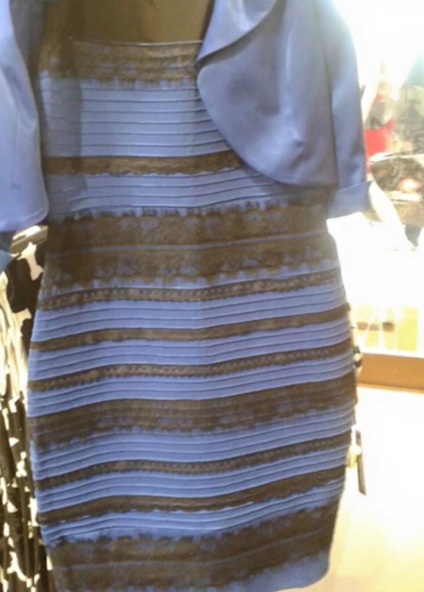{fig-alt="The photograph of the dress that viewers famously interpreted as either blue and black or white and gold."}

<!-- 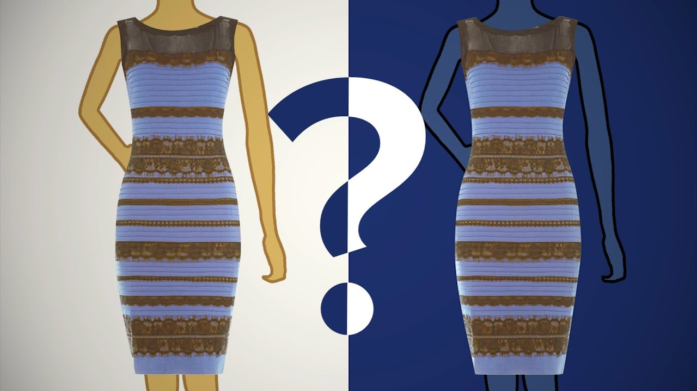{fig-alt="An illustration places the dress in different lighting contexts to show how assumptions about illumination affect perceived color."} -->

:::

The dress debate illustrates that perceived color depends on how we interpret
illumination. Different readers can experience the same image differently,
so a color choice that seems obvious to its creator may not be obvious to everyone.

## Surroundings change apparent lightness

::: {.slide-visual}

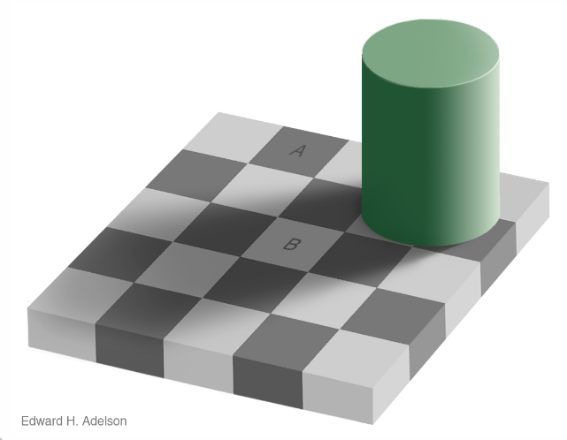{fig-alt="Edward H. Adelson's checker-shadow illusion shows squares A and B on a checkerboard beneath the shadow of a green cylinder."}

:::

Compare squares A and B before watching the next example.
The surrounding checkerboard and cast shadow influence our judgment of their lightness.
Illustration: Edward H. Adelson.

::: {.slide-visual}

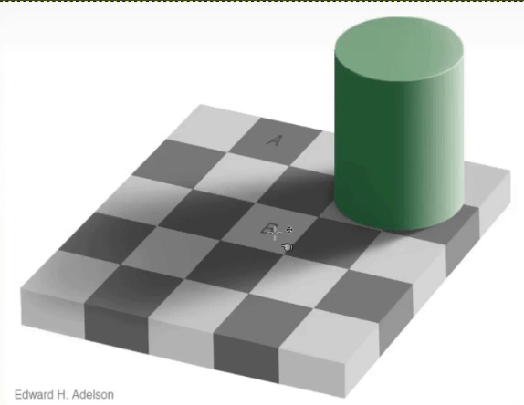{width=650 fig-alt="An animated version of the checker-shadow illusion connects the two squares with matching gray regions, revealing that their pixel values are the same."}

:::

The animation reveals that the two squares use the same gray values.
Apparent lightness is not determined by a pixel value alone;
its surroundings help determine how we interpret it.
Animation: Edward H. Adelson.

## Picking the right color palette

::: {.slide-columns}

:::: {.slide-fragment slide-title="Colored by protein expression" .slide-with-content}

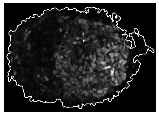{width=100% fig-alt="A microscopy image shows cells inside an irregular white boundary."}

::::

:::: {.slide-fragment slide-title="Colored by distance" .slide-with-content}

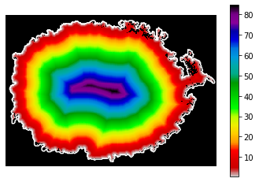{width=100% fig-alt="A continuous distance field is rendered with a rainbow palette that makes several distinct bands appear within the region."}

::::

:::

The distance is a continuous numerical variable, not a collection of distinct groups.
Abrupt hue or lightness changes can nevertheless encourage us to see boundaries
that were not defined in the data.

## Keep numerical gradients continuous

::: {.slide-visual}

:::: {.columns}
::: {.column width="33%"}
**Rainbow**

{width=100% fig-alt="The distance field uses a rainbow palette with prominent bands."}
:::
::: {.column width="33%"}
**Viridis**

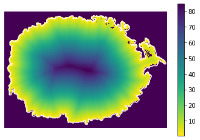{width=100% fig-alt="The same distance field uses a smoothly varying viridis palette."}
:::
::: {.column width="33%"}
**Grayscale**

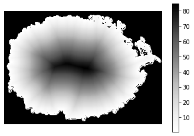{width=100% fig-alt="The same distance field is represented by an ordered grayscale gradient."}
:::
::::

:::

An ordered progression in lightness helps readers follow increasing values.
Grayscale can provide that order, while a carefully designed progression in hue
can help readers distinguish additional detail without introducing abrupt bands.

## Test the ordering in grayscale

::: {.slide-visual}

:::: {.columns}
::: {.column width="50%"}
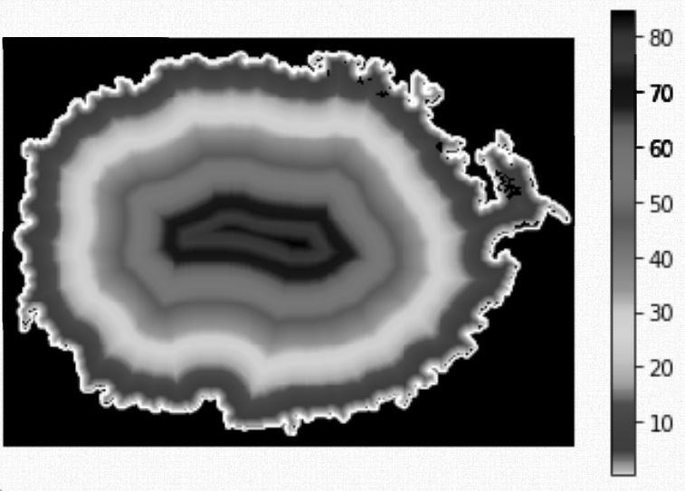{width=100% fig-alt="A monochrome view of the rainbow distance map retains alternating bright and dark rings."}
:::
::: {.column width="50%"}
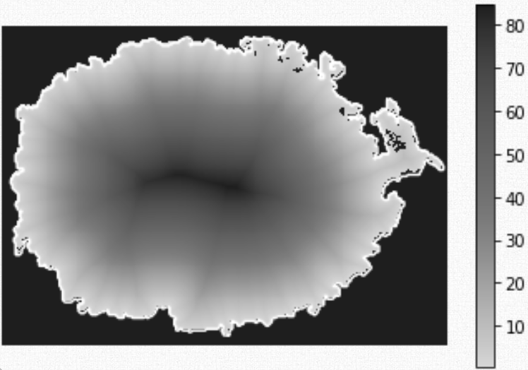{width=100% fig-alt="A monochrome view of the viridis distance map retains a more steadily changing lightness gradient."}
:::
::::

:::

Converting a figure to grayscale reveals whether its lightness supports the intended order.
Alternating light and dark regions can make a smooth numerical change look discontinuous.

## Check contrast for different color vision

::: {.slide-visual}

:::: {.columns}
::: {.column width="50%"}
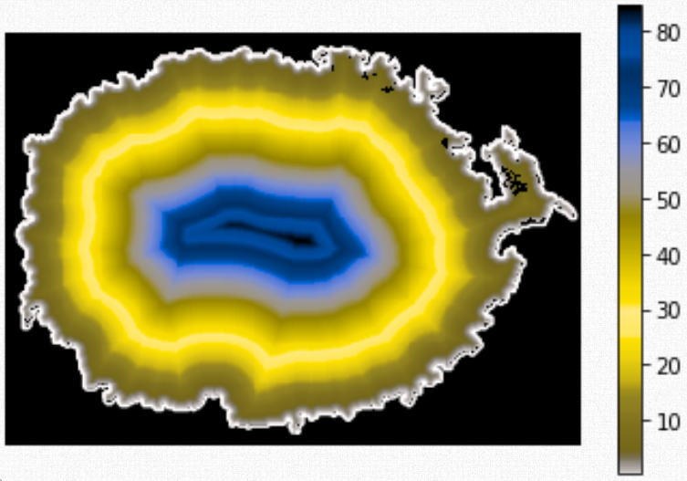{width=100% fig-alt="A color-vision-deficiency simulation changes the rainbow map into strong blue and yellow bands."}
:::
::: {.column width="50%"}
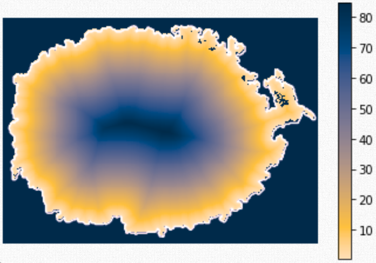{width=100% fig-alt="A color-vision-deficiency simulation of the viridis map preserves a more continuous lightness progression."}
:::
::::

:::

A palette needs to remain interpretable when readers perceive its hue contrasts differently.
Simulations are useful checks, but do not represent every viewer;
ordered lightness, labels, and redundant encodings can provide additional support.

## RGB and HSL describe display colors


::: {.slide-columns}

:::: {.slide-fragment slide-title="RGB" .slide-with-content}

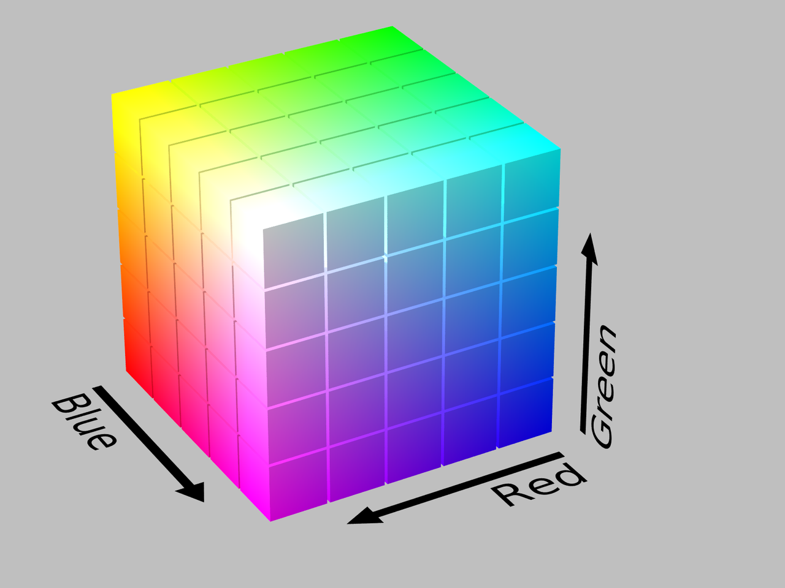{fig-alt="An RGB color model represents colors by combinations of red, green, and blue components."}

::::

:::: {.slide-fragment slide-title="HSL" .slide-with-content}

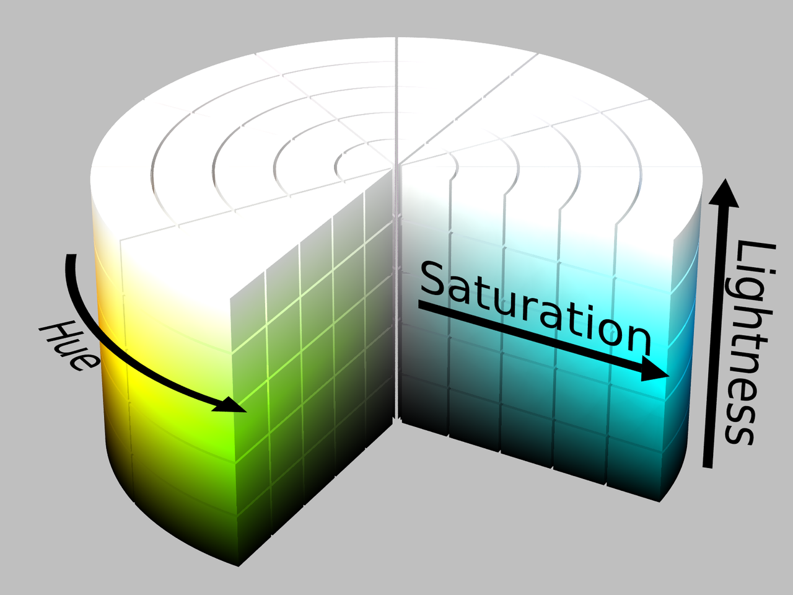{fig-alt="An HSL color model arranges hue around a circle, saturation from gray toward vivid color, and lightness from black to white."}

::::

[RGB](https://commons.wikimedia.org/w/index.php?curid=9803320) and
[HSL](https://commons.wikimedia.org/w/index.php?curid=9801661) models:
SharkD, [CC BY-SA 3.0](https://creativecommons.org/licenses/by-sa/3.0/).

:::

RGB specifies red, green, and blue components; HSL describes hue, saturation, and lightness.
These are ways to specify colors, not guarantees of perceptual uniformity:
equal steps in their coordinates need not look equally different.

## Separate hue, saturation, and lightness

::: {.slide-visual}

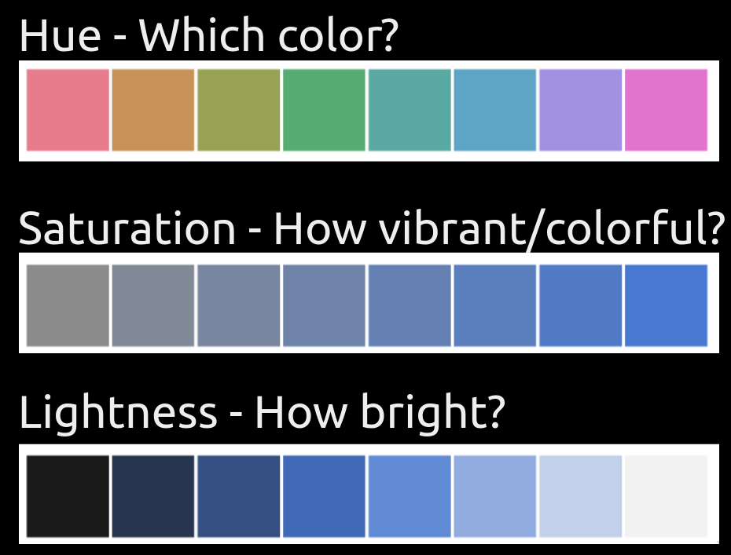{width=100% fig-alt="Three rows of swatches vary hue across colors, saturation from gray to blue, and lightness from dark to light."}

:::

Hue answers roughly "which color?", saturation describes how colorful or gray it looks,
and lightness describes a dark-to-light dimension.
The swatches from the [Seaborn palette tutorial](https://seaborn.pydata.org/tutorial/color_palettes.html)
help separate these choices.

## [Use hue to distinguish unordered groups]{.fragment .fade-in}

::: {.slide-visual slide-reveal=false}

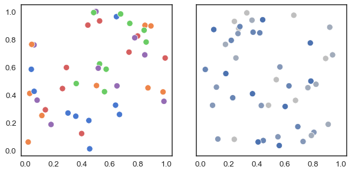{fig-alt="Two scatterplots compare distinct hues for categories with shades of blue that imply an order among the groups."}

Source: [Seaborn palette tutorial](https://seaborn.pydata.org/tutorial/color_palettes.html).

:::

Distinct hues can separate categories without suggesting a low-to-high sequence.
An ordered lightness palette can accidentally imply a ranking among otherwise unordered groups.

## [Use lightness to communicate numerical order]{.fragment .fade-in}

::: {.slide-visual slide-reveal=false}

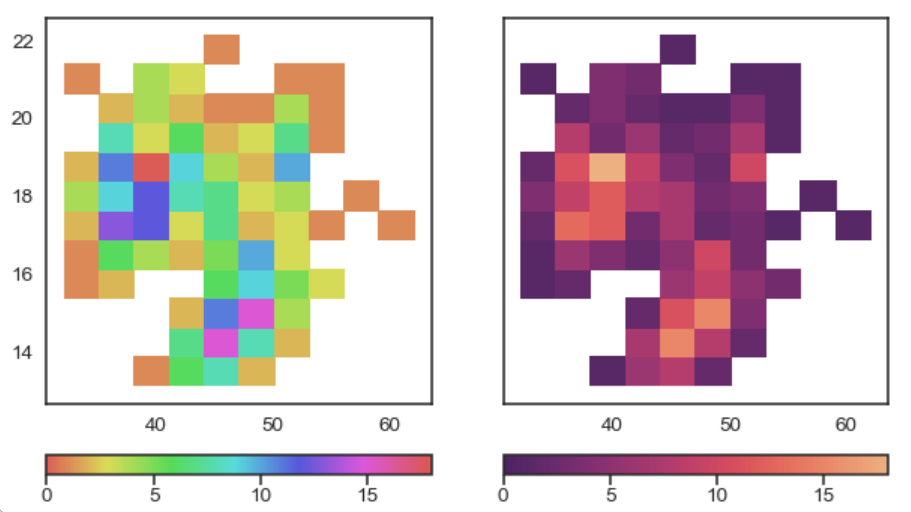{fig-alt="Two binned plots compare an unordered many-hue palette with an ordered dark-to-light palette for numerical values."}

Source: [Seaborn palette tutorial](https://seaborn.pydata.org/tutorial/color_palettes.html).

:::

For numerical magnitude, the colors should support a recoverable order.
An arbitrary set of category colors makes it harder to judge which values are larger.

## Sequential palettes need an ordered progression

::: {.slide-visual}

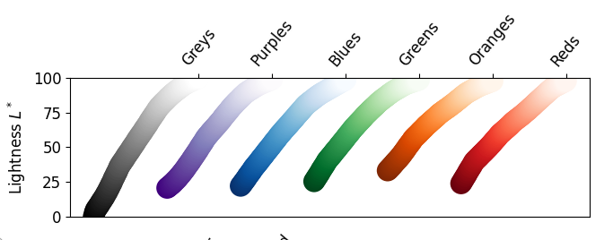{width=100% fig-alt="Several sequential palettes are plotted against perceptual lightness, showing how lightness changes through each palette."}

:::

A sequential palette represents movement along a numerical range.
Check the lightness progression as well as the attractiveness of the color strip;
plateaus or reversals can make some changes stand out more than others.

## Perceptual uniformity helps equal steps look equal

::: {.slide-visual}

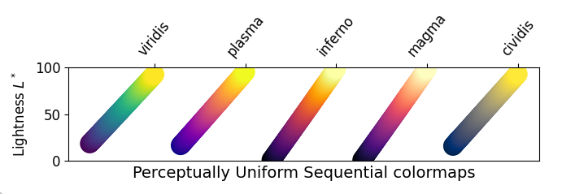{width=100% fig-alt="Lightness plots for viridis, plasma, inferno, magma, and cividis show approximately uniform sequential progressions."}

:::

Perceptually designed palettes aim to make equal data steps look approximately equally different.
These reference diagrams come from the
[Matplotlib colormap guide](https://matplotlib.org/stable/users/explain/colors/colormaps.html).

## Inspect uneven lightness changes

::: {.slide-visual}

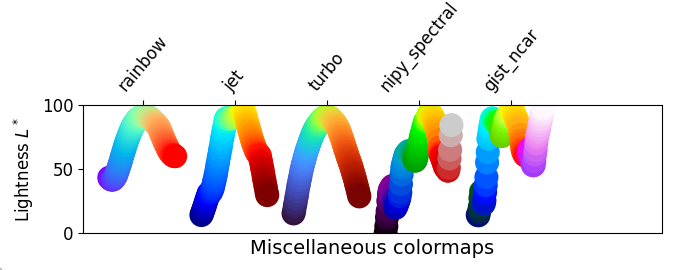{width=100% fig-alt="Lightness plots for several miscellaneous palettes have peaks, troughs, and unequal changes across the range."}

:::

A colorful palette can have a highly uneven lightness profile.
Those peaks and troughs can create artificial emphasis or obscure the ordering of values.

## The same values can look very different

::: {.slide-visual}

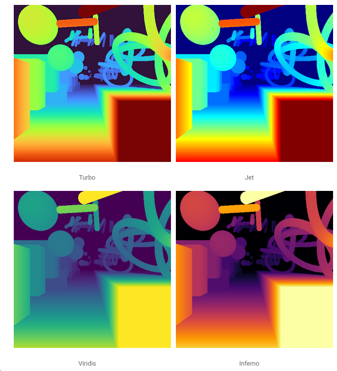{fig-alt="The same scene is rendered with Turbo, Jet, Viridis, and Inferno, revealing different apparent bands and levels of emphasis."}

:::

Changing the palette changes which features attract attention even when the values are unchanged.
Choose a palette for the comparison it supports, rather than for visual excitement alone.

## Guessing a numerical sequence from hue

::: {.slide-visual}

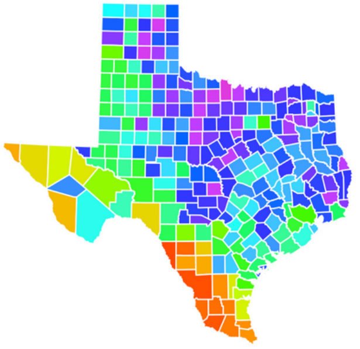{width=800 fig-alt="A Texas county map uses a rainbow-like palette to represent the percentage identifying as white."}

:::


::: {.slide-visual}

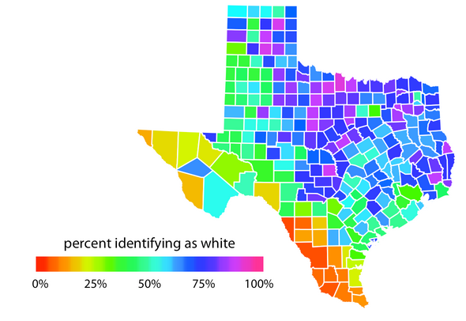{width=800 fig-alt="A Texas county map uses a rainbow-like palette to represent the percentage identifying as white."}

:::

Where would you expect red to fall in this sequence before reading the legend?
Hue alone does not provide an unambiguous numerical order;
the legend and the palette's lightness structure both matter.

## Cyclic data need a palette that wraps around

::: {.slide-visual}

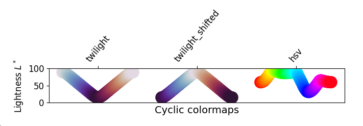{width=100% fig-alt="Cyclic palette diagrams show colors returning to a similar appearance at the beginning and end of the range."}

:::

Use a cyclic palette when the underlying variable wraps around, such as an angle
or a position within a yearly cycle. Similar endpoint colors communicate that connection,
but would be misleading for unrelated low and high endpoints on a linear scale.

## Diverging palettes need a meaningful midpoint

::: {.slide-visual}

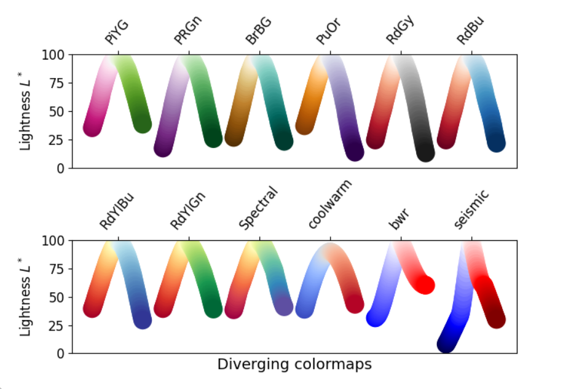{fig-alt="Diverging palettes use two sides around a central light region, with their lightness profiles shown for comparison."}

:::

Use a diverging palette when departures above and below a meaningful reference have different interpretations.
Examples include change from a baseline or correlations centered on zero;
the middle should not be chosen merely because it is halfway between the observed extremes.

## Categorical palettes distinguish groups

::: {.slide-visual}

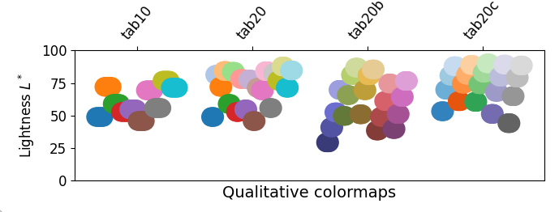{width=100% fig-alt="Qualitative palette examples use distinct colors to separate groups without a numerical progression."}

:::

A categorical palette should make groups distinguishable without implying a numerical order.
Its usefulness still depends on the number of categories, the background, and readers' color vision.

## Too many colors become clutter

::: {.slide-columns}

:::: {.slide-fragment slide-title="" .slide-with-content}

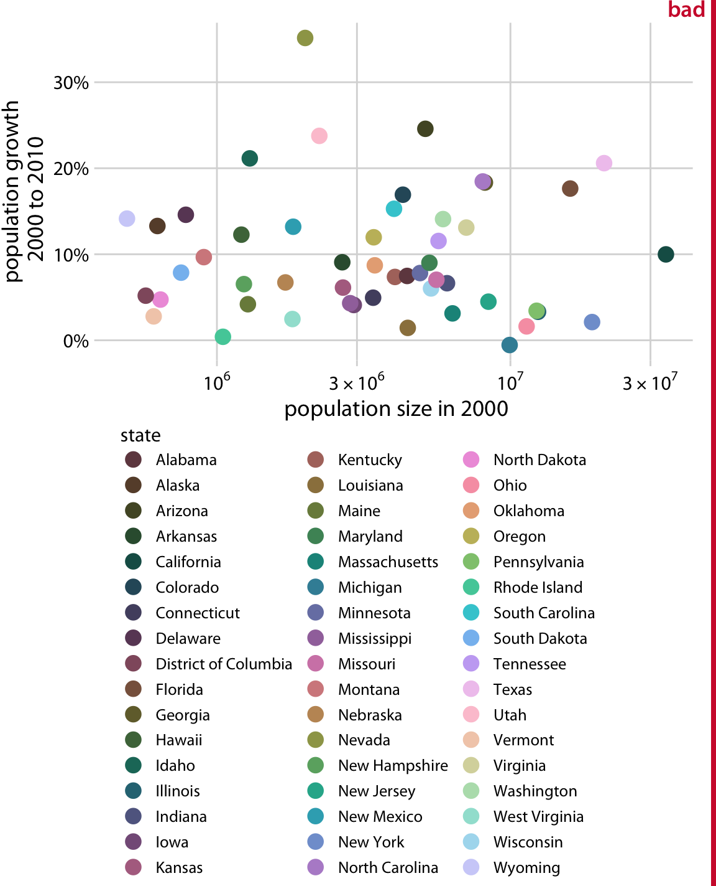{fig-alt="A country-level scatterplot assigns a different color to many countries and requires a very long legend."}

::::

:::: {.slide-fragment slide-title="" .slide-with-content}

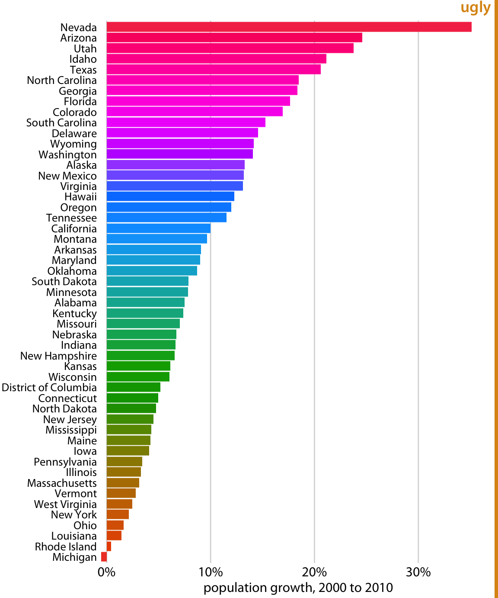{fig-alt="A bar chart uses many different country colors that form a striking rainbow but are difficult to identify individually."}

::::
:::

Coloring every country can create decoration rather than useful identification.
Highlight selected comparisons, divide the display into smaller views,
or use direct labels when that makes the intended question easier to answer.

## Work with familiar color associations

::: {.slide-columns}

:::: {.slide-fragment slide-title="" .slide-with-content}

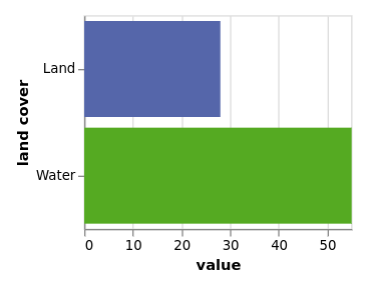{width=100% fig-alt="A land-cover bar chart colors land blue and water green, contrary to a common map-color convention."}

::::

:::: {.slide-fragment slide-title="" .slide-with-content}
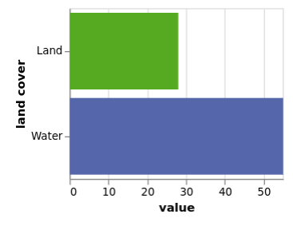{width=100% fig-alt="The same land-cover values use green for land and blue for water."}

::::
:::

When colors have a strong existing association, working with it can reduce the reader's effort.
The bar values are unchanged, but using blue for water and green for land makes
the categories easier to anticipate.

:::::::: {.slide-skip}


```{python}
#| label: color-python-setup
#| include: false
import altair as alt
import pandas as pd

alt.data_transformers.enable('vegafusion')
iris = pd.read_csv('data/vega-iris.csv')
gapminder = pd.read_csv('data/vega-gapminder.csv')
wheat = pd.read_csv('data/vega-wheat.csv').query('year > 1700').copy()
stocks = pd.read_csv('data/vega-stocks.csv', parse_dates=['date'])
```

```{r}
#| label: color-r-setup
#| include: false
library(tidyverse)
theme_set(theme_gray(base_size = 14))
iris <- datasets::iris
gapminder <- read_csv('data/vega-gapminder.csv', show_col_types = FALSE)
wheat <- read_csv('data/vega-wheat.csv', show_col_types = FALSE) |>
    filter(year > 1700)
stocks <- read_csv('data/vega-stocks.csv', show_col_types = FALSE)
```

## Facilitate interpretation through informed color choices

For continuous data, a perceptually uniform colormap is often a useful starting point.
Equal steps in the data should produce approximately equal perceived changes in color.
Lightness is especially important for conveying ordered magnitude:
[a sequential palette with steadily changing lightness makes low-to-high values
easier to interpret than a palette with unrelated bright and dark patches.]{.slide-bullet}
The [Matplotlib colormap guide](https://matplotlib.org/stable/users/explain/colors/colormaps.html)
contains examples, and [this talk about viridis](https://www.youtube.com/watch?v=xAoljeRJ3lU)
explains many of the design principles.

### Color vision and accessibility

Color vision deficiencies affect a substantial number of readers.
Red–green deficiencies are more common among men than women,
and their prevalence varies across populations.
[Do not rely on a color distinction that some readers cannot see.]{.slide-bullet}
The same guidelines often improve a chart for readers with typical color vision too.

The [Coblis simulator](https://www.color-blindness.com/coblis-color-blindness-simulator/)
can simulate different color vision deficiencies for an uploaded image.
The `cividis` palette was designed to give similar perceptual ordering
to readers with and without common red–green deficiencies.
For categorical groups, redundant shapes or direct labels can help
in addition to choosing colors carefully.

### Avoid artificial boundaries

The `jet` rainbow colormap has sharp changes in hue and uneven lightness.
Yellow and cyan regions can attract disproportionate attention,
creating apparent boundaries or features in otherwise smoothly varying data.
Because higher values are not consistently lighter, the order is also hard to recover in grayscale.

[Choose a palette whose perceptual changes support the comparison you want readers to make.]{.slide-bullet}
For more examples, see [How bad is your colormap?](https://jakevdp.github.io/blog/2014/10/16/how-bad-is-your-colormap/)
and [The rainbow is dead … long live the rainbow](https://mycarta.wordpress.com/2012/05/12/the-rainbow-is-dead-long-live-the-rainbow-part-1/).
The [turbo palette](https://research.google/blog/turbo-an-improved-rainbow-colormap-for-visualization/)
improves some shortcomings of `jet`, but does not make every rainbow palette
perceptually uniform or suitable for every reader.
Viridis or cividis are often better defaults for ordered values.
For a broader discussion, see [how color determines what we see](https://eos.org/features/visualizing-science-how-color-determines-what-we-see).

## Categorical color schemes

[Categorical palettes distinguish groups without implying a low-to-high order.]{.slide-bullet}
We use iris measurements to compare the three species.

:::: {.panel-tabset group="language"}

### Altair {.slide-skip}

Altair's default categorical palette is `tableau10`,
a sequence of ten colors beginning with blue, orange, and red.

```{python}
#| label: color-categorical-default-alt
#| slide-show: both
#| slide-title: Distinguish categories
iris_points = alt.Chart(iris).mark_circle(size=100).encode(
    x='petalWidth',
    y='petalLength',
    color='species'
)
iris_points
```

Set the palette by name with `scheme` inside `alt.Scale`.
The [Vega scheme reference](https://vega.github.io/vega/docs/schemes/)
lists categorical, sequential, diverging, and cyclic palettes.

```{python}
#| label: color-categorical-dark2-alt
#| slide-show: both
#| slide-title: Choose a predefined palette
iris_points.encode(color=alt.Color('species').scale(scheme='dark2'))
```

You can also supply colors explicitly, using names or hexadecimal codes.
Here the order of the color range corresponds to the order of the species domain.

```{python}
#| label: color-categorical-custom-alt
#| slide-show: both
#| slide-title: Specify the mapping explicitly
colors = ['coral', 'steelblue', 'rebeccapurple']
iris_points.encode(color=alt.Color('species').scale(
    domain=['setosa', 'versicolor', 'virginica'], range=colors
))
```

### ggplot {.slide-skip}

The default categorical scale in ggplot selects
[equally spaced hues from a color wheel](https://stackoverflow.com/questions/8197559/emulate-ggplot2-default-color-palette).

```{r}
#| label: color-categorical-default-gg
#| slide-show: both
#| slide-title: Distinguish categories
iris_points <- ggplot(iris, aes(x = Petal.Width, y = Petal.Length, color = Species)) +
    geom_point(size = 5)
iris_points
```

ColorBrewer palettes are available through `scale_color_brewer()`
and `scale_fill_brewer()` for categories.
The `distiller` scales interpolate these palettes for continuous values.

```{r}
#| label: color-categorical-dark2-gg
#| slide-show: both
#| slide-title: Choose a predefined palette
iris_points + scale_color_brewer(palette = 'Dark2')
```

The Tableau palette used by Altair is available through `ggthemes`.
The [R color palettes collection](https://github.com/EmilHvitfeldt/r-color-palettes)
shows many other choices and the packages that provide them.

```{r}
#| label: color-categorical-tableau-gg
iris_points + ggthemes::scale_color_tableau()
```

Here we specify the same colors as the Altair example using their hexadecimal codes.
Naming the values makes the mapping to species explicit.

```{r}
#| label: color-categorical-custom-gg
#| slide-show: both
#| slide-title: Specify the mapping explicitly
iris_points + scale_color_manual(values = c(
    setosa = '#FF7F50', versicolor = '#4682B4', virginica = '#663399'
))
```

::::

Experimenting with custom palettes can be useful,
but well-designed existing palettes incorporate considerable research and testing.
They are a good starting point for a final communication figure.
Hexadecimal RGB codes range from `#000000` for black to `#ffffff` for white.
An image editor or [online color picker](https://imagecolorpicker.com/)
can help recover the exact code for a color in an existing image.

::: {.column-margin}

The name `rebeccapurple` is a reminder of the people behind computational tools.
[Read the story of this color's name](https://medium.com/@valgaze/the-hidden-purple-memorial-in-your-web-browser-7d84813bb416).

:::

## Sequential color schemes

[Sequential palettes communicate increasing or decreasing magnitude.]{.slide-bullet}
When working on a light background, it is often useful for low values
to be closest to that background and larger values to be more visually prominent.
Consider the background, the palette direction, and the meaning of high values together.

:::: {.panel-tabset group="language"}

### Altair {.slide-skip}

Mapping petal width to color selects a continuous palette.

```{python}
#| label: color-sequential-default-alt
#| slide-show: both
#| slide-title: Show numerical magnitude
iris_points.encode(color=alt.Color('petalWidth:Q'))
```

The palette can be changed in the same way as for categories.

```{python}
#| label: color-sequential-greenblue-alt
iris_points.encode(color=alt.Color('petalWidth:Q').scale(scheme='greenblue'))
```

Viridis was developed for Matplotlib and is now available in many visualization tools.
It uses changes in lightness and hue while aiming to preserve perceptual ordering.

```{python}
#| label: color-sequential-viridis-alt
#| slide-show: both
#| slide-title: A perceptually designed palette
iris_points.encode(color=alt.Color('petalWidth:Q').scale(scheme='viridis'))
```

Reverse the palette with `reverse=True`, just as for the axis scales in @sec-communication.

```{python}
#| label: color-sequential-reversed-alt
#| slide-show: both
#| slide-title: Reverse the palette deliberately
iris_points.encode(color=alt.Color('petalWidth:Q').scale(scheme='viridis', reverse=True))
```

### ggplot {.slide-skip}

Mapping a numerical variable to color uses a continuous scale.

```{r}
#| label: color-sequential-default-gg
#| slide-show: both
#| slide-title: Show numerical magnitude
iris_numeric <- ggplot(iris, aes(x = Petal.Width, y = Petal.Length, color = Petal.Width)) +
    geom_point(size = 5)
iris_numeric
```

Use `scale_color_viridis_c()` for a continuous viridis palette.
The `_d` variant is for discrete values.

```{r}
#| label: color-sequential-viridis-gg
#| slide-show: both
#| slide-title: A perceptually designed palette
iris_numeric + scale_color_viridis_c()
```

A reverse transformation reverses the numerical color scale,
which also reverses the ordering of the legend values.

```{r}
#| label: color-sequential-reverse-transform-gg
iris_numeric + scale_color_viridis_c(transform = 'reverse')
```

To reverse only the palette while preserving the legend's numerical order,
use `direction = -1` instead.

```{r}
#| label: color-sequential-reversed-gg
#| slide-show: both
#| slide-title: Reverse the palette deliberately
iris_numeric + scale_color_viridis_c(direction = -1)
```

::::

## Diverging color schemes

[Diverging palettes distinguish departures on either side of a meaningful midpoint.]{.slide-bullet}
For example, a correlation ranges from −1 to 1 and has a natural midpoint at zero.
A sequential palette can make a value near zero look more important than
a strongly negative correlation simply because zero is numerically larger.

We calculate a correlation matrix from the Gapminder example data.
The numeric `cluster` identifier is excluded because its codes are categories,
not a quantitative measurement.
The point here is to compare color encodings, not to infer causal relationships from these correlations.

:::: {.panel-tabset group="language"}

### Altair {.slide-skip}

```{python}
#| label: color-correlations-setup-alt
numeric_gapminder = gapminder[['year', 'pop', 'life_expect', 'fertility']]
corr_df = (
    numeric_gapminder.corr()
    .rename_axis(index='variable_x', columns='variable_y')
    .stack().reset_index(name='correlation')
)
```

First, notice how the default sequential scale treats zero.

```{python}
#| label: color-diverging-default-alt
#| slide-show: both
#| slide-title: A midpoint changes the color question
correlation_heatmap = alt.Chart(corr_df, width=240, height=240).mark_rect().encode(
    x='variable_x:N',
    y='variable_y:N',
    tooltip='correlation:Q',
    color='correlation:Q'
)
correlation_heatmap
```

Choose a diverging palette and set the domain to the full possible correlation range.
The symmetric limits make equal-magnitude positive and negative correlations comparable.

```{python}
#| label: color-diverging-symmetric-alt
#| slide-show: both
#| slide-title: Center the palette on a meaningful value
correlation_heatmap.encode(
    color=alt.Color('correlation:Q').scale(domain=[-1, 1], scheme='purpleorange')
)
```

Alternatively, `domainMid=0` identifies the midpoint and selects a default diverging palette.

```{python}
#| label: color-diverging-midpoint-alt
correlation_heatmap.encode(color=alt.Color('correlation:Q').scale(domainMid=0))
```

### ggplot {.slide-skip}

The same correlation matrix can be computed directly in R.

```{r}
#| label: color-correlations-setup-gg
corr_df <- gapminder |>
    select(year, pop, life_expect, fertility) |>
    cor(use = 'pairwise.complete.obs') |>
    as.table() |>
    as.data.frame() |>
    set_names(c('variable_x', 'variable_y', 'correlation'))
```

```{r}
#| label: color-diverging-default-gg
#| slide-show: both
#| slide-title: A midpoint changes the color question
correlation_heatmap <- ggplot(corr_df, aes(x = variable_x, y = variable_y, fill = correlation)) +
    geom_tile()
correlation_heatmap
```

`ggthemes` provides a Tableau diverging palette.

```{r}
#| label: color-diverging-tableau-gg
correlation_heatmap + ggthemes::scale_fill_gradient2_tableau()
```

ColorBrewer offers alternatives through `scale_fill_distiller()`.
The palette direction should agree with any relevant familiar association,
such as red for warmer temperatures; the sign of a correlation has no inherent color.

```{r}
#| label: color-diverging-puor-gg
correlation_heatmap + scale_fill_distiller(palette = 'PuOr')
```

Specify symmetric limits to make equal-magnitude departures from zero equally prominent.

```{r}
#| label: color-diverging-symmetric-gg
#| slide-show: both
#| slide-title: Center the palette on a meaningful value
correlation_heatmap + scale_fill_distiller(palette = 'PuOr', limits = c(-1, 1))
```

::::

## Highlighting with colors

Color can also select a small part of a chart for attention.
We use historical wheat prices after 1700, with fewer bars to keep the example readable.
[Give the observation of interest a distinct color while leaving the other observations
as context.]{.slide-bullet}

:::: {.panel-tabset group="language"}

### Altair {.slide-skip}

Create a Boolean column for the year to highlight.

```{python}
#| label: color-highlight-alt
#| slide-show: both
#| slide-title: Highlight one observation
wheat['highlight'] = wheat['year'] == 1810
bars = alt.Chart(wheat).mark_bar().encode(
    x='year:O',
    y='wheat:Q',
    color='highlight:N'
)
bars
```

The Boolean legend is not helpful unless the reader knows what `True` means.
We can remove it and explain the selected year with text instead.

```{python}
#| label: color-highlight-no-legend-alt
#| slide-show: both
#| slide-title: Explain the highlight in the chart
bars = bars.encode(color=alt.Color('highlight:N').legend(None))
bars
```

### ggplot {.slide-skip}

Bar interiors use `fill`, rather than the outline `color` aesthetic.

```{r}
#| label: color-highlight-gg
#| slide-show: both
#| slide-title: Highlight one observation
wheat <- wheat |> mutate(highlight = year == 1810)
bars <- ggplot(wheat, aes(x = year, y = wheat, fill = highlight)) +
    geom_col(color = 'white') + ggthemes::scale_fill_tableau()
bars
```

Remove the legend through the theme or `guides(fill = 'none')`.

```{r}
#| label: color-highlight-no-legend-gg
#| slide-show: both
#| slide-title: Explain the highlight in the chart
bars <- bars + theme(legend.position = 'none')
bars
```

::::

## Text annotations

An exact value can make an important comparison easier to read.
Text can also explain why an observation is highlighted.
Keep in mind that labeling every observation may add more clutter than information.

:::: {.panel-tabset group="language"}

### Altair {.slide-skip}

Layer a text mark above the bars.

```{python}
#| label: color-value-labels-alt
#| slide-show: both
#| slide-title: Add exact values
bars + bars.mark_text(dy=-5).encode(text='wheat:Q')
```

The text inherited the bar chart's color encoding.
An encoding takes precedence over a color set directly in the mark.
To override it, set a literal encoding value with `alt.value()`;
otherwise a string in an encoding is interpreted as a data column name.

```{python}
#| label: color-literal-text-color-alt
#| slide-show: both
#| slide-title: Control annotation colors
bars + bars.mark_text(dy=-5).encode(text='wheat:Q', color=alt.value('black'))
```

### ggplot {.slide-skip}

Use `geom_text()` with the `label` aesthetic.

```{r}
#| label: color-value-labels-gg
#| slide-show: both
#| slide-title: Add exact values
bars + geom_text(aes(label = wheat), vjust = -0.3)
```

To match the text to the highlighted bar colors, map the `color` aesthetic
and add a corresponding color scale.
This is separate from the `fill` scale used by the bars.

```{r}
#| label: color-matching-text-color-gg
#| slide-show: both
#| slide-title: Control annotation colors
bars +
    geom_text(aes(label = wheat, color = highlight), vjust = -0.3) +
    ggthemes::scale_color_tableau()
```

When a label represents a computed count rather than a precomputed value,
use a layer with the same counting statistic, for example
`geom_text(stat = 'count', aes(label = after_stat(count)))`.

::::

### Remove unnecessary decoration

When exact labels already supply the values, some gridlines may be unnecessary.
This is a design choice: gridlines can still help readers compare distant marks.

:::: {.panel-tabset group="language"}

#### Altair {.slide-skip}

```{python}
#| label: color-no-grid-alt
#| slide-show: both
#| slide-title: Let the annotations do useful work
bars = bars.encode(y=alt.Y('wheat:Q').axis(grid=False))
bars + bars.mark_text(dy=-5).encode(text='wheat:Q', color=alt.value('black'))
```

Without gridlines, the outline around the plotting area may stand out unnecessarily.
Remove it with `configure_view(stroke=None)`.

```{python}
#| label: color-no-outline-alt
(bars + bars.mark_text(dy=-5).encode(
    text='wheat:Q', color=alt.value('black')
)).configure_view(stroke=None)
```

#### ggplot {.slide-skip}

Remove the major and minor gridlines through theme elements.

```{r}
#| label: color-no-grid-gg
#| slide-show: both
#| slide-title: Let the annotations do useful work
bars +
    geom_text(aes(label = wheat, color = highlight), vjust = -0.3) +
    ggthemes::scale_color_tableau() +
    theme(panel.grid.major = element_blank(), panel.grid.minor = element_blank())
```

::::

### Annotate selected observations

[Often only the highlighted observation needs a label.]{.slide-bullet}
Filtering the annotation data leaves the other bars intact.

:::: {.panel-tabset group="language"}

#### Altair {.slide-skip}

```{python}
#| label: color-selected-label-alt
#| slide-show: both
#| slide-title: Label only what needs explanation
bars + alt.Chart(wheat.query('year == 1810')).mark_text(dy=-5).encode(
    x='year:O', y='wheat:Q', text='wheat:Q'
)
```

For custom annotation text, use a literal value again.

```{python}
#| label: color-custom-label-alt
#| slide-show: both
#| slide-title: Explain why the observation matters
bars + alt.Chart(wheat.query('year == 1810')).mark_text(dy=-5, dx=-30).encode(
    x='year:O', y='wheat:Q', text=alt.value('The record year')
)
```

For multiple annotations, either add a text column to the original data
or create a separate annotation dataframe.

```{python}
#| label: color-annotation-data-alt
annot_wheat = pd.DataFrame({
    'year': [1730, 1810],
    'wheat': [26, 99],
    'text': ['The lowest year', 'The record year']
})
annot_wheat
```

```{python}
#| label: color-two-annotations-alt
bars + alt.Chart(annot_wheat).mark_text(dy=-5).encode(
    x='year:O', y='wheat:Q', text='text:N'
)
```

If labels overlap bars or other labels, adjust their positions, alignment, or color.
Separate annotation layers allow each label to have its own placement.

#### ggplot {.slide-skip}

Supply filtered data to the text layer, rather than filtering the whole chart.

```{r}
#| label: color-selected-label-gg
#| slide-show: both
#| slide-title: Label only what needs explanation
bars + geom_text(data = filter(wheat, year == 1810), aes(label = wheat), vjust = -0.3)
```

For a fixed annotation, `annotate()` avoids adding a data column.

```{r}
#| label: color-custom-label-gg
#| slide-show: both
#| slide-title: Explain why the observation matters
bars + annotate('text', label = 'The record year', x = 1810, y = 102, hjust = 1)
```

::::

## Direct labeling instead of using a legend

A legend can make the reader repeatedly look away from the plotted marks.
[Matching the legend's order to the visible order of the series reduces that effort;
direct labels can remove the lookup entirely.]{.slide-bullet}
The stock-price data provide an example where alphabetical order does not
match the order of the line endpoints.

:::: {.panel-tabset group="language"}

### Altair {.slide-skip}

```{python}
#| label: color-stock-legend-alt
#| slide-show: both
#| slide-title: The legend and chart can have different orders
stock_lines = alt.Chart(stocks).mark_line().encode(
    x='date:T', y='price:Q', color='symbol:N'
)
stock_lines
```

Calculate the series order at the final date.

```{python}
#| label: color-stock-order-data-alt
stock_order = (
    stocks.loc[stocks['date'] == stocks['date'].max()]
    .sort_values('price', ascending=False)
)
stock_order
```

Pass that ordering to the color encoding's `sort` parameter.

```{python}
#| label: color-stock-order-alt
#| slide-show: both
#| slide-title: Match the legend to the endpoints
stock_lines.encode(color=alt.Color('symbol:N').sort(stock_order['symbol'].tolist()))
```

The title "symbol" provides little additional information here and can be removed.

```{python}
#| label: color-stock-legend-title-alt
#| slide-show: both
#| slide-title: Remove an uninformative legend title
stock_lines.encode(color=alt.Color('symbol:N').sort(stock_order['symbol'].tolist()).title(None))
```

To label the lines directly, add text at each endpoint and remove the legend.
Use consistent color domains so the line and text layers identify the same series.
The IBM and AMZN endpoints are very close together, so we give their labels
small vertical offsets. Only the label positions change, not the line values.

```{python}
#| label: color-stock-direct-labels-alt
#| slide-show: output
#| slide-title: Label the lines directly
lines = stock_lines.encode(
    y=alt.Y('price:Q').title('Price'), color=alt.Color('symbol:N').legend(None)
)
labels = stock_order.assign(
    label_price=stock_order['price'] + stock_order['symbol'].map({'IBM': 25, 'AMZN': -25}).fillna(0)
)
text = alt.Chart(labels).mark_text(align='left', dx=6).encode(
    x='date:T', y=alt.Y('label_price:Q').title('Price'), text='symbol:N', color='symbol:N'
)
lines + text
```

### ggplot {.slide-skip}

```{r}
#| label: color-stock-legend-gg
#| slide-show: both
#| slide-title: The legend and chart can have different orders
stock_lines <- ggplot(stocks, aes(x = date, y = price, color = symbol)) +
    geom_line() + ggthemes::scale_color_tableau()
stock_lines
```

Calculate the last-date ordering, then use it as the legend's `breaks`.

```{r}
#| label: color-stock-order-data-gg
stock_order <- stocks |>
    filter(date == max(date)) |>
    arrange(desc(price))
stock_order
```

```{r}
#| label: color-stock-order-gg
#| slide-show: both
#| slide-title: Match the legend to the endpoints
stock_lines + ggthemes::scale_color_tableau(breaks = stock_order$symbol)
```

```{r}
#| label: color-stock-legend-title-gg
#| slide-show: both
#| slide-title: Remove an uninformative legend title
stock_lines + ggthemes::scale_color_tableau(breaks = stock_order$symbol, name = NULL)
```

To remove the legend altogether, set `legend.position = 'none'`.
Then add `geom_text()` with the endpoint data.
Some extra space on the right keeps the labels within the plotting area.
As in Altair, only the labels for the closely spaced IBM and AMZN series are offset.

```{r}
#| label: color-stock-direct-labels-gg
#| slide-show: output
#| slide-title: Label the lines directly
labels <- stock_order |>
    mutate(label_price = price + case_when(
        symbol == 'IBM' ~ 25, symbol == 'AMZN' ~ -25, TRUE ~ 0
    ))
stock_lines +
    geom_text(data = labels, aes(y = label_price, label = symbol), hjust = -0.1) +
    scale_x_date(expand = expansion(mult = c(0.02, 0.14))) +
    theme(legend.position = 'none')
```

::::

## Further reading {.slide-skip}

- [Color basics](https://clauswilke.com/dataviz/color-basics.html).
- [Common color pitfalls](https://clauswilke.com/dataviz/color-pitfalls.html).
- [Vega color schemes](https://vega.github.io/vega/docs/schemes/).
- [R color palettes](https://github.com/EmilHvitfeldt/r-color-palettes).

::::::::
