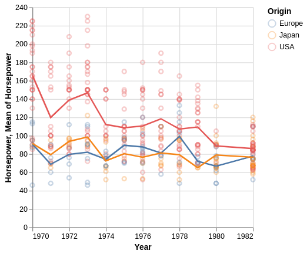
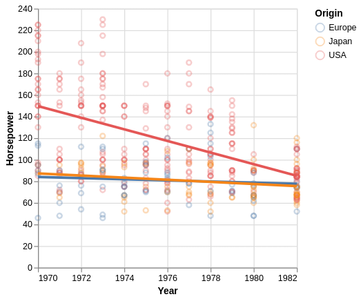
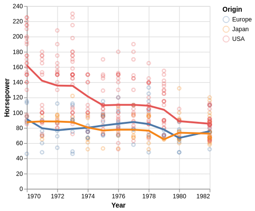

# Trends {#sec-trends}



<!-- Trendline material adapted from DSCI 531 lecture 5,
     originally introduced in the communication chapter. -->

:::: {.slide-outcomes}

::: {.callout-note title="Learning outcomes & Chapter summary"}

1. **Use** means and rolling averages to summarize patterns while retaining the observations as context.
2. **Distinguish** global regression models from local smoothing, and **choose** a trendline according to the question and audience.
3. **Adjust** smoothing neighborhoods and **explain** how they affect the local detail shown by a curve.
4. **Recognize** that describing a trend within the observed data does not justify extrapolating it beyond that range.

:::

::::

```{python}
#| label: trends-python-setup
#| include: false
import altair as alt
import pandas as pd

alt.data_transformers.enable('vegafusion')
cars = pd.read_csv('data/vega-cars.csv', parse_dates=['Year']).dropna(subset=['Horsepower'])
cars['Year'] = cars['Year'].dt.year
```

```{r}
#| label: trends-r-setup
#| include: false
library(tidyverse)
theme_set(theme_gray(base_size = 14))
cars <- read_csv('data/vega-cars.csv', show_col_types = FALSE) |>
    filter(!is.na(Horsepower)) |>
    mutate(Year = lubridate::year(Year))
```

## Why bother?

In @sec-connections, lines connected observations to show relationships and changes.
Here we use lines to summarize a pattern rather than connect every observation.
[A trendline can make a general pattern easier to see when individual observations
or multiple groups obscure it.]{.slide-bullet}
Trendlines are also called fitted lines or lines of best fit.
The choice of line determines which features of the data are emphasized.
Here we focus on the summaries themselves and keep the observations visible.
In @sec-uncertainty, we add intervals and distinguish the spread of observations
from uncertainty in an estimated mean.

We use automobile specifications from the Vega datasets collection,
with missing horsepower observations omitted and the year represented numerically.

:::: {.panel-tabset group="language"}

### Altair {.slide-skip}

```{python}
#| label: trends-car-points-alt
#| slide-show: both
#| slide-title: A trend hidden among observations
points = alt.Chart(cars).mark_point(opacity=0.3).encode(
    x=alt.X('Year:Q').scale(zero=False).axis(format='d'),
    y='Horsepower',
    color='Origin'
)
points
```

Connecting every observation does not provide a useful summary of the trend.

```{python}
#| label: trends-connected-points-alt
#| slide-show: both
#| slide-title: Connecting observations is not a summary
points + points.mark_line()
```

### ggplot {.slide-skip}

```{r}
#| label: trends-car-points-gg
#| slide-show: both
#| slide-title: A trend hidden among observations
car_points <- ggplot(cars, aes(x = Year, y = Horsepower, color = Origin)) +
    geom_point(alpha = 0.3) +
    scale_x_continuous(breaks = seq(1970, 1982, by = 2))
car_points
```

```{r}
#| label: trends-connected-points-gg
#| slide-show: both
#| slide-title: Connecting observations is not a summary
car_points + geom_line()
```

::::

## Means and rolling averages

A simple summary is the mean horsepower for each year and origin.
This works here because each year has several observations.
For a more continuous x variable, binning or smoothing may be needed
to avoid a noisy line driven by individual observations.

:::: {.panel-tabset group="language"}

### Altair {.slide-skip}

```{python}
#| label: trends-yearly-mean-alt
#| slide-show: both
#| slide-title: Summarize each year
points + points.mark_line().encode(y='mean(Horsepower)')
```

### ggplot {.slide-skip}

```{r}
#| label: trends-yearly-mean-gg
#| slide-show: both
#| slide-title: Summarize each year
car_points + geom_line(stat = 'summary', fun = 'mean')
```

::::

A moving or rolling average uses a neighborhood of observations.
Because there are several cars at each year, we first calculate the annual means
and then smooth those means within each origin.
This weights each annual mean equally, rather than weighting years by their number of cars.

::: {.deep-dive}

### Calculating a rolling average

:::: {.panel-tabset group="language"}

#### Altair {.slide-skip}

In Altair, `transform_window()` can average the previous, current, and next annual mean.
The explicit sort ensures that these are neighboring observed years.
The window uses two years at the endpoints and three in the interior.
If a year is missing within a group, neighboring rows need not be consecutive calendar years.

```{python}
#| label: trends-rolling-window-alt
mean_per_year = cars.groupby(['Origin', 'Year'])['Horsepower'].mean().reset_index()
alt.Chart(mean_per_year).transform_window(
    mean_hp='mean(Horsepower)',
    frame=[-1, 1],
    sort=[alt.SortField('Year')],
    groupby=['Origin']
).mark_line().encode(
    x=alt.X('Year:Q').scale(zero=False).axis(format='d'),
    y='mean_hp:Q',
    color='Origin'
)
```

Pandas also provides a `rolling()` operation.
Setting `min_periods=1` uses the available annual means at the endpoints,
matching the Altair window above. Without it, pandas requires three values
and omits the endpoint estimates.

```{python}
#| label: trends-rolling-pandas-alt
mean_per_year['rolling_hp'] = mean_per_year.groupby('Origin')['Horsepower'].transform(
    lambda values: values.rolling(3, center=True, min_periods=1).mean()
)
alt.Chart(mean_per_year).mark_line().encode(
    x=alt.X('Year:Q').scale(zero=False).axis(format='d'),
    y='rolling_hp',
    color='Origin'
)
```

See also [Altair's rolling-average example](https://altair-viz.github.io/gallery/scatter_with_rolling_mean.html).

#### ggplot {.slide-skip}

We can calculate the same centered window using the previous and next annual means.
`na.rm = TRUE` uses the two available means at the endpoints.

```{r}
#| label: trends-rolling-window-gg
mean_per_year <- cars |>
    group_by(Origin, Year) |>
    summarise(Horsepower = mean(Horsepower), .groups = 'drop') |>
    arrange(Origin, Year) |>
    group_by(Origin) |>
    mutate(rolling_hp = rowMeans(
        cbind(lag(Horsepower), Horsepower, lead(Horsepower)), na.rm = TRUE
    )) |>
    ungroup()

ggplot(mean_per_year, aes(x = Year, y = rolling_hp, color = Origin)) +
    geom_line() +
    scale_x_continuous(breaks = seq(1970, 1982, by = 2)) +
    labs(y = 'Mean horsepower (rolling window)')
```

::::

:::

## Regression lines

Another way to show a trend is regression.
Linear least-squares regression fits a straight line by minimizing the sum
of squared vertical deviations from the observations to the line.

:::: {.panel-tabset group="language"}

### Altair {.slide-skip}

```{python}
#| label: trends-linear-fit-alt
#| slide-show: both
#| slide-title: A linear trend
points + points.mark_line(size=3).transform_regression(
    'Year', 'Horsepower', groupby=['Origin']
)
```

Regression is not restricted to straight lines.
For example, a polynomial of order two gives a quadratic fit.

```{python}
#| label: trends-polynomial-fit-alt
#| slide-show: both
#| slide-title: A polynomial trend
points + points.mark_line(size=3).transform_regression(
    'Year', 'Horsepower', groupby=['Origin'], method='poly', order=2
)
```

### ggplot {.slide-skip}

Set the smoothing method to `lm` for a linear model.
`se = FALSE` hides ggplot's default confidence band, matching the line-only
Altair example. That default band describes uncertainty in the fitted mean,
not the standard deviation of individual observations.

```{r}
#| label: trends-linear-fit-gg
#| slide-show: both
#| slide-title: A linear trend
car_points + geom_smooth(method = 'lm', se = FALSE, linewidth = 1.2)
```

The formula can be changed to fit a polynomial.

```{r}
#| label: trends-polynomial-fit-gg
#| slide-show: both
#| slide-title: A polynomial trend
car_points +
    geom_smooth(method = 'lm', formula = y ~ poly(x, 2), se = FALSE, linewidth = 1.2)
```

::::

## Local smoothing

Sometimes one equation is a poor description of the whole dataset.
[Local regression fits nearby observations in overlapping neighborhoods,
allowing the trend to change across the x-axis.]{.slide-bullet}
This is usually called *LOESS* (locally estimated scatterplot smoothing)
or *LOWESS* (locally weighted scatterplot smoothing).
The animation builds up the red fitted curve from local fits.

::: {.slide-visual slide-title="How local regression builds a curve"}

.](img/loess-local-regression.gif)

:::

:::: {.panel-tabset group="language"}

### Altair {.slide-skip}

```{python}
#| label: trends-loess-alt
#| slide-show: both
#| slide-title: A local trend
points + points.mark_line(size=3).transform_loess(
    'Year', 'Horsepower', groupby=['Origin'], bandwidth=0.5
)
```

`bandwidth` controls the fraction of observations included in each neighborhood.
Larger fractions usually give a smoother, more general curve.
The default is 0.3; here we explicitly use 0.5 in both languages.
A bandwidth of 1 uses all observations in each neighborhood,
but is not generally identical to a single global linear regression.

```{python}
#| label: trends-loess-bandwidth-alt
#| slide-show: both
#| slide-title: Control the amount of smoothing
points + points.mark_line(size=3).transform_loess(
    'Year', 'Horsepower', groupby=['Origin'], bandwidth=0.8
)
```

### ggplot {.slide-skip}

For these small groups, `geom_smooth()` uses LOESS by default.
We set the method and neighborhood fraction explicitly here,
and hide the confidence band as in the Altair example.
We also request local linear fits and robust fitting to more closely match
Vega's LOESS implementation; R otherwise uses local quadratic fits by default.
The implementations still need not produce identical curves,
especially with repeated x-values such as the model years here.

```{r}
#| label: trends-loess-gg
#| slide-show: both
#| slide-title: A local trend
car_points + geom_smooth(
    method = 'loess', span = 0.5, se = FALSE, linewidth = 1.2,
    method.args = list(degree = 1, family = 'symmetric')
)
```

The `span` parameter changes the fraction of observations in each neighborhood.

```{r}
#| label: trends-loess-span-gg
#| slide-show: both
#| slide-title: Control the amount of smoothing
car_points + geom_smooth(
    method = 'loess', span = 0.8, se = FALSE, linewidth = 1.2,
    method.args = list(degree = 1, family = 'symmetric')
)
```

::::

The following animations illustrate the qualitative effect of narrower and wider
weighting neighborhoods in a different LOWESS implementation.
Its Gaussian-width parameter, $\sigma$, is not the same parameter as Altair's bandwidth
or ggplot's span.

:::: {.slide-visual slide-title="Local variation and smoothness" slide-layout="columns"}

.](img/lowess-small-bandwidth.gif)

.](img/lowess-large-bandwidth.gif)

::::

## Compare the questions answered by different summaries

::: {.slide-visual}

:::: {.columns}
::: {.column width="33%"}
**Mean-based summary**

{fig-alt="A scatterplot of automobile horsepower by year uses separate jagged mean-based lines for the three origins."}
:::
::: {.column width="33%"}
**Linear regression**

{fig-alt="The same automobile observations are summarized by a straight regression line for each origin."}
:::
::: {.column width="33%"}
**Local smoothing**

{fig-alt="The same automobile observations are summarized by locally smoothed curves for each origin."}
:::
::::

:::

These comparison figures from the communication lecture show how the choice of
summary changes the pattern a reader sees. Decide whether the audience needs
year-specific averages, a global trend, or variation within the observed range.

## When to choose which trendline?

::: {.slide-bullet}

- **Means and rolling averages** are useful when the summarized values should have
  a straightforward interpretation. They can be particularly accessible to a general audience.
- **Regression models** are useful when a simple equation is a reasonable description
  of the relationship. Predictions beyond the observed range rely on that model continuing
  to hold, and become more uncertain as they move further from the data.
- **LOESS** is useful for describing patterns within the observed data without choosing
  one global equation. It often resembles the trend a reader would sketch by eye,
  but depends on the smoothing setting and is poorly suited to extrapolation.

:::

## Further reading {.slide-skip}

- [Visualizing trends](https://clauswilke.com/dataviz/visualizing-trends.html).
