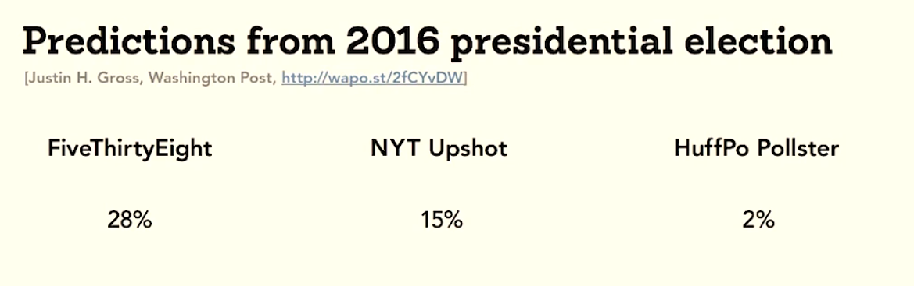
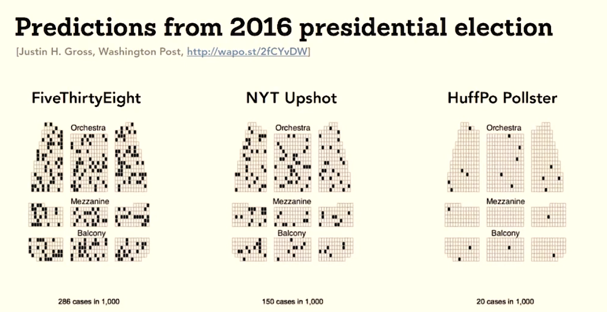
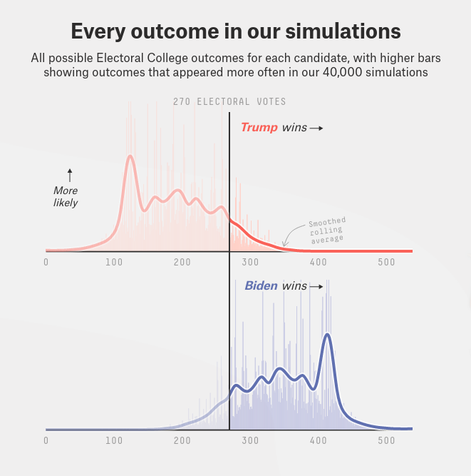
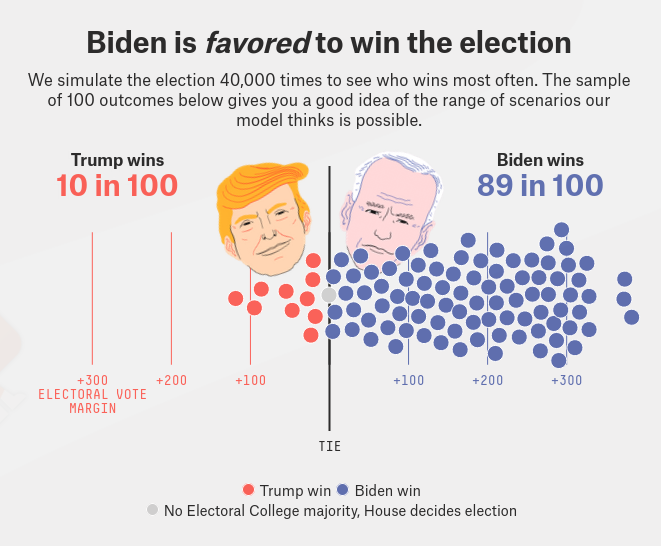
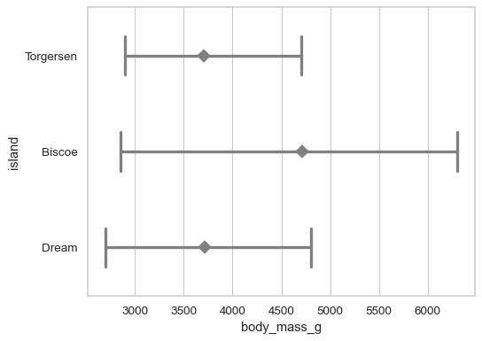
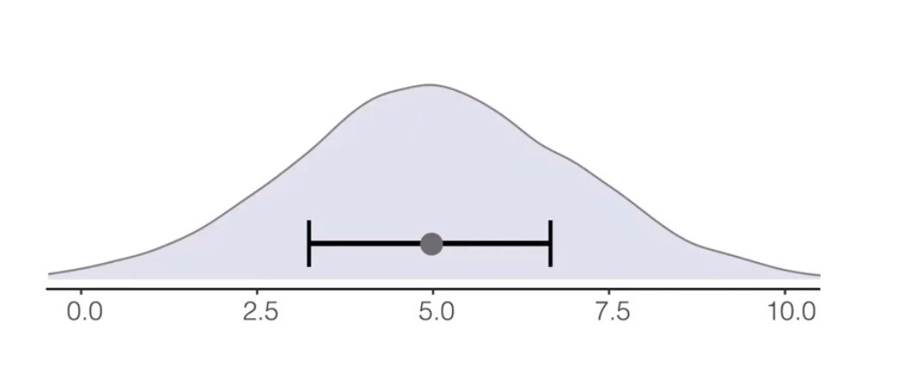
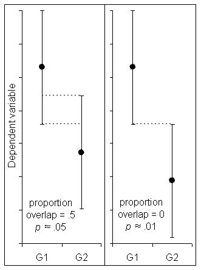
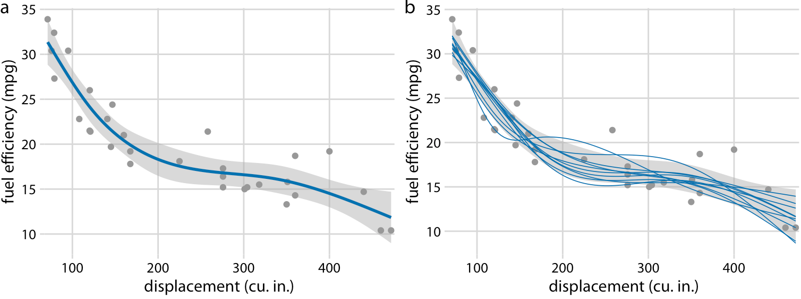
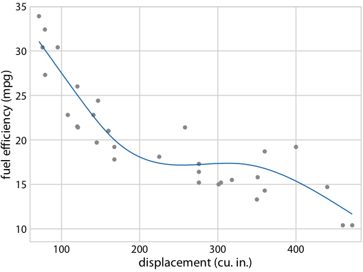
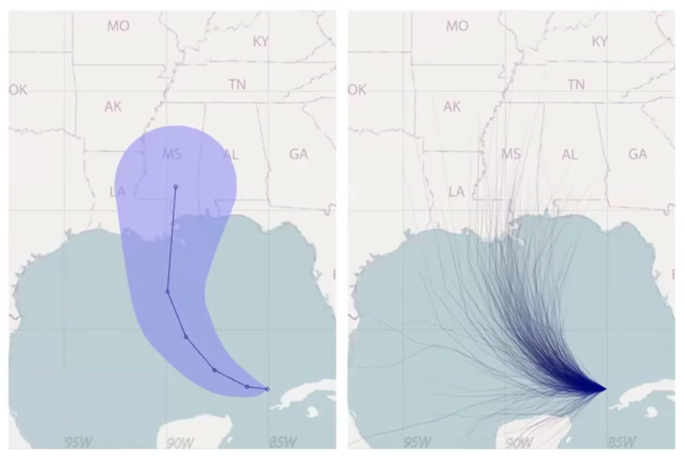

# Uncertainty {#sec-uncertainty}



:::: {.slide-outcomes}

::: {.callout-note title="Learning outcomes & Chapter summary"}

1. **Distinguish** variability among observations from uncertainty in an estimated mean.
2. **Create and interpret** confidence intervals displayed as bands and point ranges.
3. **Combine** estimates and their intervals with the underlying observations or distributions.
4. **Communicate** probabilities using frequency framing and hypothetical outcomes.
5. **Recognize** misleading interpretations of error bars, shaded bands, and forecast cones.
6. **Explain** how bootstrap resamples produce a percentile confidence interval for a mean.

:::

::::

## Why bother?

[A point or a line can look precise even when it represents an uncertain estimate.]{.slide-bullet}
Showing uncertainty helps readers judge which conclusions the data support,
but the visual representation also matters:
[an interval that is familiar to a statistician may convey something quite different
to a general audience]{.slide-bullet}.
We will first explore how to communicate uncertainty,
then create interval plots in Altair and ggplot.

## Framing probabilities as frequencies

The lecture's historical example compares three forecasts of Donald Trump's
chance of winning the 2016 US presidential election.
These percentages describe the probability of winning, not the predicted share of votes.

::: {.slide-visual}

{#fig-election-probabilities fig-alt="FiveThirtyEight: 28%; NYT Upshot: 15%; HuffPo Pollster: 2%."}

:::

::: {.slide-fragment}

> When called upon to judge probability,
people actually judge something else
and believe they have judged probability -- Daniel Kahneman

:::

::: {.callout-default .ex-prompt}

## Interpreting a probabilistic forecast {.content-visible when-format="revealjs"}

[Trump won the election. Does that result alone establish that all three models were bad?]{.slide-bullet}
[How could we make the probabilities more intuitive to an audience unfamiliar with forecasting?]{.slide-bullet}

:::: {.callout-default .ex-hint}

[An outcome with a probability below 50% is less likely than its alternative,
but is it impossible? Think about rolling a particular number on a fair six-sided die.]{.slide-bullet}

::::: {.callout-default .ex-solution}

[No. A probabilistic forecast is not a promise that the most likely outcome will occur.]{.slide-bullet}
Rolling a six does not establish that a die is unfair merely because that outcome
had only a one-in-six chance.
The models assigned different probabilities, so they did not express the same degree
of uncertainty. A scoring rule can reward a forecast that assigned more probability
to the observed outcome, but one election cannot establish a model's long-run calibration.

We can make the probabilities easier to imagine by expressing them as frequencies:
roughly 28, 15, or 2 wins out of 100 comparable hypothetical elections under each forecast.
These are model-implied scenarios, not a claim that we observed 100 elections.

:::::
::::
:::

## Making probabilities tangible {.content-visible when-format="revealjs"}

[**Frequency framing** expresses a probability as a share of a collection of outcomes.]{.slide-bullet}
In the theater-seat version below, imagine choosing a seat without seeing its color first.
Dark seats represent scenarios in which Trump wins.
Even in the first forecast, a dark seat is less likely than a light one,
but selecting one would hardly be extraordinary.

::: {.slide-visual}

{#fig-election-frequency-seats fig-alt="Three theater seating charts have progressively fewer dark seats, showing different winning probabilities as frequencies."}

:::

The format can show more than a binary win or loss.
FiveThirtyEight's 2020 forecast displayed both a distribution of simulated electoral-vote
outcomes and a sample of 100 scenarios.
The scenario display combines a frequency statement with the possible margin of victory.

::: {.slide-visual slide-title="A distribution of possible election outcomes"}

{#fig-election-distributions width=550 fig-alt="Trump and Biden electoral-vote distributions show many possible outcomes around a 270-vote winning threshold."}

:::

::: {.slide-visual slide-title="One hundred hypothetical elections"}

{#fig-election-scenarios width=550 fig-alt="A dot display positions election scenarios by electoral-vote margin and colors them by winner."}

:::

These are snapshots from the [2020 forecast](https://projects.fivethirtyeight.com/2020-election-forecast/),
not current predictions. Each dot represents a simulated scenario, not a voter.
Frequency displays can make unlikely outcomes more tangible,
but labels must explain what the marks represent and how they were generated.
Too many tiny marks can also become difficult to count.

## Reading error bars and bands

Error bars are compact and useful when comparing many estimates,
but their appearance alone does not tell us what they represent.

::: {.callout-default .ex-prompt}

:::: {.slide-visual}

{#fig-unlabeled-penguin-intervals width=550 fig-alt="Body-mass point estimates for penguins on three islands, each accompanied by a horizontal interval with no stated definition."}

::::

## What do the intervals represent? {.content-visible when-format="revealjs"}

[What information would you need before interpreting these intervals?]{.slide-bullet}
[Could you tell whether they show the spread of penguin body masses or uncertainty in a mean?]{.slide-bullet}

:::: {.callout-default .ex-solution}

[We need to know what the point estimates and intervals represent:
for example, means with standard deviations, confidence intervals for means,
or some other summary.]{.slide-bullet} [For confidence intervals, we also need the confidence level
and an explanation of how they were calculated.]{.slide-bullet}
The same point-and-line marks can display all these quantities,
so we cannot infer the interval definition from their shape.

::::
:::

In @sec-summaries, we combined measures of central tendency with indications
of how the observations vary.
But the spread of the observations and the uncertainty in an estimated mean
answer different questions.
In @sec-trends, we used lines to summarize horsepower without displaying intervals.
Here we group the cars by model year and origin, then add intervals to the annual means.
For example, cars can have very different horsepower values even when
we have enough observations to estimate their mean relatively precisely.

::: {.slide-visual slide-title="Spread and uncertainty answer different questions"}

| Display | What it describes |
|:--|:--|
| Mean ± one standard deviation (SD) | Spread of the individual observations around their mean |
| Mean ± one standard error (SE) | Uncertainty in the estimated mean; approximately a 68% CI under a normal approximation |
| 95% confidence interval (CI) for the mean | An interval targeting 95% coverage; often approximately mean ± 1.96 SE, or calculated using another interval method |

:::

::: {.slide-visual slide-title="Same observations, different intervals"}

{#fig-interval-definitions fig-alt="Identical mean estimates have different interval widths when displaying plus or minus SD, plus or minus SE, and 80%, 95%, or 99% confidence intervals."}

:::

A shorter bar does not by itself mean that the data or model are better.
Changing from SD to SE changes the question being answered;
changing the confidence level changes the interval's intended coverage.
Choose the quantity that addresses the question and label it explicitly.

## Interpreting confidence intervals {.content-visible when-format="revealjs"}

A **confidence interval** describes uncertainty in an estimate.
For a 95% confidence interval, the intended interpretation is that
[if we repeatedly sampled data and constructed intervals in the same way,
about 95% of those intervals would contain the population quantity]{.slide-bullet},
provided the method's assumptions hold.
Note that this is not the same as saying that the true population mean
has a 95% chance to be contained within a single CI.
The population mean is fixed,
and it is our construction of the CI
that varies depending on how our sample from the original population looks.

The standard error describes uncertainty in the estimated mean.
When its sampling distribution is approximately normal—as is often the case for
sufficiently large samples—mean ± one SE is approximately a 68% confidence interval,
and mean ± two SE is approximately a 95% confidence interval.

[It's common to compute the confidence interval and standard error using **bootstrapping**]{.slide-bullet}.
The core idea in bootstrapping is that
since we don't have access to data of the entire population
and we cannot repeatedly collect new samples from that population,
we treat the data we have as the closest approximation
of the distribution of the population
and draw new samples from our observed data
to build a confidence interval for our population mean estimate.
You can read more detail about this technique 
and play around with an interactive chart in the deep dive below.

### Building a confidence interval by bootstrapping {.slide-skip}

[Bootstrapping resamples observations with replacement from the observed data,
calculates the mean for each resample,
and uses the resulting distribution of means to construct an interval.]{.slide-bullet}
In the bootstrap distribution of means,
a percentile range (e.g. 5th - 95th percentile) corresponds
to the confidence interval of the population mean,
whereas a standard deviation
corresponds to the standard error of the population mean.

As an example,
where we suppose that our observed contains the horsepower of 20 cars
and we want to estimate the population mean and its confidence interval.
These are the steps we would follow to construct that interval via bootstrapping:

1. **Resample with replacement:** draw 20 observations from the observed sample.
   A car can appear more than once, and others may not appear at all.
2. **Calculate the resample's mean:** each resample contributes one value to the
   bootstrap distribution of means.
3. **Repeat and take percentiles:** choose the middle fraction corresponding to the
   desired confidence level. At 95%, the 2.5th and 97.5th percentiles of the bootstrap
   means form a **95% percentile-bootstrap confidence interval** for the population mean.

You can see this process depicted graphically below,
and play around with some of the parameters.


```{python}
#| label: fig-ci-bootstrap-interactive
#| echo: false
#| slide-show: output
#| slide-title: Build a confidence interval by bootstrapping
#| fig-cap: >
#|    Interactive chart for construction CI via bootstrapping. 
#|    After clicking a slider you can either drag with the pointer
#|    or use the arrow keys to step through the values.
#|    The slider reveals a fixed sequence of resamples generated with a random seed,
#|    so returning to the same position gives the same result.
#|    Notice that every resample still contains **20 observations**,
#|    even when the histogram contains 500 means.
#|    Increasing the number of resamples makes the bootstrap calculation
#|    more stable; it does not add new information to the original sample.

import altair as alt
import numpy as np
import pandas as pd

# Run the filtering and interaction in the browser.
bootstrap_transformer = alt.data_transformers.enable('default')
bootstrap_sample = (
    pd.read_csv('data/vega-cars.csv').dropna(subset=['Horsepower']).query('Horsepower <= 120')
    .sample(n=20, random_state=531).sort_values('Horsepower').reset_index(drop=True)
)
bootstrap_values = bootstrap_sample['Horsepower'].to_numpy()
bootstrap_n = len(bootstrap_values)
bootstrap_repetitions = 500
bootstrap_confidence_levels = np.arange(50, 100)
bootstrap_tail_probabilities = (1 - bootstrap_confidence_levels / 100) / 2
bootstrap_rng = np.random.default_rng(531)
bootstrap_indices = bootstrap_rng.integers(0, bootstrap_n, size=(bootstrap_repetitions, bootstrap_n))
bootstrap_draws = bootstrap_values[bootstrap_indices]
bootstrap_means = bootstrap_draws.mean(axis=1)
bootstrap_intervals = np.array([
    np.quantile(bootstrap_means[:k], [bootstrap_tail_probabilities, 1 - bootstrap_tail_probabilities])
    for k in range(1, bootstrap_repetitions + 1)
])
bootstrap_history = pd.DataFrame({
    'resample': np.arange(1, bootstrap_repetitions + 1),
    'draws': bootstrap_draws.tolist(),
    'observations': (bootstrap_indices + 1).tolist(),
    'mean': bootstrap_means,
    'lower_bounds': bootstrap_intervals[:, 0, :].tolist(),
    'upper_bounds': bootstrap_intervals[:, 1, :].tolist()
})
bootstrap_original = pd.DataFrame({
    'Observation': np.arange(1, bootstrap_n + 1), 'Horsepower': bootstrap_values
})
bootstrap_sample_mean = float(bootstrap_values.mean())
bootstrap_hp_limits = [float(np.floor(bootstrap_values.min() / 5) * 5 - 5),
                       float(np.ceil(bootstrap_values.max() / 5) * 5 + 5)]
bootstrap_axis_ticks = list(range(int(np.ceil(bootstrap_hp_limits[0] / 10) * 10),
                                  int(bootstrap_hp_limits[1]) + 1, 10))
bootstrap_stack_max = max(np.unique(draw, return_counts=True)[1].max() for draw in bootstrap_draws)

bootstrap_step = alt.param(
    name='bootstrap_step', value=5,
    bind=alt.binding_range(min=1, max=bootstrap_repetitions, step=1, name='Resamples accumulated: ')
)
bootstrap_confidence = alt.param(
    name='bootstrap_confidence', value=95,
    bind=alt.binding_range(min=50, max=99, step=1, name='Confidence level (%): ')
)
bootstrap_show_ci = alt.param(
    name='bootstrap_show_ci', value=True,
    bind=alt.binding_checkbox(name='Show interval: ')
)
bootstrap_source = alt.Chart(alt.Data(name='bootstrap_history'))
bootstrap_current = bootstrap_source.transform_filter(alt.datum.resample == bootstrap_step).transform_calculate(
    lower='datum.lower_bounds[bootstrap_confidence - 50]',
    upper='datum.upper_bounds[bootstrap_confidence - 50]'
)
bootstrap_reference = alt.Chart(pd.DataFrame({'mean': [bootstrap_sample_mean]})).mark_point(
    color='black', size=150, opacity=1, shape='diamond', filled=True, stroke='white', strokeWidth=1
).encode(
    x=alt.X('mean:Q').title('Horsepower'), y=alt.value(12),
    tooltip=[alt.Tooltip('mean:Q', title='Original sample mean', format='.2f')]
)

bootstrap_dot_encoding = {
    'x': alt.X('Horsepower:Q').scale(domain=bootstrap_hp_limits, nice=False, zero=False)
        .axis(values=bootstrap_axis_ticks),
    'y': alt.Y('stack:Q').scale(domain=[0, int(bootstrap_stack_max) + 1]).axis(None),
    'tooltip': ['Observation:O', 'Horsepower:Q']
}
bootstrap_original_dots = alt.Chart(bootstrap_original).transform_window(
    stack='row_number()', groupby=['Horsepower'], sort=[alt.SortField('Observation')]
).mark_circle(size=45, opacity=1).encode(**bootstrap_dot_encoding)
bootstrap_resample_dots = bootstrap_current.transform_flatten(
    ['draws', 'observations'], as_=['Horsepower', 'Observation']
).transform_window(
    stack='row_number()', groupby=['Horsepower'], sort=[alt.SortField('Observation')]
).mark_circle(size=45, opacity=1).encode(**bootstrap_dot_encoding)
bootstrap_current_mean = bootstrap_current.mark_point(
    color='grey', size=150, opacity=1, shape='diamond', filled=True, stroke='white', strokeWidth=1
).encode(
    x=alt.X('mean:Q').title('Horsepower'), y=alt.value(12),
    tooltip=[alt.Tooltip('mean:Q', title='Resample mean', format='.2f')]
)

bootstrap_histogram = bootstrap_source.transform_filter(
    alt.datum.resample <= bootstrap_step
).mark_bar(color='grey').encode(
    x=alt.X('mean:Q').bin(step=1).scale(domain=bootstrap_hp_limits, nice=False, zero=False)
        .axis(values=bootstrap_axis_ticks).title('Horsepower'),
    y=alt.Y('count():Q').title('Resamples').scale(domain=[0, 80]),
    tooltip=[alt.Tooltip('mean:Q', bin=alt.Bin(step=1), title='Mean interval'),
             alt.Tooltip('count():Q', title='Resamples')]
)
bootstrap_ci = bootstrap_current.transform_filter('bootstrap_show_ci')
bootstrap_ci_area = bootstrap_ci.mark_rect(color='#F5881F', opacity=0.15).encode(
    x='lower:Q', x2='upper:Q', y=alt.value(0), y2=alt.value(180)
)
bootstrap_ci_edges = bootstrap_ci.transform_fold(['lower', 'upper'], as_=['bound', 'endpoint']).transform_calculate(
    percentile_number="datum.bound === 'lower' ? (100 - bootstrap_confidence) / 2 : (100 + bootstrap_confidence) / 2"
).transform_calculate(
    percentile="'Percentile ' + format(datum.percentile_number, '.3~g')"
).mark_rule(
    color='#F5881F', strokeDash=[4, 3], strokeWidth=2
).encode(x='endpoint:Q', tooltip=[alt.Tooltip('percentile:N'), alt.Tooltip('endpoint:Q', format='.2f')])
bootstrap_percentile_labels = bootstrap_ci_edges.mark_text(
    color='#F5881F', baseline='top', fontSize=10,
    align=alt.ExprRef(expr="datum.bound === 'lower' ? 'right' : 'left'"),
    dx=alt.ExprRef(expr="datum.bound === 'lower' ? -4 : 4")
).encode(y=alt.value(76), text='percentile:N')
bootstrap_ci_label = bootstrap_ci.transform_calculate(
    label="'Middle ' + bootstrap_confidence + '% of bootstrap means'"
).mark_text(
    color='#F5881F', align='left', baseline='top', fontSize=11
).encode(
    x=alt.value(8), y=alt.value(40), text='label:N'
)
bootstrap_interval_values = bootstrap_ci_edges.transform_calculate(
    label="format(datum.endpoint, '.1f') + ' hp'"
).mark_text(
    color='#F5881F', baseline='middle', fontSize=10,
    align=alt.ExprRef(expr="datum.bound === 'lower' ? 'right' : 'left'"),
    dx=alt.ExprRef(expr="datum.bound === 'lower' ? -4 : 4")
).encode(y=alt.value(12), text='label:N')
bootstrap_percentile_values = bootstrap_interval_values.mark_text(
    color='#F5881F', baseline='top', fontSize=10,
    align=alt.ExprRef(expr="datum.bound === 'lower' ? 'right' : 'left'"),
    dx=alt.ExprRef(expr="datum.bound === 'lower' ? -4 : 4")
).encode(y=alt.value(90))
bootstrap_current_label = bootstrap_current.transform_calculate(
    label="'Resample mean: ' + format(datum.mean, '.1f') + ' hp'"
).mark_text(color='grey', align='left', baseline='top', fontSize=11).encode(
    x=alt.value(8), y=alt.value(24), text='label:N'
)
bootstrap_original_label = bootstrap_reference.transform_calculate(
    label="'Original mean: ' + format(datum.mean, '.1f') + ' hp'"
).mark_text(color='black', align='left', baseline='top', fontSize=11).encode(
    x=alt.value(8), y=alt.value(8), text='label:N'
)

# bootstrap_current_mean = bootstrap_current.mark_point(
#     color='grey', size=150, opacity=1, shape='diamond', filled=True, stroke='white', strokeWidth=1
# ).encode(
#     x=alt.X('mean:Q').title('Horsepower'), y=alt.value(12),
#     tooltip=[alt.Tooltip('mean:Q', title='Resample mean', format='.2f')]
# )
bootstrap_distribution_panel = (
    bootstrap_current_mean.mark_rule(color='grey', strokeDash=[2, 2]).encode(y=alt.value(24), y2=alt.value('height'))
    + bootstrap_ci_area + bootstrap_histogram + bootstrap_ci_edges
    + bootstrap_reference.encode(x=alt.X('mean:Q').title('Horsepower'), y=alt.value(8))
    + bootstrap_current_mean.encode(x=alt.X('mean:Q').title('Horsepower'), y=alt.value(24))
    + bootstrap_ci_label + bootstrap_original_label + bootstrap_current_label
    + bootstrap_percentile_labels + bootstrap_percentile_values
).properties(
    width=510, height=180,
    title=alt.TitleParams(
        text=alt.ExprRef(expr="'3. Distribution of ' + bootstrap_step + ' bootstrap means'"),
        subtitle='The percentiles of the bootrap',
        anchor='start',
        frame='group',
    )
)
bootstrap_summary_interval = bootstrap_ci.mark_rule(color='#F5881F', strokeWidth=3).encode(
    x='lower:Q', x2='upper:Q', y=alt.value(12),
    tooltip=[alt.Tooltip('lower:Q', title='Lower percentile endpoint', format='.2f'),
             alt.Tooltip('upper:Q', title='Upper percentile endpoint', format='.2f')]
)
bootstrap_summary_point = bootstrap_reference
bootstrap_summary_label = bootstrap_ci_label.transform_calculate(
    summary_label="bootstrap_confidence + '% CI for population mean'"
).encode(
    y=alt.value(28), text='summary_label:N'
)
bootstrap_original_panel = (
    bootstrap_original_dots + bootstrap_summary_interval + bootstrap_summary_point
    + bootstrap_summary_label + bootstrap_original_label + bootstrap_interval_values
).encode(
    x=alt.X().scale(domain=bootstrap_hp_limits, nice=False, zero=False)
        .axis(values=bootstrap_axis_ticks).title('Horsepower')
).properties(
    width=510, height=90,
    title=alt.TitleParams(
        text="1. Observed data (20 cars)",
        anchor='start',
        frame='group',
    )
)
bootstrap_resample_panel = (bootstrap_resample_dots + bootstrap_current_mean + bootstrap_current_label.encode(y=alt.value(8))).properties(
    width=510, height=90,
    title=alt.TitleParams(
        text=alt.ExprRef(expr= "'2. Resample #' + bootstrap_step"),
        subtitle='20 draws with replacement from the original data',
        anchor='start',
        frame='group',

)
)

alt.vconcat(
    bootstrap_original_panel,
    bootstrap_resample_panel,
    bootstrap_distribution_panel,
    spacing=20
).resolve_scale(x='shared').add_params(bootstrap_step, bootstrap_confidence, bootstrap_show_ci).properties(
    datasets={'bootstrap_history': bootstrap_history.to_dict('records')},
    usermeta={'embedOptions': {'renderer': 'canvas'}}
)
```

The bootstrap distribution describes how the estimated mean varies when we resample
the observed data. We use it to approximate how the sample mean would vary if we could
repeatedly collect new samples from the population.
At the default 95% level in the **percentile-bootstrap method**,
we take the 2.5th and 97.5th percentiles of these bootstrap means
and use **those same endpoints** as an approximate 95% confidence
interval for the population mean.
Similarly,
the standard error of the mean
corresponds to a range that is one standard deviation
down and up from the mean of the bootstrap distribution.
When the distribution of bootstrap means is roughtly normal
(which it is increasingly likely to be the bigger our boostrap sample is
as per the central limit theory),
the standard error covers a similar range as the 68% confidence interval
(since the mean ± one standard deviation covers roughtly the middle 68% of a normal distribution).

::: {.callout-default .ex-prompt}

Why can a car appear several times in one resample?
At the 95% setting, does the orange interval contain 95% of the individual cars' horsepower values?
Keeping the number of resamples fixed, what happens when you increase the confidence level?

:::: {.callout-default .ex-solution}

Sampling with replacement makes every observed car available for every draw,
including cars already selected in that resample.
The orange interval summarizes uncertainty in the **mean**, using percentiles of
the bootstrap means; it is not an interval for individual cars.
At the default setting, we call it a 95% percentile-bootstrap confidence interval because it aims for
95% repeated-sampling coverage of the population mean.
Actual coverage depends on the sampling assumptions and how well the observed sample
represents the population; taking these percentiles does not guarantee exact 95% coverage.
Increasing the selected confidence level moves the percentile endpoints farther
into the tails, widening the interval without changing the sample or its mean.

::::
:::

### Interval endpoints are not walls

Readers can interpret the endpoints of an error bar as the limits of what is possible.
This is sometimes called a **deterministic construal error**:
treating an uncertainty display as a hard constraint.
An interval summarizing part of a distribution need not contain all its possible values.
For a confidence interval, remember that the coverage statement concerns repeated
sampling; a particular interval can miss the population quantity.

::: {.slide-visual}

{#fig-distribution-and-interval fig-alt="A smooth distribution with tails extending beyond a horizontal interval around its center."}

:::

[Nor should we assume that every kind of error bar must exclude observations:
a minimum-to-maximum interval includes the observed range by construction.
The interpretation depends on what the interval actually represents.]{.slide-bullet}

### Overlap is not a general significance test

::: {.slide-visual}

{#fig-interval-overlap width=300 fig-alt="Two panels show pairs of intervals with partial overlap or just touching; the original illustration labels them with approximate p-values of .05 and .01."}

:::

## Compare the difference itself {.content-visible when-format="revealjs"}

[The amount of overlap alone does not establish whether two estimates differ significantly.]{.slide-bullet}
The answer depends on the interval definition and the relationship between the estimates,
including whether observations are paired.
[If the question concerns a difference, calculate and visualize an interval for
**the difference itself**, using a method appropriate to the data.]{.slide-bullet}

## Showing alternative outcomes

A single line and shaded band can make one fitted curve seem inevitable,
with uncertainty appearing only as a little movement up or down.
Showing alternative curves makes the possible variation in shape more explicit.

::: {.slide-visual}

{#fig-alternative-fitted-curves fig-alt="Fuel efficiency versus engine displacement, with a smooth fit and band on the left and multiple alternative fitted curves on the right."}

:::

A **hypothetical outcome plot (HOP)** cycles through sampled possibilities,
rather than drawing them all at once.
In this example, each frame shows an alternative fitted curve from the model's
posterior distribution. The animation shows uncertainty in the fitted relationship,
not a time sequence in which the cars change.

::: {.slide-visual slide-title="Hypothetical outcome plots"}

{#fig-hypothetical-fitted-curves width=550 fig-alt="An animation keeps the observed cars fixed while cycling through alternative fuel-efficiency curves."}

:::

The static comparison above remains useful for print and for readers who prefer
to inspect several alternatives at once.
For an animation, outcomes should be sampled to represent the modeled uncertainty,
rather than selected to exaggerate stability or variation.
Rare but important outcomes may need explicit annotation or a separate view,
since a short animation can easily omit them.

## Forecast uncertainty is not physical size

::: {.callout-default .ex-prompt}

:::: {.slide-visual}

{#fig-hurricane-uncertainty fig-alt="Two maps compare a widening shaded cone along a hurricane track with an ensemble of possible tracks spreading across the Gulf Coast."}

::::

## Reading the forecast cone {.content-visible when-format="revealjs"}

[What might an unfamiliar reader think the widening shaded region represents?]{.slide-bullet}
[How could the alternative tracks help, and what explanation would they still need?]{.slide-bullet}

:::: {.callout-default .ex-hint}

[Does the widening cone describe a growing storm, or growing uncertainty about
the location of its center?]{.slide-bullet}

::::: {.callout-default .ex-solution}

## Position uncertainty, not storm size {.content-visible when-format="revealjs"}

A forecast cone can be mistaken for the storm's physical size.
[Its widening instead represents increasing uncertainty about the future position
of the storm's center.]{.slide-bullet} [Its boundary is not a line separating dangerous from safe locations:
the center can move outside the cone, and hazardous weather can extend beyond it.]{.slide-bullet}

Alternative tracks make the uncertainty about location more explicit,
but viewers still need to know what the tracks represent and how they were generated.
[A collection of different models is not automatically a set of equally probable outcomes.]{.slide-bullet}
For decisions such as evacuation, pair the uncertainty display with information
about the relevant hazards and guidance, rather than asking readers to infer risk
from the center line or cone alone.

:::::
::::
:::

The same general lesson applies to statistical bands:
explain what is uncertain, what the displayed region means,
and which conclusions its boundaries do and do not support.
We now turn to constructing intervals with the plotting libraries.

## From trend summaries to intervals

We will use the [cars dataset from Vega](https://github.com/vega/vega-datasets/blob/main/data/cars.json),
available here as a local CSV.
Each row describes a car, including its model year, horsepower, and origin.
We omit rows with missing horsepower for these examples.

::: {.panel-tabset group="language"}

### Altair {.slide-skip}

```{python}
#| label: uncertainty-cars-points-alt
#| slide-show: output
import altair as alt
import pandas as pd

cars = pd.read_csv('data/vega-cars.csv', parse_dates=['Year']).dropna(subset=['Horsepower'])
cars['Year'] = cars['Year'].dt.year

points = alt.Chart(cars).mark_point(opacity=0.3).encode(
    x=alt.X('Year:Q').scale(zero=False).axis(format='d'),
    y='Horsepower:Q',
    color='Origin:N'
)
points
```

### ggplot {.slide-skip}

```{r}
#| label: uncertainty-cars-points-gg
#| slide-show: output
#| message: false
library(tidyverse)

cars <- read_csv('data/vega-cars.csv') |>
    drop_na(Horsepower) |>
    mutate(Year = lubridate::year(Year))

points <- ggplot(cars, aes(x = Year, y = Horsepower, color = Origin)) +
    geom_point(alpha = 0.3) +
    scale_x_continuous(breaks = seq(1970, 1982, by = 2))
points
```

:::

### A band describing the spread of observations

First, show the mean plus or minus one **sample standard deviation**
for each combination of origin and year.
This describes the spread of horsepower values, not uncertainty in the mean.
It is not guaranteed to contain a particular percentage of observations.

::: {.panel-tabset group="language"}

### Altair {.slide-skip}

```{python}
#| label: uncertainty-cars-sd-alt
#| slide-show: both
mean_line = points.mark_line().encode(y='mean(Horsepower):Q')
points.mark_errorband(extent='stdev', opacity=0.3) + mean_line
```

### ggplot {.slide-skip}

`mean_sdl` returns the mean plus or minus a multiple of the standard deviation.
Its default multiplier is two, so we explicitly set `mult = 1` to match Altair.

```{r}
#| label: uncertainty-cars-sd-gg
#| slide-show: both
ggplot(cars, aes(x = Year, y = Horsepower, color = Origin, fill = Origin)) +
    geom_ribbon(stat = 'summary', fun.data = mean_sdl,
                fun.args = list(mult = 1), alpha = 0.3, color = NA) +
    geom_line(stat = 'summary', fun = mean)
```

:::

### A band describing uncertainty in the mean

To summarize the uncertainty in the mean horsepower for each origin and year,
we can draw a **confidence band**.
At each year, the lower and upper edges show the endpoints of an interval;
shading connects those intervals across years.

::: {.panel-tabset group="language"}

### Altair {.slide-skip}

`mark_errorband()` calculates and draws the interval.
Setting `extent='ci'` requests a 95% bootstrap confidence interval for the mean,
calculated separately for each combination of year and origin.
The default extent is `'stderr'`, which instead shows the mean plus or minus
one standard error. Use `'stdev'` to show one standard deviation.
These choices have different meanings, so specify the extent explicitly.

```{python}
#| label: uncertainty-cars-band-alt
#| slide-show: both
band = points.mark_errorband(extent='ci', opacity=0.3)
band
```

### ggplot {.slide-skip}

In ggplot, we can create confidence bands with `geom_ribbon()`.
Previously we passed summary functions such as `mean` to `fun`.
Here we use `fun.data`, because a ribbon needs both a lower and an upper bound.

The `mean_cl_boot` function returns three values: `y`, `ymin`, and `ymax`.
These are the mean and the lower and upper endpoints of its bootstrap confidence interval.
The ribbon uses the two endpoints.
This function requires the **Hmisc** package, which is included in the textbook's R environment.

```{r}
#| label: uncertainty-cars-band-gg
#| slide-show: both
set.seed(531)

band <- ggplot(cars, aes(x = Year, y = Horsepower, color = Origin, fill = Origin)) +
    geom_ribbon(stat = 'summary', fun.data = mean_cl_boot,
                fun.args = list(conf.int = 0.95), alpha = 0.3, color = NA)
band
```

`color = NA` removes the ribbon's boundary lines, leaving only the shaded area.
The random seed makes the R bootstrap reproducible.
Both libraries use bootstrap intervals, but their endpoints can differ slightly
because the resamples are random and are generated separately.

:::

### Adding the estimated mean

A band shows the interval, but it is also helpful to show the estimate itself.
We can add a line for the mean, using the same grouping as the band.

::: {.panel-tabset group="language"}

### Altair {.slide-skip}

```{python}
#| label: uncertainty-cars-band-mean-alt
#| slide-show: both
band + mean_line
```

### ggplot {.slide-skip}

```{r}
#| label: uncertainty-cars-band-mean-gg
#| slide-show: both
set.seed(531)
band + geom_line(stat = 'summary', fun = mean)
```

:::

## What the band does and does not show {.content-visible when-format="revealjs"}

[These are **pointwise intervals**: each interval is calculated separately
for one origin in one year.]{.slide-bullet}
[Connecting them does not turn them into a simultaneous 95% confidence band
for the entire trajectory.]{.slide-bullet}
Similarly, the connecting segments do not establish the mean or its uncertainty
at unobserved times, as discussed in @sec-connections.

[These intervals summarize each year's observations independently;
they are not confidence bands around a fitted regression or LOESS curve.]{.slide-bullet}

The cars provide a convenient illustration of the plotting tools.
Interpreting these intervals as uncertainty about a broader population would
also require justifying how the cars were sampled and whether resampling
individual rows is appropriate.

## Confidence bands around fitted trends

We can also show uncertainty around the fitted relationships from @sec-trends.
Here we return to **horsepower versus acceleration time**, fitting a separate
relationship for each origin. Acceleration time is measured in seconds to reach
60 mph, so larger values indicate slower acceleration.

[Unlike the separate annual means above, a fitted relationship uses observations
across x-values to estimate its curve.]{.slide-bullet}
[The confidence band should describe uncertainty in **that fitted curve**,
using the same model as the line.]{.slide-bullet}

## Fitting the line and its confidence band {.content-visible when-format="revealjs"}

::: {.panel-tabset group="language"}

### Altair {.slide-skip}

[Altair's built-in regression and LOESS transforms return fitted curves,
but do not calculate their confidence bounds.]{.slide-bullet}
[We would need to calculate the fit and interval endpoints with a statistical
library first, then draw the line and shaded area in Altair.]{.slide-bullet}
For example, scikit-learn fits could be bootstrapped by repeatedly resampling
the observations and refitting the model, but scikit-learn does not supply
these confidence bands automatically.
We use ggplot for the compact examples here.

Adding `mark_errorband(extent='ci')` to the raw data would instead calculate
separate bootstrap intervals at each acceleration time;
those would not be confidence intervals for the fitted regression or LOESS curve.

### ggplot {.slide-skip}

For linear regression, `geom_smooth(method = 'lm')` can display both the fitted line
and a confidence band. We explicitly set `se = TRUE` and `level = 0.95`,
although these are the defaults.
Despite the argument's name, `se = TRUE` enables a confidence band;
it does not request a band of plus or minus one standard error.
Mapping both `color` and `fill` to origin gives each line and its band matching colors.

```{r}
#| label: uncertainty-acceleration-lm-gg
#| slide-show: both
#| slide-title: Linear regression with a confidence band
trend_points <- ggplot(
    drop_na(cars, Acceleration),
    aes(x = Acceleration, y = Horsepower, color = Origin, fill = Origin)
) +
    geom_point(alpha = 0.2) +
    labs(x = 'Acceleration time (seconds)')

trend_points + geom_smooth(method = 'lm', se = TRUE, level = 0.95)
```

The shaded region is a **pointwise 95% confidence interval for the fitted mean horsepower**.
It is not a standard-deviation band or a prediction interval for individual cars.
These intervals use the linear model's estimated standard errors and a t-distribution,
rather than the groupwise bootstrap calculation used earlier.

We can also show a confidence band around a LOESS curve.
Here we use R's local quadratic, non-robust fit and a span of 0.75,
making those defaults explicit.

```{r}
#| label: uncertainty-acceleration-loess-gg
#| slide-show: both
#| slide-title: LOESS with a confidence band
trend_points + geom_smooth(method = 'loess')
```

For LOESS, ggplot uses an approximate pointwise confidence interval based on
the smoother's estimated standard errors and a t-based approximation.
The curve and band depend on the chosen span and fitting settings;
the band does not account for uncertainty about which smoothing settings to choose.

:::

In both charts, the bands describe uncertainty in the fitted mean relationship,
not the spread of the underlying observations. Keeping the points visible helps
distinguish those two quantities.
As with the annual-mean intervals, pointwise 95% coverage does not imply
95% simultaneous coverage of the entire curve.

## Confidence intervals around individual estimates

For comparisons between categories, an interval around a point can be easier
to read than a band.
Here we pool the years and estimate mean horsepower separately for each origin.
This answers a different question from the preceding year-by-year comparison.

::: {.panel-tabset group="language"}

### Altair {.slide-skip}

`mark_errorbar()` displays an interval around a single estimate.
As with the band, `extent='ci'` requests a 95% bootstrap interval for the mean.

```{python}
#| label: uncertainty-cars-interval-alt
#| slide-show: both
#| slide-title: Confidence intervals for group means
err_bars = alt.Chart(cars).mark_errorbar(
    extent='ci', rule=alt.LineConfig(strokeWidth=2)
).encode(
    x='Horsepower:Q',
    y='Origin:N'
)
err_bars
```

We can add the mean as a point.

```{python}
#| label: uncertainty-cars-interval-mean-alt
#| slide-show: both
#| slide-title: Show the estimate with its interval
mean_points = err_bars.mark_point(color='black', filled=True).encode(
    x='mean(Horsepower):Q'
)
err_bars + mean_points
```

### ggplot {.slide-skip}

`geom_pointrange()` displays both the mean and its interval.
It uses all three values returned by `mean_cl_boot`.
With horsepower on the x-axis and origin on the y-axis,
the intervals are horizontal.

```{r}
#| label: uncertainty-cars-interval-mean-gg
#| slide-show: both
#| slide-title: Show the estimate with its interval
set.seed(531)

ggplot(cars, aes(x = Horsepower, y = Origin)) +
    geom_pointrange(stat = 'summary', fun.data = mean_cl_boot)
```

:::

## Showing the observations alongside uncertainty

A mean and its confidence interval can still hide the distribution of the data.
Adding faded marks for individual observations lets the reader distinguish
the spread of the cars' horsepower values from uncertainty in their mean.

::: {.panel-tabset group="language"}

### Altair {.slide-skip}

Draw the observations as light ticks first, so that the interval and mean
remain visible on top.

```{python}
#| label: uncertainty-cars-ticks-alt
#| slide-show: both
#| slide-title: Observations, means, and confidence intervals
observations = err_bars.mark_tick(color='lightgrey', opacity=0.5)
observations + err_bars + mean_points
```

### ggplot {.slide-skip}

We can use a vertical bar as the point shape to create the same kind of display.

```{r}
#| label: uncertainty-cars-ticks-gg
#| slide-show: both
#| slide-title: Observations, means, and confidence intervals
set.seed(531)

ggplot(cars, aes(x = Horsepower, y = Origin)) +
    geom_point(shape = '|', color = 'grey', alpha = 0.5, size = 5) +
    geom_pointrange(stat = 'summary', fun.data = mean_cl_boot)
```

As a ggplot-specific alternative, a faded violin can provide an overview of each distribution.
The point here represents the **mean**, unlike the median often shown inside a violin.

```{r}
#| label: uncertainty-cars-violin-gg
#| slide-show: both
#| slide-title: A distribution behind the mean and interval
set.seed(531)

ggplot(cars, aes(x = Horsepower, y = Origin)) +
    geom_violin(color = NA, fill = 'steelblue', alpha = 0.4) +
    geom_pointrange(stat = 'summary', fun.data = mean_cl_boot)
```

:::

::: {.callout-default .ex-prompt}

## Spread versus precision {.content-visible when-format="revealjs"}

[Most of the individual cars fall outside the confidence interval for their origin's mean.
Does this indicate that the interval was calculated incorrectly?]{.slide-bullet}
[What would you expect to happen to the interval if we collected more independent
observations from the same population, with a similar spread of horsepower values?]{.slide-bullet}

:::: {.callout-default .ex-hint}

[Is the interval describing variation among individual cars,
or uncertainty in the mean horsepower?]{.slide-bullet}

::::: {.callout-default .ex-solution}

## More observations can give a more precise mean {.content-visible when-format="revealjs"}

[No. A confidence interval for the mean is not intended to contain 95% of the cars.]{.slide-bullet}
The ticks and violin show the spread of individual observations;
the interval describes uncertainty in the estimated mean.
[With more independent observations and similar variability,
we generally expect the confidence interval to become narrower,
even though the spread of individual horsepower values remains similar.]{.slide-bullet}

:::::
::::
:::

## Label what the interval represents {.content-visible when-format="revealjs"}

[Always identify what an interval represents in its caption or accompanying text.]{.slide-bullet}
[Standard deviations, standard errors, and confidence intervals can be drawn
with the same marks, but they answer different questions.]{.slide-bullet}

## Further reading {.slide-skip}

- [Fundamentals of Data Visualization: Visualizing uncertainty](https://clauswilke.com/dataviz/visualizing-uncertainty.html).
- [When(ish) is My Bus? User-centered Visualizations of Uncertainty in Everyday, Mobile Predictive Systems](https://idl.uw.edu/papers/when-ish-is-my-bus).
- The lecture's videos on [communicating uncertainty](https://www.youtube.com/watch?v=-Zc47NNGwm4)
  and [hurricane forecasts](https://www.youtube.com/watch?v=byDZlMwi7kU).

<!-- Imported lecture-figure sources and extraction instructions:
     img/uncertainty-lecture/README.md. -->
