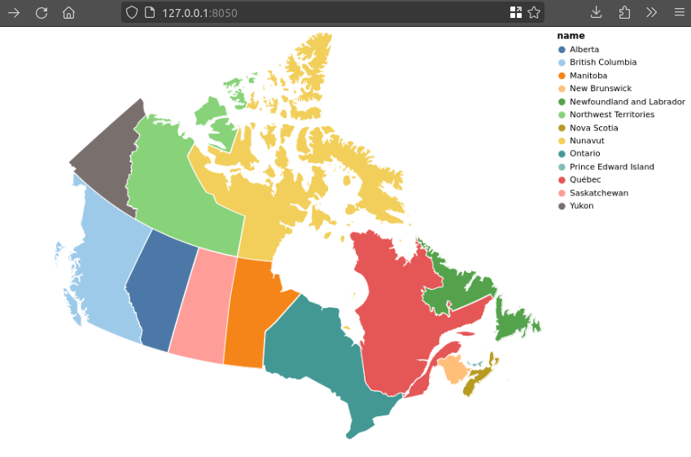
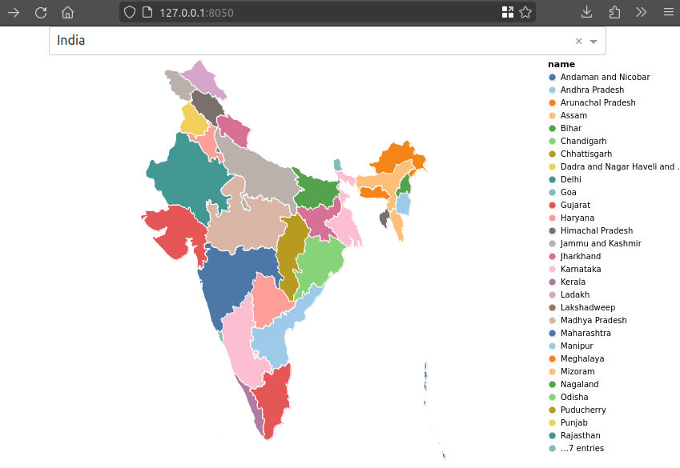
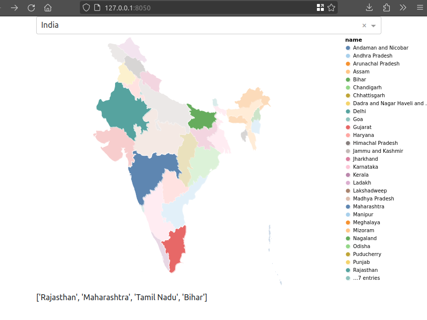

---
resources:
  - data/geospatial-world-countries.geojson
  - data/geospatial-world-regions.geojson
  - data/geospatial-canada-population-2021.csv
  - data/geospatial-us-election-2012.csv
  - data/geospatial-earthquakes.csv
  - data/plotly-world-gdp-2014.csv
  - data/plotly-us-exports-2011.csv
  - data/plotly-us-cities-2014.csv
  - data/plotly-geo/
  - data/geospatial-data.md
  - lecture-material/slides-geoviz.pdf
execute:
  message: false
  warning: false
knitr:
  opts_chunk:
    out.width: "100%"
    out.height: "400px"
---

# Geospatial {#sec-geospatial}



:::: {.slide-outcomes}
::: {.callout-note title="Learning outcomes & Chapter summary"}

1. **Recognize** GeoJSON features, geometries, and attributes, and find boundaries at an appropriate level of detail.
2. **Choose** a projection that supports the map's purpose and explain the distortions it introduces.
3. **Create** choropleths and point maps by joining geographic boundaries to other data.
4. **Evaluate** how region size, normalization, and color bins affect a map's interpretation.
5. **Link** map selections to other views and use maps in Dash applications and Plotly R widgets.

:::
::::

## Why bother?

A map makes geographic patterns visible: where observations occur, which regions
are similar, and how nearby places differ. But geographic position also constrains
the layout. A small region can be almost invisible even when its population or
contribution to a total is large. Choosing the boundaries, projection, and visual
encodings is therefore part of answering the question, not just decorating a chart.

We will combine the layout techniques from @sec-figure-composition with the
selections and linked views from @sec-interactivity. The examples use local
snapshots of the lecture's data; their dates and sources are documented in
[the data notes](data/geospatial-data.md).

The [original geospatial lecture slides](lecture-material/slides-geoviz.pdf)
provide additional projection and cartogram comparisons.

## GeoJSON: geometry alongside attributes

So far, most of our datasets have been tables of rows and columns. To represent
country boundaries, flight paths, or subway lines, we also need geometries.
[GeoJSON](https://geojson.org/) stores these geographic features in JSON.

A **Feature** has a `geometry` and a set of `properties`. For example, the
following deliberately simplified rectangle approximates Colorado's outline:

```json
{
  "type": "Feature",
  "properties": {"name": "Colorado"},
  "geometry": {
    "type": "Polygon",
    "coordinates": [
      [[-109.05, 37.00], [-109.05, 41.00], [-102.05, 41.00],
       [-102.05, 37.00], [-109.05, 37.00]]
    ]
  }
}
```

Coordinates are ordered **longitude, latitude**, in degrees. A polygon ring
closes by repeating its first coordinate. A `MultiPolygon` can represent a country
with islands, while points and lines represent locations and routes. A
`FeatureCollection` groups multiple features into one dataset.

The properties can contain anything we might otherwise put in a table: a name,
identifier, population, or link. We do not need to write the coordinates ourselves,
but recognizing this structure helps us inspect a downloaded file. See
[Tom MacWright's GeoJSON primer](https://macwright.org/2015/03/23/geojson-second-bite)
for more detail.

### Finding boundaries and choosing detail

[Natural Earth](https://www.naturalearthdata.com/downloads/) provides geographic
data at several scales:

- **Cultural** data includes countries, administrative regions, and populated places.
- **Physical** data includes coastlines, rivers, and lakes.
- **Admin 0** represents countries; **Admin 1** represents states and provinces.
- **1:110 million** is useful for an overview of the world. **1:50 million** and
  **1:10 million** provide more detail for regional maps.

Here, `m` means *million* in the map scale, not meters of positional accuracy.
More detail means larger files and slower drawing. Zooming into an overview map
does not recover coastline detail that was omitted from its data.

Natural Earth's download archives contain shapefiles, rather than GeoJSON.
GeoPandas can read both formats. These are direct download URLs for the two
archives used to prepare our local GeoJSON files:

```text
https://naciscdn.org/naturalearth/110m/cultural/ne_110m_admin_0_countries.zip
https://naciscdn.org/naturalearth/50m/cultural/ne_50m_admin_1_states_provinces.zip
```

If a website's download button uses a redirect, the browser's Network tab can
help identify the actual file URL. For detailed local work, also look for data
from the relevant national or regional mapping agency.

## Working with geographic data in GeoPandas

**GeoPandas** extends pandas with geometry types and spatial operations.
`read_file()` reads a local file or a supported URL, including zipped shapefiles.
Here we use a local snapshot, so rendering does not require downloading boundaries.

```{python}
#| label: geospatial-read-countries
import altair as alt
import geopandas as gpd
import pandas as pd

world_countries = gpd.read_file('data/geospatial-world-countries.geojson')
world_countries.head()
```

The `geometry` column contains the country outlines. The local file keeps a
subset of Natural Earth's attributes. We lowercase their names, calculate an
approximate GDP per person, and remove Antarctica for the following comparisons.
`GDP_MD` is GDP in millions of US dollars, so we multiply by one million before
dividing by population.

```{python}
#| label: geospatial-country-attributes
world_countries = world_countries.rename(
    columns=lambda name: name.lower()
).assign(
    gdp_per_capita=lambda frame: frame['gdp_md'] * 1e6 / frame['pop_est']
).query('continent != "Antarctica"')
world_countries[['name', 'continent', 'pop_est', 'pop_year', 'gdp_year']].head()
```

These attributes are historical estimates, not current statistics. Their
reference years can differ; inspect `pop_year` and `gdp_year` before making a
substantive comparison.

### Quick static and interactive views

GeoPandas has a convenient `plot()` method for an initial look at the geometries.

```{python}
#| label: geospatial-geopandas-plot
import matplotlib.pyplot as plt

world_countries.plot(figsize=(9, 4))
plt.show()
```

Its `explore()` method creates a Leaflet map with panning, zooming, and tooltips.
This uses Folium, Matplotlib, and mapclassify, which are included in the textbook's
Python environment. The OpenStreetMap background tiles require a network connection.

```{python}
#| label: geospatial-geopandas-explore
world_countries.explore(
    tiles='OpenStreetMap',
    tooltip=['name', 'continent'],
    popup=False,
    height=400
)
```

Zoom in and compare the background tiles with the country outlines. The tiles
can show finer detail than our 1:110 million boundaries. Changing the zoom level
changes the view; it does not change the resolution of the overlaid polygons.

## Drawing maps with Altair

Altair accepts a GeoDataFrame directly. `mark_geoshape()` draws its geometries,
and the usual encoding channels map attributes to color, tooltips, and so on.

```{python}
#| label: geospatial-world-outline-alt
alt.Chart(world_countries, width=550).mark_geoshape()
```

### Choosing a projection

A **projection** turns positions on the curved Earth into positions on a flat
page. Every flat map distorts something: area, shape, distance, or direction.

Altair's default geographic projection is **Equal Earth**, which preserves
relative areas. Web maps commonly use **Web Mercator**, which greatly enlarges
high-latitude regions. Africa is about 14 times Greenland's area, despite how
similar their sizes can appear on a Mercator world map.

Compare the same data under the two projections:

```{python}
#| label: geospatial-projection-comparison-alt
projection_map = alt.Chart(world_countries, width=260, height=200).mark_geoshape(
    fill='lightgray', stroke='white', strokeWidth=0.3
)
projection_map.project('equalEarth').properties(title='Equal Earth') | \
    projection_map.project('mercator').properties(title='Mercator')
```

Equal-area projections support comparisons of geographic extent. Conformal
projections preserve local angles and shapes, which can be useful for navigation
or local detail. Choose a projection for the task and region, and use the same
one for maps that readers need to compare.

The coordinates in our GeoJSON use longitude and latitude in WGS84
(`EPSG:4326`). This coordinate reference system describes the data; Altair's
`project()` controls how it is displayed. Changing the display projection does
not change the underlying measurements. In GeoPandas, `to_crs()` actually
transforms coordinates; assigning a CRS merely declares what existing
coordinates mean.

### Encoding country attributes

The grammar of graphics still applies. A nominal variable such as continent
gets a categorical color scale, and the country name can appear in a tooltip.

```{python}
#| label: geospatial-continents-alt
alt.Chart(world_countries, width=500).mark_geoshape().encode(
    color=alt.Color('continent:N').title('Continent'),
    tooltip='name:N'
)
```

A **choropleth** fills geographic regions according to an attribute. Here we
start with total population, then replace the color encoding with GDP per person.

```{python}
#| label: geospatial-world-population-alt
country_map = alt.Chart(world_countries, width=500).mark_geoshape().encode(
    color=alt.Color('pop_est:Q').title('Population estimate'),
    tooltip=['name:N', alt.Tooltip('pop_est:Q', format=',')]
)
country_map
```

```{python}
#| label: geospatial-world-gdp-alt
country_map.encode(
    color=alt.Color('gdp_per_capita:Q').title('GDP per person (US$)'),
    tooltip=['name:N', alt.Tooltip('gdp_per_capita:Q', format=',.0f')]
)
```

For ordered categories, use an ordinal encoding. Natural Earth's labels include
an ordering number, so the default label order is meaningful here.

```{python}
#| label: geospatial-economy-alt
country_map.encode(
    color=alt.Color('economy:O').title('Economy group'),
    tooltip=['name:N', 'economy:O']
)
```

```{python}
#| label: geospatial-income-alt
country_map.encode(
    color=alt.Color('income_grp:O').title('Income group'),
    tooltip=['name:N', 'income_grp:O']
)
```

### Focusing on a region

Filtering to a continent lets Altair fit the projection to the remaining
geometries. It is different from cropping a world map to a rectangular window.

```{python}
#| label: geospatial-africa-alt
africa = alt.Chart(
    world_countries.query('continent == "Africa"'), width=450, height=420
).mark_geoshape().encode(
    color=alt.Color('pop_est:Q').title('Population estimate'),
    tooltip=['name:N', alt.Tooltip('pop_est:Q', format=',')]
)
africa
```

Adding a stroke makes adjacent boundaries easier to see, especially when their
fill colors are similar.

```{python}
#| label: geospatial-africa-boundaries-alt
africa.mark_geoshape(stroke='gray', strokeWidth=0.5)
```

## States, provinces, and territories

Filtering country polygons does not reveal administrative boundaries that are
absent from the file. This view of Canada and the United States still has only
country outlines:

```{python}
#| label: geospatial-north-america-alt
alt.Chart(
    world_countries.query('name.isin(["Canada", "United States of America"])'),
    width=550
).mark_geoshape(stroke='white')
```

To show states and provinces, load Admin 1 data instead. Natural Earth's
1:50 million Admin 1 dataset covers selected countries; it is not a complete
set of subdivisions for every country in the world.

```{python}
#| label: geospatial-read-regions
world_regions = gpd.read_file('data/geospatial-world-regions.geojson')
world_regions[['name', 'admin', 'iso_a2']].head()
```

```{python}
#| label: geospatial-regional-boundaries-alt
alt.Chart(world_regions, width=500).mark_geoshape(stroke='white', strokeWidth=0.3).encode(
    color=alt.Color('admin:N').title('Country'),
    tooltip=['admin:N', 'name:N']
)
```

### A map of Canada

Select Canada's provinces and territories using the country code. The dataset
includes names, representative point coordinates, and Wikipedia links as well
as boundaries.

```{python}
#| label: geospatial-canada-regions
canadian_provinces = world_regions.query('iso_a2 == "CA"').copy()
canadian_provinces[['name', 'postal', 'latitude', 'longitude']]
```

This rotated transverse Mercator view is one option for displaying Canada.
Canada also uses Lambert conformal conic and regional UTM coordinate systems;
there is no single projection that is best for every Canadian map. The display
below is an illustration, not a specification of an official UTM zone.

```{python}
#| label: geospatial-canada-links-alt
canada_map = alt.Chart(canadian_provinces, width=500, height=420).mark_geoshape(
    stroke='white'
).project('transverseMercator', rotate=[90, 0, 0])
canada_map.encode(
    color=alt.Color('name:N').scale(scheme='tableau20').title('Province or territory'),
    tooltip='name:N',
    href='wikipedia:N'
)
```

The palette has enough distinct colors for these 13 regions. The `href` channel
makes a region a link; clicking it opens its Wikipedia page.

### Joining population data

The administrative boundaries do not include the population counts we want.
We need to join a separate table. The lecture obtained its 2021 census counts
from a [Wikipedia table](https://en.wikipedia.org/wiki/Population_of_Canada_by_province_and_territory).
We use that saved table rather than scraping the website every time the chapter renders.

```{python}
#| label: geospatial-canada-populations
province_populations = pd.read_csv('data/geospatial-canada-population-2021.csv')
province_populations
```

For a new dataset, `pd.read_html(url)` can retrieve the HTML tables on a webpage:

```{python}
#| eval: false
tables = pd.read_html(
    'https://en.wikipedia.org/wiki/Population_of_Canada_by_province_and_territory'
)
tables[0].head()
```

This requires a pandas HTML parser such as `lxml`. Inspect the result before
selecting a table or column: page layouts and multi-level headers change.
Prefer a downloadable statistical table when one is available, and keep its
reference date. Also check join keys: for example, `Quebec` and `Québec` do not
match unless we explicitly reconcile them.

```{python}
#| label: geospatial-canada-population-join
canadian_provinces = canadian_provinces.merge(
    province_populations, on='name', how='left', validate='one_to_one'
)
assert len(canadian_provinces) == 13
assert canadian_provinces['population'].notna().all()
canadian_provinces[['name', 'population']]
```

A left join keeps every boundary so that an unmatched region is detectable.
An inner join can silently remove a region whose name differs between sources.

## Choropleths and their pitfalls

We can now color the regions by population. Rebuild the base chart using the
joined GeoDataFrame so that its new column is available to the encoding.

```{python}
#| label: geospatial-canada-population-alt
canada_population_map = alt.Chart(
    canadian_provinces, width=500, height=420
).mark_geoshape(stroke='gray').project('transverseMercator', rotate=[90, 0, 0]).encode(
    color=alt.Color('population:Q').title('Population, 2021'),
    tooltip=['name:N', alt.Tooltip('population:Q', format=',')]
)
canada_population_map
```

Always check whether the result makes sense. For these data, Ontario has the
largest population, followed by Québec. The northern territories are large on
the map but have small populations. A [reference map on Wikimedia Commons](https://commons.wikimedia.org/wiki/File:Canada_provinces_and_territories_by_population.svg)
offers another visual check, provided we account for differences in data dates.

### Binning color

We can bin the color scale, as we did with histograms. This can make a map with
many small regions easier to scan, but it hides differences within bins and
creates abrupt changes at bin boundaries. Close values can fall into different
bins, while more distant values can share a color.

```{python}
#| label: geospatial-canada-binned-alt
canada_population_map.encode(
    color=alt.Color('population:Q').bin(maxbins=5).title('Population, 2021')
)
```

Compare this with the continuous scale. Changing the bin boundaries changes
which differences look important, even though the data have not changed.

### Highlighting boundaries on hover

Selections from @sec-interactivity work with geographic marks too. Here, hovering
adds a white outline and draws that region last, keeping its outline visible.
We retain a legend so the color scale remains interpretable without a tooltip.

```{python}
#| label: geospatial-canada-hover-alt
province_hover = alt.selection_point(
    name='province_hover', fields=['name'], on='pointerover', clear='pointerout', empty=False
)
canada_population_map.mark_geoshape(strokeWidth=2).encode(
    color=alt.Color('population:Q').scale(scheme='tealblues').title('Population, 2021'),
    stroke=alt.condition(province_hover, alt.value('white'), alt.value('#222222')),
    order=alt.condition(province_hover, alt.value(1), alt.value(0))
).add_params(province_hover)
```

### What does the map's area imply?

A choropleth gives each region visual space according to its geographic area,
not its population or contribution to a total. A small, densely populated region
can be hard to see; a large, sparsely populated one can dominate the page.

- Use **rates, proportions, or densities** when the question is about intensity
  rather than totals. Population and population density answer different questions.
- Use a **sequential scale** for ordered quantities, and show missing observations
  distinctly from genuine zeros.
- Consider **smaller geographic units** when their boundaries and data support
  the question. Aggregation can conceal substantial variation within a region.
- Add **proportional symbols** or a **bar chart** when readers need to compare totals.
- A **cartogram** resizes or rearranges regions according to a quantity, trading
  some geographic familiarity for a more relevant allocation of space.

Even an equal-area projection cannot make geographic area stand in for population.
Changing the projection and changing the statistical encoding solve different problems.

## The United States: projections and electoral votes

### Separated regions and composite projections

Alaska and Hawaii are far from the contiguous United States. A single fitted
world projection leaves a lot of space between them.

```{python}
#| label: geospatial-us-regions
us_states = world_regions.query('iso_a2 == "US"').copy()
alt.Chart(us_states, width=550).mark_geoshape(stroke='white')
```

`albersUsa` is a composite projection with repositioned insets for Alaska and
Hawaii. It makes a compact overview, but inset positions and scales are not
literal geographic relationships.

```{python}
#| label: geospatial-us-albers-alt
alt.Chart(us_states, width=550).mark_geoshape(stroke='white').project('albersUsa')
```

### Joining election results

The lecture used the 2012 presidential election to compare a winner-by-state
map with electoral votes. Our local table combines the state winners and the
electoral-vote allocations used in 2012. These are electoral votes, not popular votes.

```{python}
#| label: geospatial-election-data
election_results = pd.read_csv('data/geospatial-us-election-2012.csv')
us_states = us_states.merge(
    election_results, on='name', how='left', validate='one_to_one'
)
assert len(us_states) == 51
assert us_states['electoral_votes'].notna().all()
assert us_states['electoral_votes'].sum() == 538
us_states[['name', 'winning_party', 'electoral_votes']].head()
```

The 51 regions include the District of Columbia. Its name differs across
sources, so the saved table normalizes it explicitly rather than dropping it
during a join.

The original tables are available on Wikipedia's pages for the
[Electoral College](https://en.wikipedia.org/wiki/United_States_Electoral_College)
and [2012 US elections](https://en.wikipedia.org/wiki/2012_United_States_elections).
As with the Canadian population data, table positions and headers should be
inspected rather than assumed to remain unchanged.

```{python}
#| label: geospatial-election-winners-alt
party_color = alt.Color('winning_party:N').scale(
    domain=['Dem', 'Rep'], range=['#4c78a8', '#e45756']
).title('Winning party')
election_map = alt.Chart(us_states, width=550).mark_geoshape(
    stroke='white'
).project('albersUsa').encode(
    color=party_color,
    tooltip=['name:N', 'winning_party:N']
)
election_map
```

This shows which party won each state, but not how much each state contributed
to the result. Adding opacity for electoral votes provides another encoding,
yet small states are still difficult to compare.

```{python}
#| label: geospatial-election-opacity-alt
election_map.encode(
    opacity=alt.Opacity('electoral_votes:Q').title('Electoral votes'),
    tooltip=['name:N', 'winning_party:N', 'electoral_votes:Q']
)
```

### Points instead of regions

Proportional symbols allocate visible size according to a quantity rather than
land area. First, overlay neutral circles on the party-colored regions:

```{python}
#| label: geospatial-election-neutral-points-alt
electoral_points = alt.Chart(us_states).mark_circle(stroke='black').encode(
    longitude='longitude:Q', latitude='latitude:Q',
    color=alt.value('white'),
    size=alt.Size('electoral_votes:Q').scale(range=[20, 1500]).title('Electoral votes'),
    tooltip=['name:N', 'winning_party:N', 'electoral_votes:Q']
)
election_map + electoral_points
```

Alternatively, keep the geographic background neutral and color the circles.
Now size and color describe the same marks. Altair's `size` encodes symbol area,
not radius.

```{python}
#| label: geospatial-election-colored-points-alt
state_background = alt.Chart(us_states).mark_geoshape(
    fill='lightgray', stroke='white'
)
party_points = electoral_points.mark_circle(stroke='white', strokeWidth=0.5).encode(
    color=party_color
)
map_points = (state_background + party_points).project('albersUsa').properties(width=550)
map_points
```

The supplied longitude and latitude locate representative points for each region;
they are not the locations of individual voters. If a dataset lacks such points,
Altair's [`geoCentroid` expression](https://altair-viz.github.io/user_guide/marks/geoshape.html#mapping-points)
can calculate a geographic centroid. Check the result: a centroid need not fall
inside an irregular or multipart region. Dense clusters of small regions can
also cause symbols to overlap.

### Linking a map and a bar chart

Use the region name as a shared selection key. Hover over a circle to highlight
the corresponding state in both views; clearing the hover restores all states.

```{python}
#| label: geospatial-election-hover-alt
state_hover = alt.selection_point(
    name='state_hover', fields=['name'], on='pointerover', clear='pointerout'
)
selected_points = party_points.encode(
    opacity=alt.condition(state_hover, alt.value(0.9), alt.value(0.2))
).add_params(state_hover)
map_with_selection = (state_background + selected_points).project(
    'albersUsa'
).properties(width=480)
map_with_selection
```

The bar chart makes individual values easier to compare. It has one column per
party, with independently ordered state names but a shared quantitative x-scale.

```{python}
#| label: geospatial-election-linked-bars-alt
bars = alt.Chart(pd.DataFrame(us_states.drop(columns='geometry')), width=200).mark_bar().encode(
    x=alt.X('electoral_votes:Q').title('Electoral votes'),
    y=alt.Y('name:N').sort('-x').title(None),
    color=party_color,
    opacity=alt.condition(state_hover, alt.value(0.9), alt.value(0.2)),
    column=alt.Column('winning_party:N').title(None)
).resolve_scale(y='independent')
map_with_selection & bars
```

For a direct comparison of the party totals, sum the electoral votes rather than
judging colored land area or the number of states won:

```{python}
#| label: geospatial-electoral-totals
us_states.groupby('winning_party')['electoral_votes'].sum()
```

The totals are 332 for the Democratic candidate and 206 for the Republican
candidate. Neither a winner-by-state map nor this electoral-vote table tells us
the popular-vote margin within each state.

## Further exploration: a rotating earthquake globe

An orthographic projection looks like a globe. This example combines a sphere,
country polygons, and earthquake locations. A slider rotates all layers together;
circle size encodes magnitude and fill encodes depth in kilometers.

The power scale is an illustrative visual choice, not a claim that circle area
is proportional to earthquake energy. The data are a historical USGS sample
distributed with Vega, not a live earthquake feed.

```{python}
#| label: geospatial-earthquake-globe-alt
earthquakes = pd.read_csv('data/geospatial-earthquakes.csv')
globe_rotation = alt.param(
    name='globe_rotation', value=120,
    bind=alt.binding_range(min=-180, max=180, step=5, name='Rotate longitude ')
)
quake_hover = alt.selection_point(
    name='quake_hover', on='pointerover', clear='pointerout', empty=False
)
sphere = alt.Chart(alt.sphere()).mark_geoshape(fill='aliceblue', stroke='black')
globe_countries = alt.Chart(world_countries).mark_geoshape(
    fill='mintcream', stroke='black', strokeWidth=0.35
)
quakes = alt.Chart(earthquakes).mark_circle(opacity=0.4).transform_filter(
    'cos(datum.latitude * PI / 180) * '
    'cos((datum.longitude + globe_rotation) * PI / 180) > 0'
).encode(
    longitude='longitude:Q', latitude='latitude:Q',
    size=alt.Size('magnitude:Q').scale(
        type='pow', exponent=4, domain=[0, 6], range=[1, 1000]
    ).title('Magnitude'),
    fill=alt.Fill('depth:Q').scale(scheme='lightorange', domain=[0, 400]).title('Depth (km)'),
    stroke=alt.value('black'),
    strokeWidth=alt.condition(quake_hover, alt.value(1), alt.value(0)),
    tooltip=['place:N', 'magnitude:Q', 'depth:Q']
).add_params(quake_hover)
alt.layer(sphere, globe_countries, quakes).project(
    type='orthographic', rotate=alt.expr('[globe_rotation, 0, 0]')
).add_params(globe_rotation).properties(width=450, height=450)
```

The filter removes points on the far hemisphere, including when rotation crosses
the date line. Merely projecting a point to an x/y position does not guarantee
that a circle mark will be clipped behind the globe.

## Maps in Dash

A map can be embedded in a Dash application just like another Altair figure.
`dash_vega_components.Vega` accepts a chart specification from `to_dict()`.
Changing a dropdown can rebuild that specification; selections inside a map can
send signals back to Python callbacks.

The following are **standalone app examples**. Save one as `app.py` and run it
from the `textbook` directory so that its relative data path resolves:

```bash
uv run --with dash --with dash-bootstrap-components --with dash-vega-components python app.py
```

These additional packages are needed for the apps. The code is displayed without
starting a web server during a book render.

### Embedding a map

```{python}
#| eval: false
import altair as alt
import dash_bootstrap_components as dbc
import dash_vega_components as dvc
from dash import Dash
import geopandas as gpd

canadian_provinces = gpd.read_file('data/geospatial-world-regions.geojson').query('iso_a2 == "CA"')
chart = alt.Chart(canadian_provinces, width=500, height=420).mark_geoshape(
    stroke='white'
).project('transverseMercator', rotate=[90, 0, 0]).encode(
    tooltip='name:N',
    color=alt.Color('name:N').scale(scheme='tableau20'),
    href='wikipedia:N'
)
app = Dash(__name__, external_stylesheets=[dbc.themes.BOOTSTRAP])
app.layout = dbc.Container([dvc.Vega(spec=chart.to_dict())])

if __name__ == '__main__':
    app.run(debug=True)
```

{fig-alt="A Dash application showing Canadian provinces and territories in distinct colors."}

### Choosing the country with a dropdown

The dropdown lists only countries represented in our boundary dataset. A
callback filters the GeoDataFrame and returns a new map specification.

```{python}
#| eval: false
import altair as alt
import dash_bootstrap_components as dbc
import dash_vega_components as dvc
from dash import Dash, Input, Output, callback, dcc
import geopandas as gpd

world_regions = gpd.read_file('data/geospatial-world-regions.geojson')
app = Dash(__name__, external_stylesheets=[dbc.themes.BOOTSTRAP])
app.layout = dbc.Container([
    dcc.Dropdown(id='country', value='India', options=sorted(world_regions['admin'].unique())),
    dvc.Vega(id='map', spec={})
])

@callback(Output('map', 'spec'), Input('country', 'value'))
def create_map(country):
    regions = world_regions.loc[world_regions['admin'] == country]
    return alt.Chart(regions, width=500, height=420).mark_geoshape(stroke='white').encode(
        tooltip='name:N',
        color=alt.Color('name:N').scale(scheme='tableau20').legend(None)
    ).to_dict()

if __name__ == '__main__':
    app.run(debug=True)
```

For countries with more than 20 regions, this palette repeats colors; the tooltip
identifies each region. Use a different encoding if unique colors are essential.

{fig-alt="A country dropdown above a map of India's administrative regions."}

### Sending a map selection to a callback

Give the selection a stable name, add it to the chart, and list that name in
`signalsToObserve`. The component exposes signal changes through `signalData`,
which is an input to the second callback.

```{python}
#| eval: false
import altair as alt
import dash_bootstrap_components as dbc
import dash_vega_components as dvc
from dash import Dash, Input, Output, callback, dcc, html
import geopandas as gpd

world_regions = gpd.read_file('data/geospatial-world-regions.geojson')
app = Dash(__name__, external_stylesheets=[dbc.themes.BOOTSTRAP])
app.layout = dbc.Container([
    dcc.Dropdown(id='country', value='India', options=sorted(world_regions['admin'].unique())),
    dvc.Vega(id='map', spec={}, signalsToObserve=['select_region']),
    html.Div(id='chart-selection')
])

@callback(Output('map', 'spec'), Input('country', 'value'))
def create_map(country):
    select_region = alt.selection_point(name='select_region', fields=['name'])
    regions = world_regions.loc[world_regions['admin'] == country]
    return alt.Chart(regions, width=500, height=420).mark_geoshape(stroke='white').encode(
        tooltip='name:N',
        color=alt.Color('name:N').scale(scheme='tableau20').legend(None),
        opacity=alt.condition(select_region, alt.value(0.9), alt.value(0.3))
    ).add_params(select_region).to_dict()

@callback(Output('chart-selection', 'children'), Input('map', 'signalData'))
def show_selection(signal_data):
    selection = (signal_data or {}).get('select_region') or {}
    names = selection.get('name', [])
    return ', '.join(names) if names else 'Click a region on the map.'

if __name__ == '__main__':
    app.run(debug=True)
```

{fig-alt="A selected administrative region of India highlighted on a map, with its name displayed below."}

This callback runs in Python on the app's server. By contrast, the earlier
Altair hover and linked-bar interactions run in the browser and can be shared
as static HTML using @sec-figure-composition's export techniques.

## Geographic maps with Plotly in R

Plotly offers projected geographic maps with built-in navigation and tooltips.
They can be used in Shiny applications; the Python API has similar concepts.
Other R options include `geom_sf()` for static maps and Leaflet for tiled maps.

The following examples are live R HTML widgets. Plotly's geographic boundary
files are stored locally alongside the CSV snapshots, so drawing the maps does
not need to fetch geographic data from Plotly's CDN. Tiled maps, which use
background imagery such as OpenStreetMap, are a separate map type and may
require online resources.

### Country codes and a quantitative fill

Plotly includes world country boundaries and can match them to ISO three-letter
country codes. `~` refers to a column in the supplied dataframe.

```{r}
#| label: geospatial-plotly-gdp-data
library(plotly)

gdp <- read.csv('data/plotly-world-gdp-2014.csv')
head(gdp)
```

Start with a constant fill to see the matched countries:

```{r}
#| label: geospatial-plotly-world
plot_ly(gdp, type = 'choropleth', locations = ~CODE,
        z = rep(1, nrow(gdp)), showscale = FALSE) |>
    config(topojsonURL = 'data/plotly-geo/')
```

Map the numeric GDP column to `z` to color each region by its value. `read.csv()`
has converted the original `GDP (BILLIONS)` column label into `GDP..BILLIONS.`.

```{r}
#| label: geospatial-plotly-gdp
plot_ly(gdp, type = 'choropleth', locations = ~CODE, z = ~GDP..BILLIONS.) |>
    config(topojsonURL = 'data/plotly-geo/')
```

The default tooltip includes the code and value. Add country names, choose a
sequential palette, and state the units explicitly:

```{r}
#| label: geospatial-plotly-gdp-tooltip
plot_ly(gdp, type = 'choropleth', locations = ~CODE, z = ~GDP..BILLIONS.,
        text = ~COUNTRY, colorscale = 'Blues',
        hovertemplate = '%{text}<br>GDP: %{z:,.1f} billion US$<extra></extra>',
        colorbar = list(title = 'GDP, 2014<br>(billion US$)')) |>
    layout(geo = list(showland = TRUE, landcolor = '#eeeeee')) |>
    config(topojsonURL = 'data/plotly-geo/')
```

Other named palettes include `Greys`, `YlGnBu`, `Greens`, `YlOrRd`, `Reds`,
`Viridis`, and `Cividis`. Choose one that matches the kind of variable, as in
@sec-color. Gray land provides a background for regions without a matched value;
missing data should not be read as zero.

### State codes and a regional projection

For US states, use two-letter state codes and `locationmode = 'USA-states'`.
This historical dataset reports agricultural exports in 2011, in millions of US dollars.

```{r}
#| label: geospatial-plotly-exports-data
exports <- read.csv('data/plotly-us-exports-2011.csv')
head(exports)
```

```{r}
#| label: geospatial-plotly-exports-world
exports_map <- plot_ly(
    exports, type = 'choropleth', locationmode = 'USA-states',
    locations = ~code, z = ~total.exports, text = ~state,
    colorscale = 'Purples',
    colorbar = list(title = 'Exports<br>(million US$)'),
    hovertemplate = '%{text}<br>Exports: %{z:,.1f} million US$<extra></extra>'
)
exports_map |> config(topojsonURL = 'data/plotly-geo/')
```

Set the geographic scope and projection to focus on the United States:

```{r}
#| label: geospatial-plotly-exports-usa
exports_map |>
    layout(geo = list(scope = 'usa', projection = list(type = 'albers usa')),
           title = 'US agricultural exports, 2011') |>
    config(topojsonURL = 'data/plotly-geo/')
```

### Click selection and application events

`clickmode = 'event+select'` enables selection while also emitting click events.
Selection is visible in the standalone widget; a server-side application needs
to listen to those events before it can update other views. In Shiny, this is
typically done with `event_data('plotly_click')` or `event_data('plotly_selected')`.

```{r}
#| label: geospatial-plotly-exports-selection
exports_map |>
    layout(geo = list(scope = 'usa', projection = list(type = 'albers usa')),
           title = 'Click a state to select it', clickmode = 'event+select') |>
    config(topojsonURL = 'data/plotly-geo/')
```

See the [Plotly click-mode reference](https://plotly.com/r/reference/layout/#layout-clickmode)
for the available event and selection modes.

### Point maps

For geographic points, use `plot_geo()` and `add_markers()`. In this R wrapper,
pass longitude as `x` and latitude as `y`; `plot_geo()` translates them into
geographic coordinates rather than ordinary Cartesian scales. Here circle area
represents the population in a historical US city dataset.

```{r}
#| label: geospatial-plotly-cities
cities <- read.csv('data/plotly-us-cities-2014.csv')
plot_geo(cities, sizes = c(5, 80)) |>
    add_markers(x = ~lon, y = ~lat, size = ~pop, text = ~name,
                hoverinfo = 'text', marker = list(sizemode = 'area', opacity = 0.6)) |>
    layout(geo = list(scope = 'usa', projection = list(type = 'albers usa'))) |>
    config(topojsonURL = 'data/plotly-geo/')
```

For boundaries beyond Plotly's built-in country and US-state maps, supply a
custom GeoJSON and an explicit feature identifier. The
[R choropleth documentation](https://plotly.com/r/choropleth-maps/) describes
this workflow. As with our GeoPandas joins, verify that every intended feature
has a matching data key.

## Further reading

- [Fundamentals of Data Visualization: visualizing geospatial data](https://clauswilke.com/dataviz/geospatial-data.html).
- [Altair: geoshape marks and mapping points](https://altair-viz.github.io/user_guide/marks/geoshape.html).
- [GeoPandas: interactive mapping](https://geopandas.org/en/stable/docs/user_guide/interactive_mapping.html).
- [Plotly for R: maps](https://plotly-r.com/maps.html).
- [Dash Leaflet: GeoJSON layers](https://www.dash-leaflet.com/docs/geojson).
- [Natural Earth downloads](https://www.naturalearthdata.com/downloads/) and [local data provenance](data/geospatial-data.md).
