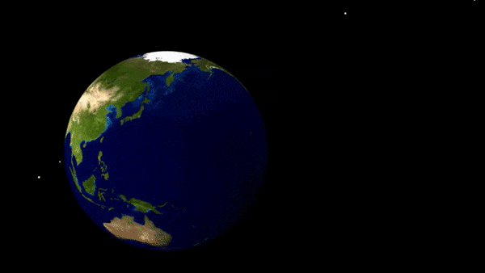

# Geospatial {#sec-geospatial}



:::: {.slide-outcomes}
::: {.callout-note title="Learning outcomes & Chapter summary"}

1. **Recognize** GeoJSON features, geometries, and attributes,
   and find boundaries at an appropriate level of detail.
2. **Choose** a projection that supports the map's purpose and explain the distortions it introduces.
3. **Create** choropleths and point maps by joining geographic boundaries to other data.
4. **Evaluate** how region size, normalization, and color bins affect a map's interpretation.
5. **Add** geographic tooltips and **link** map selections to other views.

:::
::::

## Why bother?

Similar to how categorical variables can have a natural order
or a natural mapping to certain colors,
[geographical data has a natural spatial layout
that makes it easier to identify and recognize regions.]{.slide-bullet}
[Visualizing geogrphical data as a map makes such geographic patterns visible,
e.g. where observations occur, which regions are similar, and how nearby places differ.]{.slide-bullet}

## Choosing a projection {#map-projections}

[A map must turn positions on the curved Earth into positions on a flat page.
This transformation is called a **projection**.]{.slide-bullet}
Since a projection flattens a 3D space into 2D,
[it necessarily distorts some combination of area, shape, distance, and direction.]{.slide-bullet}
Therefore there are many projections to choose from for different purposes,
but what is a reasonable default choice?
Let's find out in the next exercise.

::: {.callout-default .ex-prompt}

## Africa or Greenland? {.content-visible when-format="revealjs"}

This image below shows the world map with its most commonly used map project,
Mercator,
which was introduced in 1569 mainly for use in navigation,.
[Study this image and try to estimate which land region is largest,
Africa or Greenland?]{.slide-bullet}

:::: {.slide-visual}

.](img/geospatial-lecture/mercator-world.png){#fig-map-mercator width=70% fig-alt="A rectangular Mercator world map."}

::::

:::: {.callout-default .ex-hint}

## Why flattening changes area {.content-visible when-format="revealjs"}

[Mercator's projection
preserves local angles and shapes which is useful for navigation,
but greatly enlarges areas at high latitudes.]{.slide-bullet}
The animation below gives an intuition for 
where this issue stems from.
Opening the globe into strips leaves gaps.
Filling those gaps make a continuous rectangle as for the Mercator projection
to preserve angles and shapes
requires stretching parts of the surface,
which distorts the area of each surface
paritcularly closer to the poles where the gaps are bigger.

::::: {.slide-visual}

{#fig-map-projection-animation width=85% fig-alt="An animation opens a globe into curved strips, flattens them, and stretches them to fill a rectangular world map."}

:::::

::::: {.callout-default .ex-solution}

## Compare with an equal-area map {.content-visible when-format="revealjs"}

The familiar Mercator world map Greenland look comparable in size to Africa.
However,
[the area of Africa is actually about **14 times larger**.]{.slide-bullet}
The Mercator map is useful for navigation
but the distorted areas on this map
do not provide a reliable basis for estimating areas and distances
which is arguably a more common use case when showing maps today.
The Equal Earth projection shown below
was introduced in 2018
in an attempt to preserve relative areas
It has since slowly been replacing the Mercator projection
as the default choice for showing maps and visualizing geographic data
(unless a specific purpose calls for a specific projection).

:::::: {.slide-visual}

.](img/geospatial-lecture/equal-earth-world.png){#fig-map-equal-earth fig-alt="An Equal Earth projection of the same world imagery, showing Africa much larger than Greenland and less exaggerated polar regions."}

::::::

:::::

::::

:::

Note that the choice of projection
also depends on the region being shown.
A projection designed for a limited region
suffer less from the issues of distortion
and different regions often have different choices for their default projection.
For example,
in Canada both the transverse Mercator and Lambert conformal conic projections
are commonly used.
Special projections can also be used
for countries with regions spread far apart,
such as the US,
which is often shown with Alaska and Hawaii
repositioned closed to the rest of the American states.
In general,
we want to use a projection designed for the place and purpose,
and keep it consistent across maps that readers need to compare.

## Geographic data and file formats

So far, most of our datasets have been tables of rows and columns. To represent
country boundaries, flight paths, or subway lines, we also need geometries.
[**Geometry** describes where a feature is and what shape it has; **attributes**
describe what we know about it, such as its name, population, or category.]{.slide-bullet}

There are two broad ways to represent spatial data:

- [**Vector data** describe features using points, lines, and polygons.]{.slide-bullet} These
  are the main focus of this chapter: country boundaries, administrative
  regions, and locations for symbols.
- [**Raster data** describe a grid of cells, such as satellite imagery or an
  elevation surface.]{.slide-bullet} Formats such as GeoTIFF store georeferencing alongside
  raster values. A screenshot of a map is an image, but does not by itself
  supply the feature geometries and attributes needed for our data joins.

Geographical data comes in many different file formats,
each specialized for slightly different purposes.
Here,
we are going to use GeoJSON as an example,
but in the deep dive below,
you can read more about different formats.

::: {.deep-dive}

| Format | Typical files | What to recognize |
|:--|:--|:--|
| **Shapefile** | `.shp`, `.shx`, `.dbf`, often `.prj` and other sidecars | An older, widely supported vector format. Geometry, attributes, indexes, and CRS information are split across files, usually delivered together in a ZIP archive. Keep the component files together. |
| **GeoJSON** | `.geojson` or `.json` | JSON containing geometries and attributes. Convenient for inspecting data and exchanging features with web-mapping libraries. Standard GeoJSON uses WGS84 longitude/latitude coordinates. |
| **GeoPackage** | `.gpkg` | A single SQLite-based file that can contain multiple spatial layers, their attributes, and CRS information. Common in GIS workflows. |
| **GeoParquet** | `.parquet` | Columnar storage with geometry and spatial metadata, useful for larger analytical datasets. A regular Parquet file is not automatically GeoParquet. |
| **TopoJSON** | `.topojson` or `.json` | A topology-based JSON format that can share boundary segments between neighboring regions. Common in web maps; its structure differs from GeoJSON. |

:::

[GeoJSON](https://geojson.org/) makes the geometry–attribute relationship easy
to inspect because it stores geographic features in readable JSON. We use it
for the prepared boundary files in this chapter, but the mapping principles
also apply to data read from other formats.

::: {.slide-visual slide-title="Geometry and properties in GeoJSON"}

A **Feature** has a `geometry` and a set of `properties`. For example, the
following deliberately simplified rectangle approximates Colorado's outline:

```json
{
  "type": "Feature",
  "properties": {"name": "Colorado"},
  "geometry": {
    "type": "Polygon",
    "coordinates": [
      [[-109.05, 37.00], [-109.05, 41.00], [-102.05, 41.00],
       [-102.05, 37.00], [-109.05, 37.00]]
    ]
  }
}
```

:::

Coordinates are ordered **longitude, latitude**, in degrees. A polygon ring
closes by repeating its first coordinate. A `MultiPolygon` can represent a country
with islands, while points and lines represent locations and routes. A
`FeatureCollection` groups multiple features into one dataset.

The properties can contain anything we might otherwise put in a table: a name,
identifier, population, or link. We do not need to write the coordinates ourselves,
but recognizing this structure helps us inspect a downloaded file. See
[Tom MacWright's GeoJSON primer](https://macwright.org/2015/03/23/geojson-second-bite)
for more detail.

### Finding boundary data and choosing detail {.slide-skip}

A helpful website for finding data with geographical boundaries is
[Natural Earth](https://www.naturalearthdata.com/downloads/),
which provides different file format
at different scales and for different boundary representations:

- **Cultural** data includes countries, administrative regions, and populated places.
- **Physical** data includes coastlines, rivers, and lakes.
- **Admin 0** represents countries; **Admin 1** represents states and provinces.
- **1:110 million** is useful for an overview of the world. **1:50 million** and
  **1:10 million** provide more detail for regional maps.

## Working with geographic data

Each paired example offers **Altair** and **ggplot** tabs. The R examples read
spatial data with `sf`, draw maps with `geom_sf()`, and use `ggplotly()` to add
interactivity. The language choice is synchronized within the chapter.

::: {.panel-tabset group="language"}

### Altair {.slide-skip}

For Altair,
we use the package GeoPandas,
which can read many different geo data files into a **GeoDataFrame**,
holding attributes and geometries for the different regions.
GeoPandas extends pandas with geometry types and spatial operations.

```{python}
#| label: geospatial-read-countries
#| slide-show: code
import altair as alt
import geopandas as gpd
import pandas as pd

world_countries = gpd.read_file('data/geospatial-world-countries.geojson')
world_countries.head()
```

The `geometry` column contains the country outlines. The local file keeps a
subset of Natural Earth's attributes. We lowercase their names, calculate an
approximate GDP per person, and remove Antarctica for the following comparisons.
`GDP_MD` is GDP in millions of US dollars, so we multiply by one million before
dividing by population.

```{python}
#| label: geospatial-country-attributes
world_countries = world_countries.rename(
    columns=lambda name: name.lower()
).assign(
    gdp_per_capita=lambda frame: frame['gdp_md'] * 1e6 / frame['pop_est']
).query('continent != "Antarctica"')
world_countries[['name', 'continent', 'pop_est', 'pop_year', 'gdp_year']].head()
```

Note that these attributes are historical estimates and their
reference years can differ somehow.
You can inspect `pop_year` and `gdp_year`
for the exact collection year of each attribute.

#### Quick static and interactive views {.slide-skip}

GeoPandas has a convenient `plot()` method for an initial look at the geometries.

```{python}
#| label: geospatial-geopandas-plot
import matplotlib.pyplot as plt

world_countries.plot(figsize=(9, 4))
plt.show()
```

Its `explore()` method creates a Leaflet map with panning, zooming, and tooltips.
This uses Folium, Matplotlib, and mapclassify, which are included in the textbook's
Python environment. The OpenStreetMap background tiles require a network connection.

```{python}
#| label: geospatial-geopandas-explore
world_countries.explore(
    tiles='OpenStreetMap',
    tooltip=['name', 'continent'],
    popup=False,
    height=400
)
```

Zoom in and compare the background tiles with the country outlines. The tiles
can show finer detail than our 1:110 million boundaries. Changing the zoom level
changes the view; it does not change the resolution of the overlaid polygons.

### ggplot {.slide-skip}

The **sf** package reads spatial data into a dataframe with a geometry column,
much like GeoPandas. We draw maps with `geom_sf()` and convert them with
`ggplotly()` to add tooltips, panning, and zooming.

```{r}
#| label: geospatial-read-countries-sf
#| slide-show: code
#| message: false
library(sf)
library(dplyr)
library(ggplot2)
# Only import the one function we will use to avoid cluttering the namespace
library(plotly, include.only = "ggplotly")

world_sf <- st_read('data/geospatial-world-countries.geojson')
head(world_sf)
```

```{r}
#| label: geospatial-country-attributes-sf
world_sf <- world_sf |>
    rename_with(tolower) |>
    mutate(gdp_per_capita = gdp_md * 1e6 / pop_est) |>
    dplyr::filter(continent != 'Antarctica')
world_sf |> select(name, continent, pop_est, pop_year, gdp_year) |> head()
```

The geometry stays attached during filtering and joins. In later plots, the
`label` aesthetic supplies names to the tooltip without drawing text.

:::

## Drawing geographic marks

::: {.panel-tabset group="language"}

### Altair {.slide-skip}

Altair accepts a GeoDataFrame directly.
`mark_geoshape()` draws its geometries,
and the usual encoding channels map attributes to color, tooltips, and so on.

```{python}
#| label: geospatial-world-outline-alt
#| slide-show: both
#| slide-title: Draw geographic shapes
alt.Chart(world_countries, width=550).mark_geoshape()
```

### ggplot {.slide-skip}

`geom_sf()` draws the geometry, and `coord_sf()` chooses the projection.
We use `text` to encode the tooltip
to avoid that it gets prefixed with the name of the dataframe column.

```{r}
#| label: geospatial-world-outline-sf
#| slide-show: both
#| slide-title: Draw geographic shapes
world_map_gg <- ggplot(world_sf, aes(text = name)) +
    geom_sf() +
    coord_sf(crs = '+proj=eqearth')
ggplotly(world_map_gg, tooltip = 'text')
```

:::

### Encoding country attributes

The grammar of graphics still applies. A nominal variable such as continent
gets a categorical color scale, and the country name can appear in a tooltip.

::: {.panel-tabset group="language"}

#### Altair {.slide-skip}

```{python}
#| label: geospatial-continents-alt
#| slide-show: both
#| slide-title: Encode a categorical attribute
alt.Chart(world_countries, width=500).mark_geoshape().encode(
    color=alt.Color('continent').title('Continent'),
    tooltip='name'
)
```

#### ggplot {.slide-skip}

Map the categorical variable directly to `fill`.

```{r}
#| label: geospatial-continents-sf
#| slide-show: both
#| slide-title: Encode a categorical attribute
ggplotly(world_map_gg + aes(fill = continent), tooltip = 'text')
```

:::

A **choropleth** fills geographic regions according to an attribute. Here we
start with total population, then replace the color encoding with GDP per person.

::: {.panel-tabset group="language"}

#### Altair {.slide-skip}

Showing total population.

```{python}
#| label: geospatial-world-population-alt
#| slide-show: both
#| slide-title: Color countries by population
country_map = alt.Chart(world_countries, width=500).mark_geoshape().encode(
    color=alt.Color('pop_est').title('Population estimate'),
    tooltip=['name', alt.Tooltip('pop_est', format=',')]
)
country_map
```

Here we show the GDP per capita.

```{python}
#| label: geospatial-world-gdp-alt
#| slide-show: both
#| slide-title: Color countries by GDP per person
country_map.encode(
    color=alt.Color('gdp_per_capita:Q').title('GDP per person (US$)'),
    tooltip=['name:N', alt.Tooltip('gdp_per_capita:Q', format=',.0f')]
)
```

#### ggplot {.slide-skip}

```{r}
#| label: geospatial-world-population-sf
#| slide-show: both
#| slide-title: Color countries by population
ggplotly(world_map_gg + aes(fill = pop_est), tooltip = 'text')
```

```{r}
#| label: geospatial-world-gdp-sf
#| slide-show: both
#| slide-title: Color countries by GDP per person
ggplotly(world_map_gg + aes(fill = gdp_per_capita), tooltip = 'text')
```

:::

For ordered categories, use an ordinal encoding. Natural Earth's labels include
an ordering number, so the default label order is meaningful here.

::: {.panel-tabset group="language"}

#### Altair {.slide-skip}

We encode the economy as an ordinal variable
since it has a natural order to it.

```{python}
#| label: geospatial-economy-alt
#| slide-show: both
#| slide-title: Encode ordered economy groups
country_map.encode(
    color=alt.Color('economy:O'),
    tooltip=['name', 'economy:O']
)
```

```{python}
#| label: geospatial-income-alt
#| slide-show: both
#| slide-title: Encode ordered income groups
country_map.encode(
    color=alt.Color('income_grp:O'),
    tooltip=['name:N', 'income_grp:O']
)
```

#### ggplot {.slide-skip}

Ordered factors give the sequential palette the intended category order.

```{r}
#| label: geospatial-economy-sf
#| slide-show: both
#| slide-title: Encode ordered economy groups
ggplotly(world_map_gg + aes(fill = factor(economy, ordered = TRUE)), tooltip = 'name')
```

```{r}
#| label: geospatial-income-sf
#| slide-show: both
#| slide-title: Encode ordered income groups
ggplotly(world_map_gg + aes(fill = factor(income_grp, ordered = TRUE)), tooltip = 'name')
```

:::

### Focusing on a region

Filtering to a continent lets Altair fit the projection to the remaining
geometries. It is different from cropping a world map to a rectangular window.

::: {.panel-tabset group="language"}

#### Altair {.slide-skip}

```{python}
#| label: geospatial-africa-alt
#| slide-show: both
#| slide-title: Focus on one continent
africa = alt.Chart(
    world_countries.query('continent == "Africa"'), width=450
).mark_geoshape().encode(
    color=alt.Color('pop_est').title('Population estimate'),
    tooltip=['name', alt.Tooltip('pop_est', format=',')]
)
africa
```

Adding a stroke makes adjacent boundaries easier to see, especially when their
fill colors are similar.

```{python}
#| label: geospatial-africa-boundaries-alt
#| slide-show: both
#| slide-title: Make adjacent boundaries visible
africa.mark_geoshape(stroke='gray', strokeWidth=0.5)
```

#### ggplot {.slide-skip}

Filtering an `sf` dataframe keeps its geometries attached.

```{r}
#| label: geospatial-africa-sf
#| slide-show: both
#| slide-title: Focus on one continent
africa_sf <- world_sf |> filter(continent == 'Africa')
africa_map_gg <- ggplot(africa_sf, aes(label = name, fill = pop_est)) +
    geom_sf(color = NA) + coord_sf(crs = '+proj=eqearth')
ggplotly(africa_map_gg, tooltip = c('label', 'fill'))
```
We could emphasize the lines between countries more

```{r}
#| label: geospatial-africa-boundaries-sf
#| slide-show: both
#| slide-title: Make adjacent boundaries visible
ggplotly(
    africa_map_gg
        + geom_sf(color = 'grey', linewidth = 0.1)
        + coord_sf(crs = '+proj=eqearth'),
    tooltip = c('label', 'fill'))
```

:::

## States, provinces, and territories

Filtering country polygons does not reveal administrative boundaries that are
absent from the file. This view of Canada and the United States still has only
country outlines:

::: {.panel-tabset group="language"}

### Altair {.slide-skip}

```{python}
#| label: geospatial-north-america-alt
#| slide-show: both
#| slide-title: Country boundaries are not province boundaries
alt.Chart(
    world_countries.query('name.isin(["Canada", "United States of America"])'),
    width=550
).mark_geoshape(stroke='white')
```

### ggplot {.slide-skip}

Here we use `+` to change the data in our existing ggplot object
to only include North America.

```{r}
#| label: geospatial-north-america-sf
#| slide-show: both
#| slide-title: Country boundaries are not province boundaries
north_america_sf <- world_sf |>
    filter(name %in% c('Canada', 'United States of America'))
ggplotly((world_map_gg + north_america_sf), tooltip = 'text')
```

:::

To show states and provinces, load Admin 1 data instead. Natural Earth's
1:50 million Admin 1 dataset covers selected countries; it is not a complete
set of subdivisions for every country in the world.

::: {.panel-tabset group="language"}

### Altair {.slide-skip}

```{python}
#| label: geospatial-read-regions
#| slide-show: both
#| slide-title: Read administrative regions
world_regions = gpd.read_file('data/geospatial-world-regions.geojson')
world_regions[['name', 'admin', 'iso_a2']].head()
```

```{python}
#| label: geospatial-regional-boundaries-alt
#| slide-show: both
#| slide-title: Draw administrative regions
alt.Chart(world_regions, width=500).mark_geoshape(stroke='white', strokeWidth=0.3).encode(
    color=alt.Color('admin').title('Country'),
    tooltip=['admin', 'name']
)
```

### ggplot {.slide-skip}

```{r}
#| label: geospatial-read-regions-sf
#| slide-show: both
#| slide-title: Read administrative regions
regions_sf <- st_read('data/geospatial-world-regions.geojson', quiet = TRUE)
regions_sf |> select(name, admin, iso_a2) |> head()
```

```{r}
#| label: geospatial-regional-boundaries-sf
#| slide-show: both
#| slide-title: Draw administrative regions
regions_map_gg <- ggplot(regions_sf, aes(label = name, fill = admin)) +
    geom_sf() +
    coord_sf(crs = '+proj=eqearth')
ggplotly(regions_map_gg, tooltip = c('label', 'fill'))
```

:::

### A map of Canada

Select Canada's provinces and territories using the country code. The dataset
includes names, representative point coordinates, and Wikipedia links as well
as boundaries.

::: {.panel-tabset group="language"}

#### Altair {.slide-skip}

```{python}
#| label: geospatial-canada-regions
#| slide-show: both
#| slide-title: Select Canada's provinces and territories
canadian_provinces = world_regions.query('iso_a2 == "CA"').copy()
canadian_provinces[['name', 'postal', 'latitude', 'longitude']]
```

This rotated transverse Mercator view is one option for displaying Canada.
Canada also uses Lambert conformal conic and regional UTM coordinate systems;
there is no single projection that is best for every Canadian map. The display
below is an illustration, not a specification of an official UTM zone.

```{python}
#| label: geospatial-canada-links-alt
#| slide-show: both
#| slide-title: Choose a regional projection for Canada
canada_map = alt.Chart(canadian_provinces, width=500).mark_geoshape(
    stroke='white'
).project('transverseMercator', rotate=[90, 0, 0])
canada_map.encode(
    color=alt.Color('name:N').scale(scheme='tableau20'),
    tooltip='name:N',
    href='wikipedia:N'
)
```

The palette has enough distinct colors for these 13 regions. The `href` channel
makes a region a link; clicking it opens its Wikipedia page.

#### ggplot {.slide-skip}

The `sf` version keeps the geometry with the province attributes. We use the
same central meridian as the other implementations.

```{r}
#| label: geospatial-canada-regions-sf
#| slide-show: code
#| slide-title: Select Canada's provinces and territories
canadian_provinces_sf <- regions_sf |> filter(iso_a2 == 'CA')
canadian_provinces_sf |> select(name, postal, latitude, longitude)
canada_crs <- '+proj=tmerc +lon_0=-90 +lat_0=0 +datum=WGS84'
```

```{r}
#| label: geospatial-canada-links-sf
#| slide-show: output
#| slide-title: Choose a regional projection for Canada
canada_map_gg <- ggplot(canadian_provinces_sf, aes(fill = name)) +
    geom_sf() +
    coord_sf(crs = canada_crs)
ggplotly(canada_map_gg, tooltip = 'fill')
```

:::

### Joining population data

The administrative boundaries do not include the population counts we want.
We need to join a separate table. The lecture obtained its 2021 census counts
from a [Wikipedia table](https://en.wikipedia.org/wiki/Population_of_Canada_by_province_and_territory).
We use that saved table rather than scraping the website every time the chapter renders.

::: {.panel-tabset group="language"}

#### Altair {.slide-skip}

```{python}
#| label: geospatial-canada-populations
province_populations = pd.read_csv('data/geospatial-canada-population-2021.csv')
province_populations
```

For a new dataset, `pd.read_html(url)` can retrieve the HTML tables on a webpage:

```{python}
#| eval: false
tables = pd.read_html(
    'https://en.wikipedia.org/wiki/Population_of_Canada_by_province_and_territory'
)
tables[0].head()
```

This requires a pandas HTML parser such as `lxml`. Inspect the result before
selecting a table or column: page layouts and multi-level headers change.
Prefer a downloadable statistical table when one is available, and keep its
reference date. Also check join keys: for example, `Quebec` and `Québec` do not
match unless we explicitly reconcile them.

```{python}
#| label: geospatial-canada-population-join
canadian_provinces = canadian_provinces.merge(
    province_populations, on='name', how='left', validate='one_to_one'
)
assert len(canadian_provinces) == 13
assert canadian_provinces['population'].notna().all()
canadian_provinces[['name', 'population']]
```

#### ggplot {.slide-skip}

The left join preserves the geometries and the same census counts.

```{r}
#| label: geospatial-canada-population-join-sf
province_populations_sf <- readr::read_csv('data/geospatial-canada-population-2021.csv')
canadian_provinces_sf <- canadian_provinces_sf |>
    left_join(province_populations_sf, by = 'name', relationship = 'one-to-one')
stopifnot(nrow(canadian_provinces_sf) == 13, !anyNA(canadian_provinces_sf$population))
canadian_provinces_sf |> select(name, population)
```

:::

A left join keeps every boundary so that an unmatched region is detectable.
An inner join can silently remove a region whose name differs between sources.

## Choropleths and their pitfalls

We can now color the regions by population, using the new column from the join.

::: {.panel-tabset group="language"}

### Altair {.slide-skip}

```{python}
#| label: geospatial-canada-population-alt
#| slide-show: both
#| slide-title: Population by province and territory
canada_population_map = (
    alt.Chart(canadian_provinces, width=500)
    .mark_geoshape(stroke='gray')
    .project('transverseMercator', rotate=[90, 0, 0])
    .encode(
        color=alt.Color('population'),
        tooltip=['name', alt.Tooltip('population', format=',')]
    )
)
canada_population_map
```

### ggplot {.slide-skip}

Replace the data with the joined spatial table and map population to `fill`.

```{r}
#| label: geospatial-canada-population-sf
#| slide-show: both
#| slide-title: Population by province and territory
canada_population_gg <- (canada_map_gg + canadian_provinces_sf) +
    aes(label = name, fill = population)
ggplotly(canada_population_gg, tooltip = c('label', 'fill'))
```

:::

Always check whether the result makes sense. For these data, Ontario has the
largest population, followed by Québec. The northern territories are large on
the map but have small populations. A [reference map on Wikimedia Commons](https://commons.wikimedia.org/wiki/File:Canada_provinces_and_territories_by_population.svg)
offers another visual check, provided we account for differences in data dates.

### Binning color

We can bin the color scale, as we did with histograms. This can make a map with
many small regions easier to scan, but it hides differences within bins and
creates abrupt changes at bin boundaries. Close values can fall into different
bins, while more distant values can share a color.

::: {.panel-tabset group="language"}

#### Altair {.slide-skip}

```{python}
#| label: geospatial-canada-binned-alt
#| slide-show: both
#| slide-title: Bin the population colors
canada_population_map.encode(
    color=alt.Color('population:Q').bin(step=2_000_000, extent=[0, 16_000_000]).title('Population, 2021')
)
```

#### ggplot {.slide-skip}

Use the same two-million-person boundaries, now as a factor for a discrete scale.

```{r}
#| label: geospatial-canada-binned-sf
#| slide-show: both
#| slide-title: Bin the population colors
population_breaks_gg <- seq(0, 16e6, by = 2e6)
population_labels_gg <- paste0(head(population_breaks_gg, -1) / 1e6, '–',
                               tail(population_breaks_gg, -1) / 1e6, ' million')
canadian_provinces_sf <- canadian_provinces_sf |>
    mutate(population_bin = cut(population, breaks = population_breaks_gg,
                                right = FALSE, labels = population_labels_gg))
ggplotly((canada_population_gg + canadian_provinces_sf) +
             aes(fill = population_bin),
         tooltip = c('label', 'fill'))
```

:::

Compare this with the continuous scale. Changing the bin boundaries changes
which differences look important, even though the data have not changed.

### Highlighting boundaries on hover (Altair)

Selections from @sec-interactivity work with geographic marks too. Here, hovering
adds a white outline and draws that region last, keeping its outline visible.
We retain a legend so the color scale remains interpretable without a tooltip.

```{python}
#| label: geospatial-canada-hover-alt
#| slide-show: both
province_hover = alt.selection_point(
    name='province_hover', fields=['name'], on='pointerover', clear='pointerout', empty=False
)
canada_population_map.mark_geoshape(strokeWidth=2).encode(
    color=alt.Color('population:Q').scale(scheme='tealblues').title('Population, 2021'),
    stroke=alt.condition(province_hover, alt.value('white'), alt.value('#222222')),
    order=alt.condition(province_hover, alt.value(1), alt.value(0))
).add_params(province_hover)
```

### What does the map's area imply?

A choropleth gives each region visual space according to its geographic area,
not its population or contribution to a total. A small, densely populated region
can be hard to see; a large, sparsely populated one can dominate the page.

- [Use **rates, proportions, or densities** when the question is about intensity
  rather than totals.]{.slide-bullet} Population and population density answer different questions.
- [Use a **sequential scale** for ordered quantities, and show missing observations
  distinctly from genuine zeros.]{.slide-bullet}
- [Consider **smaller geographic units** when their boundaries and data support
  the question.]{.slide-bullet} Aggregation can conceal substantial variation within a region.
- [Add **proportional symbols** or a **bar chart** when readers need to compare totals.]{.slide-bullet}
- [A **cartogram** resizes or rearranges regions according to a quantity, trading
  some geographic familiarity for a more relevant allocation of space.]{.slide-bullet}

Even an equal-area projection cannot make geographic area stand in for population.
Changing the projection and changing the statistical encoding solve different problems.

### Totals, rates, and population density

If we want to compare how intensely a phenomenon occurs, a total may answer the
wrong question. More people in a region can mean more events even when the rate
per person is low. Likewise, total population and population density describe
different things: [density divides population by area.]{.slide-bullet}

The county-level example below makes densely populated metropolitan areas stand
out. Its color scale is **logarithmic**: the labeled steps represent multiplicative
changes, not equal additions. Small high-density counties can still be difficult
to see, even though their density is correctly encoded by color.

::: {.slide-visual}

, using the 2015 five-year American Community Survey.](img/geospatial-lecture/county-population-density.png){#fig-map-county-density fig-alt="A county-level US population-density map highlights metropolitan areas in dark colors and sparsely populated western regions in pale colors; the legend labels range from 0.01 to 10000 people per square kilometer."}

:::

Normalization should follow the question. Disease incidence might require cases
per person, whereas an environmental measure might require a quantity per unit
area. Dividing by an unrelated denominator merely changes the map; it does not
automatically make it more informative.

### Aggregation and color bins change the story

[Choropleths can also show summaries such as median income.]{.slide-bullet} When regions are
small relative to the spatial pattern of interest, we can see local variation
without one region dominating the display. Discrete color bins can make the
legend easier to read across many small regions, at the cost of hiding differences
within a bin.

::: {.slide-visual}

, 2015 five-year American Community Survey.](img/geospatial-lecture/county-median-income.png){#fig-map-county-income fig-alt="A US county-level choropleth of median income uses five purple categories and reveals variation within individual states."}

:::

Changing the unit from counties to states changes the visible pattern. The map
below is dominated by Alaska's large area and high median income, even though
relatively few people live there. Small, densely populated states on the east
coast receive much less visual space. This can be useful for comparing places,
but it is a poor way to judge how common an income level is in the population.

::: {.slide-visual slide-title="Aggregation can hide local variation"}

, 2015 five-year American Community Survey.](img/geospatial-lecture/state-median-income.png){#fig-map-state-income fig-alt="A US state-level median-income choropleth is visually dominated by a large, dark-purple Alaska, while small northeastern states are hard to see."}

:::

[These two income figures also use **different bin boundaries**.]{.slide-bullet} The same shade
therefore does not mean the same income in both maps; read each legend. To
isolate the effect of changing geographic units, hold the color scale constant.
State medians also are not obtained by simply averaging county medians.

The broader lesson is that the chosen boundaries and aggregation can conceal
variation or change apparent relationships. A state-level pattern does not
establish that every county, household, or person within that state follows it.

## The United States: projections and electoral votes {.slide-skip}

### Separated regions and composite projections

Alaska and Hawaii are far from the contiguous United States. A single fitted
world projection leaves a lot of space between them.

::: {.panel-tabset group="language"}

#### Altair {.slide-skip}

```{python}
#| label: geospatial-us-regions
#| slide-show: both
#| slide-title: Separated regions leave empty space
us_states = world_regions.query('iso_a2 == "US"').copy()
alt.Chart(us_states, width=550).mark_geoshape(stroke='white')
```

#### ggplot {.slide-skip}

```{r}
#| label: geospatial-us-regions-sf
#| slide-show: both
#| slide-title: Separated regions leave empty space
us_states_sf <- regions_sf |> dplyr::filter(iso_a2 == 'US')
us_map_gg <- ggplot(us_states_sf, aes(label = name)) +
    geom_sf() +
    coord_sf(crs = '+proj=eqearth')
ggplotly(us_map_gg + aes(fill = I('lightgray')), tooltip = 'label')
```

:::

`albersUsa` is a composite projection with repositioned insets for Alaska and
Hawaii. It makes a compact overview, but inset positions and scales are not
literal geographic relationships.

::: {.panel-tabset group="language"}

#### Altair {.slide-skip}

```{python}
#| label: geospatial-us-albers-alt
#| slide-show: both
#| slide-title: Make a compact US inset layout
alt.Chart(us_states, width=550).mark_geoshape(stroke='white').project('albersUsa')
```

#### ggplot {.slide-skip}

A composite inset arrangement is not a single CRS. This helper separately
projects Alaska and Hawaii and moves them into a compact **display-only** layout.
Alaska is reduced to 35% of its linear size, as in the standard composite view.
Keep the original spatial data for measurements and geographic analysis.

```{r}
#| label: geospatial-us-albers-sf
#| slide-show: output
#| slide-title: Make a compact US inset layout
# alaska_origin <- st_bbox(st_transform(dplyr::filter(us_states_sf, name == 'Alaska'), 3338))[c('xmin', 'ymin')]
# hawaii_origin <- st_bbox(st_transform(dplyr::filter(us_states_sf, name == 'Hawaii'), 26904))[c('xmin', 'ymin')]
# us_insets <- function(features) {
#     move <- function(part, crs, origin, scale, position) {
#         part <- st_transform(part, crs)
#         geometry <- (st_geometry(part) - as.numeric(origin)) * scale + position
#         st_geometry(part) <- st_set_crs(geometry, 5070)
#         part
#     }
#     bind_rows(
#         features |> dplyr::filter(!name %in% c('Alaska', 'Hawaii')) |> st_transform(5070),
#         move(dplyr::filter(features, name == 'Alaska'), 3338, alaska_origin,
#              0.35, c(-2200000, -1200000)),
#         move(dplyr::filter(features, name == 'Hawaii'), 26904, hawaii_origin,
#              1, c(-1100000, -1150000))
#     )
# }
# us_albers_gg <- ggplot(us_insets(us_states_sf), aes(label = name)) +
#     geom_sf(color = 'white', linewidth = 0.2) +
#     coord_sf(crs = 5070)
# ggplotly(us_albers_gg + aes(fill = I('lightgray')), tooltip = 'label')
us_albers_gg <- usmap::plot_usmap(regions = "states")
  #coord_sf(crs = "ESRI:102003")
```

:::

### Moving an inset is different from resizing it

The standard composite view is compact partly because Alaska is reduced in
scale. That can be convenient when the map's purpose is to identify states, but
it is misleading if readers interpret all land areas on one common scale.
[Alaska's actual area is more than twice Texas's.]{.slide-bullet}

The lecture's alternative below moves Alaska and Hawaii without shrinking
Alaska relative to the contiguous states. It takes more room, but preserves
the area comparison. Insets should make their changed location and any changed
scale clear; a compact layout is not a literal view of the states' geography.

::: {.slide-visual}

, via the lecture.](img/geospatial-lecture/alaska-true-relative-size.png){#fig-map-alaska-scale fig-alt="The contiguous United States is shown above Alaska and Hawaii; Alaska is not shrunk to the usual inset scale and appears much larger than Texas."}

:::

### Joining election results

The lecture used the 2012 presidential election to compare a winner-by-state
map with electoral votes. Our local table combines the state winners and the
electoral-vote allocations used in 2012. These are electoral votes, not popular votes.

::: {.panel-tabset group="language"}

#### Altair {.slide-skip}

```{python}
#| label: geospatial-election-data
#| slide-show: code
#| slide-title: Join the 2012 election results
election_results = pd.read_csv('data/geospatial-us-election-2012.csv')
us_states = us_states.merge(
    election_results, on='name', how='left', validate='one_to_one'
)
assert len(us_states) == 51
assert us_states['electoral_votes'].notna().all()
assert us_states['electoral_votes'].sum() == 538
us_states[['name', 'winning_party', 'electoral_votes']].head()
```

#### ggplot {.slide-skip}

```{r}
#| label: geospatial-election-data-sf
#| slide-show: code
#| slide-title: Join the 2012 election results
election_results_sf <- readr::read_csv('data/geospatial-us-election-2012.csv')
us_states_sf <- us_states_sf |>
    left_join(election_results_sf, by = 'name', relationship = 'one-to-one')
stopifnot(nrow(us_states_sf) == 51, !anyNA(us_states_sf$electoral_votes),
          sum(us_states_sf$electoral_votes) == 538)
us_states_sf |> select(name, winning_party, electoral_votes) |> head()
```

:::

The 51 regions include the District of Columbia. Its name differs across
sources, so the saved table normalizes it explicitly rather than dropping it
during a join.

The original tables are available on Wikipedia's pages for the
[Electoral College](https://en.wikipedia.org/wiki/United_States_Electoral_College)
and [2012 US elections](https://en.wikipedia.org/wiki/2012_United_States_elections).
As with the Canadian population data, table positions and headers should be
inspected rather than assumed to remain unchanged.

::: {.panel-tabset group="language"}

#### Altair {.slide-skip}

```{python}
#| label: geospatial-election-winners-alt
#| slide-show: both
#| slide-title: Show each state's winning party
party_color = alt.Color('winning_party').scale(
    domain=['Dem', 'Rep'], range=['#4c78a8', '#e45756']
).title('Winning party')
election_map = alt.Chart(us_states, width=550).mark_geoshape(
    stroke='white'
).project('albersUsa').encode(
    color=party_color,
    tooltip=['name', 'winning_party']
)
election_map
```

#### ggplot {.slide-skip}

The fill aesthetic handles the two party categories directly. The inset helper
is applied after joining the election attributes.

```{r}
#| label: geospatial-election-winners-sf
#| slide-show: both
#| slide-title: Show each state's winning party
party_colors_gg <- c(Dem = '#4c78a8', Rep = '#e45756')
#us_display_sf <- us_insets(us_states_sf)
#election_map_gg <- (us_albers_gg + us_display_sf) +

election_map_gg <- usmap::plot_usmap(regions = "states") + us_states_sf
    aes(fill = winning_party) +
    scale_fill_manual(values = party_colors_gg, name = 'Winning party')
ggplotly(election_map_gg, tooltip = c('label', 'fill'))
```

:::

This shows which party won each state, but not how much each state contributed
to the result. Adding opacity for electoral votes provides another encoding,
yet small states are still difficult to compare.

::: {.panel-tabset group="language"}

#### Altair {.slide-skip}

```{python}
#| label: geospatial-election-opacity-alt
#| slide-show: both
#| slide-title: Opacity still leaves small states hard to compare
election_map.encode(
    opacity=alt.Opacity('electoral_votes:Q').title('Electoral votes'),
    tooltip=['name', 'winning_party', 'electoral_votes']
)
```

#### ggplot {.slide-skip}

This is the ggplot implementation. It is displayed statically because our
current `ggplotly()` version cannot convert varying polygon alpha in this
`geom_sf()` layer reliably.

```{r}
#| label: geospatial-election-opacity-sf
#| slide-show: both
#| slide-title: Opacity still leaves small states hard to compare
election_map_gg + aes(alpha = electoral_votes) +
    scale_alpha_continuous(range = c(0.3, 1), name = 'Electoral votes')
```

:::

### Cartograms: giving area a new meaning

The original lecture's election map makes the area problem particularly clear.
[The amount of red or blue shows the land area of states won by each party, not
the number of electoral votes.]{.slide-bullet} Obama won 332 of 538 electoral votes in 2012,
about 61.7%, despite the prominence of red regions in this view. Neither land
area nor the electoral-vote percentage is the popular-vote percentage.

::: {.slide-visual}

, via the lecture.](img/geospatial-lecture/election-2012-geographic.png){#fig-map-election-geographic width=85% fig-alt="A conventional red-and-blue 2012 US election map contains large red areas across the central and western states, even though the Democratic candidate won more electoral votes."}

:::

A **cartogram** deliberately changes region areas or replaces regions with
stylized shapes so that visual space follows a chosen quantity. Contiguous
cartograms try to retain neighboring relationships, but the distorted outlines
can make familiar places harder to identify.

The particular Newman cartogram included in the lecture is **population-weighted**.
California and northeastern states expand relative to sparsely populated states.
It illustrates the effect of changing the area encoding, but its blue/red area
does not directly measure the Electoral College result or individual voters'
preferences. Population, votes cast, and electoral votes are different quantities.

::: {.slide-visual slide-title="A population-weighted cartogram"}

, CC BY 2.0.](img/geospatial-lecture/election-2012-cartogram.png){#fig-map-election-population-cartogram width=85% fig-alt="A distorted map expands populous states such as California and New York and shrinks less populous states while retaining the red and blue state-winner colors."}

:::

To represent electoral weight directly, use electoral votes for area. The
Financial Times examples below show two approaches to the same 2012 result:

- A **tile cartogram** assigns one equal-sized square to each electoral vote.
  State labels and approximate relative positions help readers locate regions.
  This differs from a grid with one equal-sized tile per state, which would
  give every state equal weight.
- A **circle cartogram** makes each circle's area proportional to electoral
  votes and moves circles to keep them separate. It simplifies boundaries but
  sacrifices exact positions and some neighboring relationships.

::: {.slide-visual slide-title="One tile per electoral vote"}

, via the lecture.](img/geospatial-lecture/election-2012-tile-cartogram.png){#fig-map-election-tiles width=80% fig-alt="A red-and-blue 2012 election cartogram approximates US geography using labeled groups of equal-sized squares, with more squares for states with more electoral votes."}

:::

::: {.slide-visual slide-title="Circle area can encode electoral votes"}

, via the lecture.](img/geospatial-lecture/election-2012-circle-cartogram.png){#fig-map-election-circles width=80% fig-alt="A 2012 election cartogram replaces states with nonoverlapping labeled circles sized by electoral votes; California, Texas, Florida, and New York are prominent."}

:::

These are tradeoffs rather than universally better maps. A geographic map can
make a familiar state easier to find; a cartogram can make its contribution to
a total clearer. For the question of who won overall, a bar chart or a labeled
total can be more direct than either map.

### Points instead of regions

Proportional symbols allocate visible size according to a quantity rather than
land area. First, overlay neutral circles on the party-colored regions:

::: {.panel-tabset group="language"}

#### Altair {.slide-skip}

```{python}
#| label: geospatial-election-neutral-points-alt
#| slide-show: both
#| slide-title: Add proportional symbols to the regions
electoral_points = alt.Chart(us_states).mark_circle(stroke='black').encode(
    longitude='longitude',
    latitude='latitude',
    color=alt.value('white'),
    size=alt.Size('electoral_votes').scale(range=[20, 1500])),
    tooltip=['name', 'winning_party', 'electoral_votes']
)
election_map + electoral_points
```

#### ggplot {.slide-skip}

Convert the supplied point coordinates into `sf` features and apply the same
inset layout to points and boundaries. `scale_size_area()` makes circle area
represent electoral votes.

```{r}
#| label: geospatial-election-neutral-points-sf
#| slide-show: both
#| slide-title: Add proportional symbols to the regions
electoral_points_sf <- st_as_sf(st_drop_geometry(us_states_sf),
                                coords = c('longitude', 'latitude'), crs = 4326)
#electoral_display_sf <- us_insets(electoral_points_sf)
#election_map_gg <- usmap::plot_usmap(regions = "states") +
ggplotly(election_map_gg +
             geom_sf(data = electoral_points_sf, aes(size = electoral_votes),
                     fill = 'white', color = 'black', shape = 21, inherit.aes = FALSE) +
             scale_size_area(max_size = 12, name = 'Electoral votes'),
         tooltip = c('label', 'fill', 'size'))
```

:::

Alternatively, keep the geographic background neutral and color the circles.
Now size and color describe the same marks. Symbol area, rather than radius,
should represent the quantity.

::: {.panel-tabset group="language"}

#### Altair {.slide-skip}

```{python}
#| label: geospatial-election-colored-points-alt
#| slide-show: both
#| slide-title: Put the quantity and party on the same marks
state_background = alt.Chart(us_states).mark_geoshape(
    fill='lightgray', stroke='white'
)
party_points = electoral_points.mark_circle(stroke='white', strokeWidth=0.5).encode(
    color=party_color
)
map_points = (state_background + party_points).project('albersUsa').properties(width=550)
map_points
```

#### ggplot {.slide-skip}

Use a neutral boundary layer and map party and electoral votes to the points.

```{r}
#| label: geospatial-election-colored-points-sf
#| slide-show: both
#| slide-title: Put the quantity and party on the same marks
ggplotly((us_albers_gg + us_display_sf) + aes(fill = I('lightgray')) +
             geom_sf(data = electoral_display_sf,
                     aes(label = name, color = winning_party, size = electoral_votes),
                     alpha = 0.8, inherit.aes = FALSE) +
             scale_color_manual(values = party_colors_gg, name = 'Winning party') +
             scale_size_area(max_size = 12, name = 'Electoral votes'),
         tooltip = c('label', 'colour', 'size'))
```

:::

The supplied longitude and latitude locate representative points for each region;
they are not the locations of individual voters. If a dataset lacks such points,
Altair's [`geoCentroid` expression](https://altair-viz.github.io/user_guide/marks/geoshape.html#mapping-points)
can calculate a geographic centroid. Check the result: a centroid need not fall
inside an irregular or multipart region. Dense clusters of small regions can
also cause symbols to overlap.

### Linking a map and a bar chart

Use the region name as a shared selection key. Hover over a circle to highlight
the corresponding state in both views; clearing the hover restores all states.

```{python}
#| label: geospatial-election-hover-alt
#| slide-show: both
state_hover = alt.selection_point(
    name='state_hover', fields=['name'], on='pointerover', clear='pointerout'
)
selected_points = party_points.encode(
    opacity=alt.condition(state_hover, alt.value(0.9), alt.value(0.2))
).add_params(state_hover)
map_with_selection = (state_background + selected_points).project(
    'albersUsa'
).properties(width=480)
map_with_selection
```

The bar chart makes individual values easier to compare. It has one column per
party, with independently ordered state names but a shared quantitative x-scale.

```{python}
#| label: geospatial-election-linked-bars-alt
#| slide-show: both
#| slide-title: Link the map to an aligned comparison
bars = alt.Chart(pd.DataFrame(us_states.drop(columns='geometry')), width=200).mark_bar().encode(
    x=alt.X('electoral_votes:Q').title('Electoral votes'),
    y=alt.Y('name:N').sort('-x').title(None),
    color=party_color,
    opacity=alt.condition(state_hover, alt.value(0.9), alt.value(0.2)),
    column=alt.Column('winning_party:N').title(None)
).resolve_scale(y='independent')
map_with_selection & bars
```

### Checking electoral-vote totals {.slide-skip}

For a direct comparison of the party totals, sum the electoral votes rather than
judging colored land area or the number of states won:

::: {.panel-tabset group="language"}

#### Altair {.slide-skip}

```{python}
#| label: geospatial-electoral-totals
us_states.groupby('winning_party')['electoral_votes'].sum()
```

#### ggplot {.slide-skip}

```{r}
#| label: geospatial-electoral-totals-sf
us_states_sf |>
    st_drop_geometry() |>
    group_by(winning_party) |>
    summarise(electoral_votes = sum(electoral_votes), .groups = 'drop')
```

:::

The totals are 332 for the Democratic candidate and 206 for the Republican
candidate. Neither a winner-by-state map nor this electoral-vote table tells us
the popular-vote margin within each state.

::: {.deep-dive}

## A rotating earthquake globe

An orthographic projection looks like a globe. This example combines a sphere,
country polygons, and earthquake locations. A slider rotates all layers together;
circle size encodes magnitude and fill encodes depth in kilometers.

The power scale is an illustrative visual choice, not a claim that circle area
is proportional to earthquake energy. The data are a historical USGS sample
distributed with Vega, not a live earthquake feed.

```{python}
#| label: geospatial-earthquake-globe-alt
#| slide-show: output
#| slide-title: Spherical map projection
earthquakes = pd.read_csv('data/geospatial-earthquakes.csv')
globe_rotation = alt.param(
    name='globe_rotation', value=120,
    bind=alt.binding_range(min=-180, max=180, step=5, name='Rotate longitude ')
)
quake_hover = alt.selection_point(
    name='quake_hover', on='pointerover', clear='pointerout', empty=False
)
sphere = alt.Chart(alt.sphere()).mark_geoshape(fill='aliceblue', stroke='black')
globe_countries = alt.Chart(world_countries).mark_geoshape(
    fill='mintcream', stroke='black', strokeWidth=0.35
)
quakes = alt.Chart(earthquakes).mark_circle(opacity=0.4).transform_filter(
    'cos(datum.latitude * PI / 180) * '
    'cos((datum.longitude + globe_rotation) * PI / 180) > 0'
).encode(
    longitude='longitude:Q', latitude='latitude:Q',
    size=alt.Size('magnitude:Q').scale(
        type='pow', exponent=4, domain=[0, 6], range=[1, 1000]
    ).title('Magnitude'),
    fill=alt.Fill('depth:Q').scale(scheme='lightorange', domain=[0, 400]).title('Depth (km)'),
    stroke=alt.value('black'),
    strokeWidth=alt.condition(quake_hover, alt.value(1), alt.value(0)),
    tooltip=['place:N', 'magnitude:Q', 'depth:Q']
).add_params(quake_hover)
alt.layer(sphere, globe_countries, quakes).project(
    type='orthographic', rotate=alt.expr('[globe_rotation, 0, 0]')
).add_params(globe_rotation).properties(width=450, height=450)
```

The filter removes points on the far hemisphere, including when rotation crosses
the date line. Merely projecting a point to an x/y position does not guarantee
that a circle mark will be clipped behind the globe.

:::

## Further reading {.slide-skip}

- [Fundamentals of Data Visualization: visualizing geospatial data](https://clauswilke.com/dataviz/geospatial-data.html).
- [Altair: geoshape marks and mapping points](https://altair-viz.github.io/user_guide/marks/geoshape.html).
- [GeoPandas: interactive mapping](https://geopandas.org/en/stable/docs/user_guide/interactive_mapping.html).
- [ggplot2: maps with simple features](https://ggplot2.tidyverse.org/reference/ggsf.html).
- [Plotly for R: converting simple-feature maps with ggplotly](https://plotly-r.com/maps.html#sf).
- [Natural Earth downloads](https://www.naturalearthdata.com/downloads/).
